# Audit de complétude & Plan de codage — CrasseCadia

> **Objet** : vérifier si les règles et la spécification technique sont assez détaillées
> pour coder le jeu (cible : **Discord Activity + site web `.io`, intercompatibles**),
> puis proposer un plan de codage en phases.
>
> **Documents audités** : `regles-source-de-verite.md` (v1.3), `phase-0-questions.md`,
> `plan-compatibilite-et-synchronisation.md`, `specification-technique-et-architecture-globale.md`,
> `installation-apprentissage-tests.md`, `Nombre de joueurs.docx` (règles d'origine),
> et l'état actuel du dépôt.

---

## 1. Verdict

**Pas encore suffisant pour coder le jeu complet, mais suffisant pour démarrer le noyau.**

| Domaine | État | Commentaire |
|---|---|---|
| Matériel, mise en place, déroulé du tour, marché, reroll | 🟢 Bon | Quelques cas limites à trancher (§3.3) |
| Scoring environnements | 🟠 Partiel | Modèle de données de l'environnement et mode de comptage à préciser |
| Scoring jetons Tier D | 🟠 Partiel | Algorithmes de décomposition et propriété non définis pour 3 formes sur 5 |
| Scoring jetons Tier A | 🔴 Insuffisant | Propriété, exclusivité et cas limites absents |
| Tiers B et C | 🔴 Esquisses | À sortir de la v1 |
| Objectifs secrets | 🔴 Insuffisant | **Aucun objectif n'est défini**, ni le format des conditions |
| Mode équipes | 🟠 Partiel | Algorithme d'ordre de passage et propriété en équipe à fixer |
| Architecture réseau | 🔴 À revoir | Le P2P WebRTC est **incompatible avec les Discord Activities** |
| Intercompatibilité Discord ↔ `.io` | 🔴 Absente | Objectif final du projet, mais non traité dans les documents |
| Comptes, ELO, mods ZIP, monétisation | 🟠 Décrits mais hors MVP | Gros volume, à reporter après un jeu jouable |
| Rendu graphique | 🟢 Très détaillé | Peut-être trop pour une v1 : le profil « Ultra Low » est le bon MVP |

Les points rouges ne bloquent pas tous le démarrage. Le plan (§7) indique pour chaque
phase les décisions qui doivent être prises **avant** de la commencer.

---

## 2. Ce qui est solide

- Le principe **« `shared/` = source unique de vérité »** avec des règles en fonctions pures,
  exécutées par le serveur (autorité) et par le client (prévisualisation).
- Le choix **TypeScript de bout en bout + monorepo npm workspaces**, adapté au binôme.
- Les coordonnées **axiales pointy-top** et la règle « personne ne réimplémente `hex.ts` ».
- Un déroulé du tour très précis : marché par emplacement, reroll 3/4 et règle anti-boucle,
  jeton non plaçable, bouton retour, confirmation, minuteur, timeout sans dépense de jokers.
- Les barèmes chiffrés du Tier D et l'algorithme d'équilibrage des tuiles (ratio 1:2:2).
- La méthode de travail : mocks pour Dev B, tests unitaires pour Dev A, phases de
  synchronisation.

---

## 3. Lacunes de règles (game design)

### 3.1 Bloquantes pour le moteur de scoring

| # | Lacune | Pourquoi ça bloque | Proposition par défaut |
|---|---|---|---|
| G1 | **Modèle d'un environnement** : une tuile bicolore a 2 couleurs. Appartient-elle à 2 environnements ? Combien compte-t-elle dans la taille ? | C'est la structure de données de base du BFS | Nœud du graphe = **demi-tuile** (tuile × couleur). Une tuile bicolore compte pour **1** dans chacun de ses deux environnements |
| G2 | **Points d'environnement « en cours de partie »** : revenu à chaque tour, ou simple photo de l'état actuel ? | Change totalement les scores | **Photo** (score live = état actuel) ; seul l'état final compte |
| G3 | **Règle de propriété générale** : plusieurs formulations coexistent (« dernier poseur », « strictement plus grand », « ancienneté ») | Il faut un algorithme déterministe unique | **Propriétaire = poseur de l'élément le plus récent de la structure.** C'est équivalent aux règles actuelles, puisque seul un ajout agrandit une structure, et cela se calcule à partir du plateau seul |
| G4 | **Environnement sous le seuil** : a-t-il un propriétaire ? Concourt-il pour le bonus +2/+1 ? | Cas fréquent en début de partie | Propriétaire suivi, **0 point**, **exclu des bonus** |
| G5 | **Égalités à 3 ou plus pour le bonus** | « Rétrograder au grade suivant » ne couvre que 2 environnements | Tri par taille décroissante, puis par ancienneté du dernier agrandissement ; rang 1 → +2, rang 2 → +1 |
| G6 | **Carrés Tier D (point ouvert O2)** : 4 carrés en ligne = 2 paires (exclusivité §5.2.6) ou 0 (invalidation §5.2.1) ? | Les deux paragraphes se contredisent | Seule une **composante connexe d'exactement 2 carrés** est une paire ; à partir de 3, tout vaut 0 |
| G7 | **Triangles Tier D** : un triangle à l'intersection de deux lignes, à quelle ligne appartient-il ? Comment compter les « chaînes secondaires » ? | L'exclusivité impose une décomposition | Calcul des lignes maximales sur les 3 axes, attribution gloutonne **la plus longue d'abord** (égalité → la plus ancienne). Les triangles restants forment des chaînes secondaires scorées séparément ; un triangle seul = chaîne de 1 (2 pts) |
| G8 | **Cœurs Tier D** : deux triangles qui se chevauchent (losange de 4 cœurs) ; propriétaire des segments après une cassure | Le docx et la v1.3 diffèrent | Tout cœur appartenant à au moins un triangle est invalidé. Chaque segment restant est scoré à part, propriétaire = poseur du cœur le plus récent du segment |
| G9 | **Étoiles Tier D** : une étoile voisine compte-t-elle comme type ? Un jeton invalidé (carré cassé) sert-il de support ? | Change le maximum atteignable | Oui pour les deux (5 types possibles, Étoile incluse ; un jeton physiquement présent compte) |
| G10 | **Tier A** : propriété des trios, triangles de bord, paires de cœurs et clans ; exclusivité (un cœur dans 2 paires espacées ?) ; « périmètre extérieur » évalué quand (il bouge à chaque pose) ? ; Étoile Tier A : biomes des tuiles voisines seules, ou aussi de la tuile de l'étoile, et une tuile bicolore compte-t-elle pour 2 ? | Le Tier A n'est pas implémentable en l'état | Reporter le Tier A après le Tier D, ou le compléter avec le même niveau de détail |
| G11 | La ligne « Ex. : un jeton carré adjacent à deux étoiles… » sous l'Étoile Tier A est un copier-coller du Tier D | Erreur de document | Supprimer |

### 3.2 Bloquantes pour la boucle de jeu

| # | Lacune | Proposition par défaut |
|---|---|---|
| G12 | **Jokers de départ** : jamais précisés dans les règles (seulement « 0 à 30+ » en mode custom) | **0** (le bonus monochrome sert de source) ; réglable |
| G13 | **Contrainte de pose de tuile** : faut-il que les arêtes correspondent ? | **Aucune contrainte**, seule l'adjacence compte (comme dans Cascadia) |
| G14 | **Pose de jeton** : 1 jeton max par tuile ? Sur n'importe quelle tuile du plateau, y compris celles des adversaires ? | 1 jeton par tuile, tuile **vide**, **n'importe où** sur le plateau |
| G15 | **Reroll manuel** : combien par tour ? Si le reroll redonne 3 identiques, le bouton réapparaît-il ? | **1 reroll manuel par tour** |
| G16 | **Pose des tuiles de départ** : simultanée ou séquentielle ? Avec 8 joueurs, les emplacements adjacents entrent en conflit. Comment sont générées leurs couleurs d'arêtes ? Comptent-elles dans la pool de jetons ? | **Séquentielle** dans l'ordre de jeu, minuteur dédié, couleurs tirées avec le même équilibrage, capacités **ajoutées** à la pool |
| G17 | **Ordre de passage en équipes inégales** (« la petite équipe joue plusieurs fois ») : aucun algorithme | Pour chaque manche : pour chaque rang `s` de 0 à (taille max − 1), pour chaque équipe `t` : joue `équipe[t][s mod taille(t)]` |
| G18 | **Propriété en équipe** : un coéquipier qui agrandit ma structure me la « vole »-t-il ? Ronds « individuels » = par joueur ou par équipe ? | En mode équipe, **propriétaire = équipe** pour tout ; scoring par équipe |
| G19 | **Timeout** : les règles disent « coup aléatoire », la spec (classé) dit « bot Facile après 30 s puis 5 s » | Une seule interface `autoPlay(state)` : aléatoire en v1, bot ensuite. Joueur connecté inactif → règle du minuteur ; déconnecté → règle AFK |
| G20 | **Nombre de joueurs** : « 2 à 8 », « 1 à 8 + bots », « jusqu'à 16 », « 1 vs 42 vs 999 » | Maximum technique **16 sièges** (bots inclus) ; équipes libres dans cette limite |

### 3.3 Objectifs secrets — lacune majeure

Le mécanisme est décrit, mais rien n'est implémentable :

- **Aucun catalogue d'objectifs** (il en faut environ 20 à faible valeur et 10 à haute valeur).
- **Aucun format de condition** (le seul exemple est `LARGEST_ENVIRONMENT` / `TOKEN_PAIRS` dans un mod).
- « Valeur générée dynamiquement » : selon quelle formule ?
- **Évaluation** : un objectif « complété » peut-il être perdu à cause d'une crasse ? Cela change
  le déclencheur du ravitaillement.
- Peut-on rejeter les 3 cartes initiales ? Que deviennent les cartes rejetées (défausse, remises dans le paquet) ?
- Taille du paquet, et que se passe-t-il quand il est vide ?
- Minuteur de la phase de choix, et choix automatique en cas de timeout.

**Proposition** : un objectif complété est **verrouillé** (comme une route des Aventuriers du
Rail), ce qui donne un déclencheur de ravitaillement stable. Les conditions sont des types
fermés (`ENV_SIZE`, `TOKEN_COUNT`, `STRUCTURE_SIZE`, `CONTROL_COLORS`…) avec des paramètres,
qui serviront aussi de base au futur DSL de mods.

---

## 4. Contradictions entre documents

| # | Contradiction | À trancher |
|---|---|---|
| C1 | **Tier officiel du classé** : les règles font du **Tier D** la référence v1, la spec (§2.2, §3.2) impose le **Tier A** en classé | Choisir un seul tier pour le classé v1 |
| C2 | **Visibilité des structures** : les règles (§6.1) affichent celles de tous les joueurs, la spec (§2.3) n'affiche par défaut que les siennes | Choisir le comportement par défaut |
| C3 | **Mode « sans minuteur »** et timer classé de 45 s : absents des règles (15–180 s) | Ajouter au document source de vérité |
| C4 | **Bornes du nombre de tours** : libre (règles), 10–30 (classique), 5–100+ (custom) | Fixer les bornes par mode |
| C5 | **Custom « 30+ types de jetons/biomes »** : le scoring n'est défini que pour 5 formes nommées | Préciser quelles règles s'appliquent aux formes 6 à 30 (nécessite le DSL) ou retirer l'option de la v1 |
| C6 | **Arborescence du code** : `shared/src/core/hex.ts` (spec) contre `shared/hex.ts` (plan) contre `shared/hexed.ts` (dépôt) | Adopter `shared/src/...` |
| C7 | **Tier C « Cœur parasite : vole quel que soit le joueur »** contredit « l'ancienneté prime toujours » (§6) | Normal si c'est une exception propre au tier, mais à écrire explicitement |
| C8 | **« Zero-log / RGPD »** contre **publicités récompensées** (régie, traceurs, consentement CMP) | Prévoir un bandeau de consentement ou des pubs sans traceurs |

---

## 5. Lacunes techniques et d'architecture

### 5.1 🔴 Le P2P WebRTC ne fonctionne pas dans Discord

D'après la documentation Discord, **WebRTC n'est pas pris en charge dans les Activities** :
tout le trafic passe par le proxy Discord (Cloudflare), et la CSP n'autorise que les domaines
mappés de l'application. Le mode « Joueur-Hôte WebRTC » de la spec est donc impossible côté
Discord, qui est justement une des deux cibles.

Il pose aussi d'autres problèmes, même sur le web :
- il faut des serveurs **TURN** (payants) pour une partie des connexions ;
- la **migration d'hôte** est complexe ;
- l'hôte voit les informations cachées (objectifs secrets, ordre de la pioche) et peut tricher ;
- c'est un **deuxième chemin réseau** à maintenir pour un binôme débutant.

Un jeu au tour par tour envoie quelques messages par minute : un seul petit serveur Colyseus
peut tenir des centaines de parties. L'économie de « 90 % » vise un coût qui n'existe pas
encore.

**Recommandation** : **un seul serveur autoritaire Colyseus pour tous les modes**. Garder
l'exécution locale des règles uniquement pour le **mode hors-ligne/solo contre bots** (sans
réseau). Réévaluer le P2P bien plus tard, seulement pour le web et si les coûts le justifient.

### 5.2 🔴 Intercompatibilité Discord ↔ site `.io` : à spécifier

C'est l'objectif final du projet, mais aucun document ne le traite. À définir :

1. **Un seul backend, un seul build client**. Le client détecte s'il tourne dans Discord
   (paramètres `frame_id` / `instance_id` dans l'URL) et charge alors l'adaptateur Discord.
2. **Réseau sous Discord** : WebSocket et assets via des **URL mappings** du portail
   développeur (`/.proxy/...`) ou `patchUrlMappings` du SDK. Tous les chemins d'assets
   doivent être **relatifs**. Pas de CDN ni de domaine tiers non mappé (polices, analytics,
   régie pub…).
3. **Salons** :
   - dans Discord, une Activity lancée dans un salon vocal = un salon de jeu identifié par
     `instanceId` (tous les membres du vocal arrivent dans le même) ;
   - chaque salon a aussi un **code court** (ex. `K7P2QX`), qui permet à un joueur du site
     `.io` de rejoindre une partie lancée depuis Discord, et inversement.
4. **Identité unifiée** : un compte = un identifiant interne, avec des identités liées
   (Discord OAuth, Google, email, invité). Un joueur Discord qui se connecte sur le site avec
   Discord retrouve **le même profil, ELO et cosmétiques**.
5. **Paiements** : dans Discord, **IAP Discord** (SKU/entitlements, disponibilité régionale
   limitée) ; sur le web, Stripe ou équivalent. Le serveur fusionne les droits (entitlements)
   des deux sources dans le compte. À vérifier : la politique Discord sur les publicités dans
   les Activities. Par prudence, **pubs uniquement sur le site `.io`**.
6. **Contraintes de plateforme** : Discord mobile (tactile, petit écran portrait), iframe
   redimensionnable, pas de `localStorage` garanti partout (prévoir un repli).
7. **Hébergement** : domaine `.io` en HTTPS, client statique (CDN compatible avec le proxy
   Discord), serveur Colyseus derrière un reverse proxy avec WebSocket sécurisé.

### 5.3 🟠 Le contrat de données `shared/types.ts` doit être revu

- `Tile` mélange la **définition** d'une tuile (dans la pioche ou le marché, sans position) et
  la **tuile posée**. `MarketSlot.tileId` ne référence aucun type avec un `id`. Il faut séparer
  `TileDef { id, edges, accepted }` et `PlacedTile { def, q, r, rotation, placedBy, seq }`.
- Il n'y a **aucun horodatage de pose de jeton**, alors que l'ancienneté des structures en
  dépend. Il faut un **compteur de séquence global** (`seq`), plus fin que `turnNumber`
  (plusieurs poses par manche en mode équipe).
- La **propriété** (`tileOwnerId`, `tokenOwnerId`, `score`) ne doit pas être stockée : elle
  doit être **calculée** à partir de `placedBy` + `seq` (règle G3). Sinon, il y aura deux
  sources de vérité.
- **Informations cachées** : `GameState` contient les objectifs de tous les joueurs et la
  pioche. Les clients ne doivent recevoir qu'une **vue filtrée** (`StateView` / filtres
  Colyseus, ou envoi de vues par joueur).
- **Colyseus Schema contre état pur** : les règles pures manipulent des objets simples, alors
  que Schema impose des classes. **Recommandation** : l'état autoritaire reste un `GameState`
  simple dans la room, et le serveur diffuse des vues filtrées par message. On évite ainsi
  une double définition des types (le piège que le projet veut justement éviter).
- **RNG seedé** et déterministe dans `shared/`. Indispensable pour les tests, les replays et
  le débogage.
- `computeScores` doit renvoyer un **détail** (structures, membres, propriétaire, points,
  état invalidé), pas seulement un total : le client en a besoin pour dessiner les liserés et
  les traits de liaison.
- Validation des messages entrants (Zod) et numéro de version de protocole (déjà prévu).

### 5.4 🟠 Tests sans exemples calculés à la main

La Phase 0 a remplacé les exemples de score par des « tests unitaires incrémentaux ».
Mais un test a besoin d'une **valeur attendue** : quelqu'un doit la calculer à la main. Il
faut un jeu de **15 à 20 petits plateaux de référence** (environ 5 à 10 tuiles chacun), avec le
score attendu **validé par les deux devs**. C'est la seule protection contre une mauvaise
interprétation des règles.

### 5.5 🟠 Volume du périmètre

La spec décrit le produit final : comptes email/Google/Discord, Argon2, ELO et 3 files
classées, saisons, mods ZIP avec DSL sécurisé, abonnement VIP, pubs récompensées, replays,
tournois, 4 thèmes, shaders solaires, particules saisonnières, entrelacement borroméen au
stencil, audio procédural, bots en 3 niveaux, migration d'hôte. Pour un binôme qui découvre
JavaScript, c'est plusieurs années de travail.

Le profil **« Ultra Low Performance »** (2D plat, sans animations) est **exactement le bon
rendu MVP** : on le code en premier et les profils Low et Normal viennent ensuite comme
améliorations.

### 5.6 État actuel du dépôt

- `shared/hexed.ts`, `shared/rules.ts`, `shared/types.ts`, `script.js` sont **vides** ;
  `style.css` est presque vide ; `hexed.ts` devrait s'appeler `hex.ts` et se trouver dans `src/`.
- `script.js` / `style.css` à la racine sont des restes à supprimer.
- Aucun `tsconfig.json`, aucun `index.html` client, pas d'ESLint/Prettier ni de CI.
- Les packages déclarent `"type": "commonjs"` alors que la config TS prévue est en ESM
  (`module: ESNext`). Il faut passer à `"type": "module"`.
- `shared` n'est référencé ni par `server` ni par `client` (il manque la dépendance
  `"shared": "*"`, ou un nom de package comme `@crassecadia/shared`).

---

## 6. Décisions à prendre (liste de contrôle)

À valider en une session commune, puis à reporter dans `regles-source-de-verite.md` (v1.4).
Les propositions par défaut sont dans les tableaux ci-dessus.

- **Avant la phase 2 (noyau)** : G1, G2, G3, G12, G13, G14, G15, G16, G20.
- **Avant la phase 3 (scoring)** : G4–G9, G11, C1 + les plateaux de référence (§5.4).
- **Avant la phase 5 (réseau)** : abandon ou report du P2P (§5.1), filtrage des infos cachées.
- **Avant la phase 6 (objectifs, équipes)** : §3.3 (catalogue d'objectifs), G17, G18, G19.
- **Avant la phase 7 (Discord + `.io`)** : §5.2 points 3, 4 et 7 ; nom de domaine.
- **Avant la phase 10+** : C1, C5, C8, modèle de comptes, monétisation.

> **Note juridique** : le nom « CrasseCadia » renvoie directement à la marque *Cascadia*.
> Les mécaniques de jeu ne sont généralement pas protégeables, mais **un nom proche d'une
> marque peut l'être**. Choisir le nom définitif avant toute publication publique.

---

## 7. Plan de codage en phases

Principe : **un jeu jouable le plus tôt possible**, puis des couches successives. Chaque
phase a un critère de sortie vérifiable. A = Dev A (règles, serveur), B = Dev B (rendu, UI).

```mermaid
graph LR
    P1[1 Socle] --> P2[2 Noyau regles]
    P2 --> P3[3 Scoring Tier D]
    P2 --> P4[4 Client hors-ligne]
    P3 --> P4
    P4 --> P5[5 Serveur Colyseus]
    P5 --> P6[6 Objectifs equipes chat]
    P6 --> P7[7 Discord + .io]
    P7 --> P8[8 Bots et AFK]
    P8 --> P9[9 Polish visuel et audio]
    P9 --> P10[10 Comptes ELO classe]
    P10 --> P11[11 Monetisation]
    P11 --> P12[12 Modding Tiers A B C]
```

### Phase 1 — Socle du dépôt et outillage *(A, avec B)*

- `"type": "module"`, `tsconfig.base.json` + un `tsconfig` par package, `strict: true`.
- Arborescence `shared/src/{core,rules,rules/scoring}`, nom de package `@crassecadia/shared`
  référencé par `server` et `client`.
- ESLint + Prettier, scripts racine `typecheck`, `test`, `lint`.
- CI GitHub Actions : typecheck + lint + tests sur chaque PR.
- `client/index.html` + `main.ts` qui affiche un canvas PixiJS vide ; `server/src/index.ts`
  qui démarre Colyseus.
- Suppression de `script.js`, `style.css` et des fichiers vides mal nommés.

**Sortie** : `npm run typecheck && npm test && npm run lint` passent au vert en local et en CI.

### Phase 2 — Noyau de règles dans `shared/` (sans réseau, sans scoring) *(A)*

1. `core/hex.ts` : directions, voisins, distance, rotations, `hexToPixel`/`pixelToHex`,
   arêtes partagées (quelle arête de A touche quelle arête de B). Tests.
2. `core/rng.ts` : générateur seedé (mulberry32 ou équivalent), tirages, mélanges. Tests.
3. `core/types.ts` : `TileDef`, `PlacedTile`, `Token`, `MarketSlot`, `PlayerState`,
   `GameConfig`, `GameState`, `Move`, `MoveResult`, `GameEvent` (cf. §5.3).
4. `rules/generation.ts` : pioche équilibrée (couleurs, ratio 1:2:2, formes), tuiles de
   départ 1/2/3, pool de jetons. Tests statistiques sur l'équilibrage.
5. `rules/market.ts` : marché 4+4, reroll manuel/auto, anti-boucle, regarnissage par
   emplacement (les 3 cas). Tests sur chaque cas des §4.2 et §4.9.
6. `rules/turn.ts` : machine à états du tour (`chooseTile → placeTile → chooseToken →
   placeToken → confirm`), jokers, bonus monochrome, jeton non plaçable, `undo` (sauf
   reroll), `getValidMoves`, `validateMove`, `applyMove` (immuable).
7. `rules/setup.ts` + `rules/turnOrder.ts` : J1 aléatoire, pose des tuiles de départ, ordre
   sièges/aléatoire, calcul de `T` et du seuil d'environnement.
8. `rules/autoPlay.ts` : coup aléatoire légal sans dépense de joker (timeout).
9. `mocks/` : 3 ou 4 `GameState` JSON (début, milieu, fin de partie) pour Dev B.

**Sortie** : une partie complète simulée **en test**, coups aléatoires, sans exception,
avec des invariants vérifiés (marché toujours à 4, pool cohérente, jokers ≥ 0).

### Phase 3 — Scoring Tier D *(A ; B valide les plateaux de référence)*

1. Fichiers de **plateaux de référence** (§5.4) écrits **avant** le code, scores attendus
   validés par les deux.
2. `rules/environment.ts` : graphe des demi-tuiles, composantes, propriétaire (G3), seuil,
   points, bonus de fin +2/+1 avec égalités (G5).
3. `rules/scoring/registry.ts` : interface `TokenScorer { shape, tier, score(board, ctx) →
   StructureResult[] }`.
4. Scorers Tier D : `square`, `triangle` (décomposition G7), `heart` (G8), `round`, `star` (G9).
   Chaque scorer renvoie les **structures détaillées**, pas seulement des points.
5. `rules/scoring/index.ts` : `computeScores` = environnements + jetons + jokers (+ objectifs
   plus tard), avec le détail par joueur.
6. Tests de propriété : scores déterministes, aucun jeton dans deux structures (hors support
   d'étoile), un ajout ne fait jamais perdre la propriété au poseur.

**Sortie** : tous les plateaux de référence passent ; couverture des scorers proche de 100 %.

### Phase 4 — Client hors-ligne jouable (« hot-seat ») *(B, avec A en binôme)*

Le client exécute les règles de `shared/` **localement** : 2 à 4 joueurs sur le même écran.
C'est la première version jouable et le futur rendu « Ultra Low ».

1. Application PixiJS v8, conteneur de scène, caméra pan/zoom (souris + tactile).
2. Rendu 2D plat : hexagones, arêtes colorées, demi-tuiles bicolores, icônes d'accueil
   (1/2/3, superposition simple au début), jetons posés.
3. Interaction : survol et cases légales (`getValidMoves`), rotation (molette, touche R,
   bouton tactile), pose de tuile, choix et pose de jeton, halo rouge des jetons non plaçables.
4. HUD en HTML/CSS : marché, jokers, joueur courant, minuteur, boutons reroll / retour /
   confirmer / « ne rien choisir », score live détaillé.
5. Affichage de la propriété : liseré des environnements, traits de liaison des structures,
   structures invalidées en rouge pointillé.
6. Écran de fin avec le détail du score.
7. Responsive portrait et paysage dès le départ.

**Sortie** : une partie complète de 20 manches à 2 joueurs, jouée sur un seul PC et sur un
téléphone, sans bug bloquant. **Premier vrai playtest des règles** : réviser l'équilibrage
ici, pas plus tard.

### Phase 5 — Serveur autoritaire Colyseus + client réseau *(A ; B pour l'adaptateur client)*

1. `GameRoom` : état `GameState` pur, `onMessage('move')` → validation Zod → `validateMove`
   → `applyMove` → diffusion de **vues filtrées par joueur** (pioche et objectifs cachés).
2. Minuteur serveur, `autoPlay` à expiration, numérotation des messages (anti-rejeu),
   version de protocole.
3. Lobby minimal : créer un salon, **code court**, rejoindre, paramètres du chef de salon
   (tours, minuteur, ordre), démarrage.
4. Reconnexion : token invité (`sessionStorage`, 3 h), reprise du siège.
5. Client : adaptateur `net/` qui implémente la même interface que le mode hors-ligne
   (`GameDriver`). Le rendu ne sait pas s'il est local ou en ligne.
6. Tests d'intégration serveur (client Colyseus de test) : partie complète simulée, coups
   illégaux rejetés, reconnexion.

**Sortie** : deux navigateurs sur deux machines jouent une partie complète ; rafraîchir la
page (F5) ne fait pas perdre la partie.

### Phase 6 — Objectifs secrets, mode équipes, chat *(A règles/serveur, B UI)*

- Catalogue d'objectifs (§3.3) au format déclaratif, évaluateur dans `shared/`, phase de
  choix, ravitaillement, décompte ±valeur, UI des cartes.
- Équipes : composition libre et 50/50 aléatoire, ordre de passage (G17), propriété et score
  par équipe (G18), objectifs partagés entre coéquipiers.
- Chat équipe (`Entrée`) / général (`Maj+Entrée`), en RAM uniquement, échappement des
  messages, limite de débit.

**Sortie** : une partie 2v2 et une partie 1v3 complètes avec objectifs ; tests du décompte
des objectifs et de l'ordre de passage.

### Phase 7 — Discord Activity + site `.io` intercompatibles *(ensemble)*

1. Déploiement : domaine `.io` en HTTPS, client statique, serveur Colyseus en WSS, variables
   d'environnement, sauvegarde des logs techniques sans données personnelles.
2. Application Discord : portail développeur, URL mappings (`/` → client, `/api` et `/ws` →
   serveur), `@discord/embedded-app-sdk`, OAuth2 (échange du code côté serveur), pseudo et
   avatar Discord.
3. Détection de la plateforme au démarrage et adaptateurs `platform/discord.ts` /
   `platform/web.ts` (identité, partage d'invitation, stockage).
4. Salons : `instanceId` Discord → salon automatique ; code court affiché pour que les
   joueurs web rejoignent ; flux « rejoindre par code » des deux côtés.
5. Identité : invités web (`Pseudo#XXX`) et joueurs Discord dans la même table de jeu ;
   modèle de compte prêt pour la liaison (phase 10).
6. Tests réels : salon vocal Discord (desktop et mobile) + joueurs sur le site, dans la même
   partie.

**Sortie** : une partie mixte (au moins 2 joueurs Discord + 1 joueur web) complète, sans
erreur CSP ni coupure.

### Phase 8 — Bots et gestion AFK *(A)*

- Bot Facile (coup aléatoire pondéré), Moyen (glouton : meilleur gain de score immédiat via
  `computeScores`), Rusé (glouton + pénalisation du gain adverse / sabotage).
- Remplacement AFK/déconnexion selon la spec (3 tours à 30 s puis 5 s ; coéquipier en
  priorité en mode équipe).
- Mode solo contre bots, **entièrement hors-ligne** (moteur local de la phase 4).

**Sortie** : 100 parties bot contre bot simulées sans erreur ; le bot Moyen bat le bot Facile
dans la majorité des parties.

### Phase 9 — Rendu Low et Normal, animations, audio, DA *(B)*

- `PerformanceManager` (3 profils, Render Scale, préférences enregistrées).
- Tuiles 2.5D (biseau, ombres), shader « Pion de Luxe », entrelacement borroméen des 3 icônes.
- `AnimationDirector` piloté par les `GameEvent` du moteur (pose, slam en cas de vol, vague,
  fracture persistante).
- Audio (`SoundEngine`), éclairage selon l'heure locale, thème par défaut, puis noms et DA
  définitifs.

**Sortie** : 60 FPS en Ultra Low sur une machine ancienne, et en Normal sur un PC récent ;
aucune différence de règles entre les profils (mêmes `GameState` en entrée).

### Phase 10 — Comptes persistants, classé, ELO, saisons *(A)*

- Base de données (PostgreSQL), comptes avec identités liées (Discord, Google, email +
  Argon2id), sessions par cookie `HttpOnly`, limite de débit, export et suppression RGPD,
  purge après 2 ans d'inactivité.
- Matchmaking (1v1, 2v2, FFA 4), ELO/MMR (Glicko-2 conseillé), paramètres verrouillés,
  historique de parties limité à 3 ou 4 semaines.
- Saisons : rotation du tier, habillage visuel saisonnier.

**Sortie** : une saison de test avec classement ; le même compte joué depuis Discord et depuis
le site.

### Phase 11 — Monétisation *(A backend, B boutique)*

- Catalogue de cosmétiques (thèmes, skins de pions) ; **aucun avantage de jeu**.
- IAP Discord (SKU/entitlements) dans l'Activity, paiement web sur le site, **droits
  fusionnés** dans le compte.
- Pubs **uniquement sur le site**, dans le lobby, avec consentement (C8).

**Sortie** : un achat fait dans Discord est visible sur le site, et inversement.

### Phase 12 — Modding, mode custom étendu, Tiers A/B/C *(A, puis B pour l'UI)*

- Tier A complet (après G10), puis B et C entièrement spécifiés avant d'être codés.
- DSL de règles déclaratif (grammaire écrite **avant** le code), validation par schéma,
  chargeur ZIP sécurisé (limites de taille, ratio, liste blanche, chemins), quotas par palier.
- Curseurs du mode custom au-delà de 5 formes / 5 biomes (C5).

**Sortie** : un mod d'exemple (2 nouveaux jetons + 3 objectifs) chargé et jouable en ligne ;
la batterie de ZIP malveillants est rejetée.

---

## 8. Prochaine étape recommandée

1. Une session commune d'environ 2 h pour trancher les décisions « avant phase 2 et 3 » (§6),
   en partant des propositions par défaut, puis publier `regles-source-de-verite.md` v1.4.
2. Écrire les **15 à 20 plateaux de référence** du Tier D.
3. Lancer la **phase 1**, puis la phase 2 : elles ne dépendent d'aucune décision encore ouverte
   au-delà de G1–G3 et G12–G16.

---

*Sources externes vérifiées :*
[Discord — Activities Networking](https://docs.discord.com/developers/activities/development-guides/networking) ·
[Discord — IAP for Activities](https://docs.discord.com/developers/monetization/implementing-iap-for-activities) ·
[Discord — App Monetization](https://docs.discord.com/developers/platform/app-monetization)
