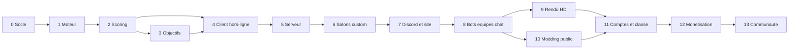

# CrasseCadia — Source de vérité unique

> **Version** : 2.1 (2026-10-03). Remplace tous les documents de `archive/`. Journal du codage : §22.4.
> **Portée** : règles du jeu, modes, interface, direction artistique, architecture technique,
> modding, sécurité, monétisation et plan de codage.
> **Primauté** : en cas de contradiction entre ce document et le code, **ce document fait foi**.
> Toute évolution de règle se fait **d'abord ici** (avec une entrée au journal du §22), ensuite
> dans le code et les tests.

### Légende des statuts

| Marque | Signification |
|---|---|
| *(aucune)* | Décision actée |
| **[PROPOSITION]** | Choix par défaut raisonnable, modifiable sans impact majeur |
| **[PLAYTEST]** | Acté sur le principe, valeurs chiffrées à confirmer en playtest |
| **[À CONFIRMER]** | Interprétation à valider par le responsable des règles |

« Rien n'est figé » : les choix techniques (§13 à §19) sont les meilleurs connus aujourd'hui.
Ils peuvent changer si une meilleure option apparaît, à condition de mettre ce document à jour.

---

## Sommaire

1. [Vision, objectifs et équipe](#1-vision-objectifs-et-équipe)
2. [Glossaire](#2-glossaire)
3. [Géométrie du plateau](#3-géométrie-du-plateau)
4. [Matériel et génération](#4-matériel-et-génération)
5. [Mise en place](#5-mise-en-place)
6. [Déroulement d'un tour](#6-déroulement-dun-tour)
7. [Propriété, ancienneté et pipeline de scoring](#7-propriété-ancienneté-et-pipeline-de-scoring)
8. [Environnements](#8-environnements)
9. [Jetons — les 4 tiers officiels](#9-jetons--les-4-tiers-officiels)
10. [Objectifs secrets](#10-objectifs-secrets)
11. [Équipes, fin de partie, déconnexions et bots](#11-équipes-fin-de-partie-déconnexions-et-bots)
12. [Modes de jeu, salons et paramètres](#12-modes-de-jeu-salons-et-paramètres)
13. [Interface et expérience joueur](#13-interface-et-expérience-joueur)
14. [Rendu graphique et direction artistique](#14-rendu-graphique-et-direction-artistique)
15. [Architecture technique](#15-architecture-technique)
16. [Plateformes : Discord et site `.io` intercompatibles](#16-plateformes--discord-et-site-io-intercompatibles)
17. [Modding](#17-modding)
18. [Comptes, sécurité et vie privée](#18-comptes-sécurité-et-vie-privée)
19. [Monétisation](#19-monétisation)
20. [Qualité, tests et performance](#20-qualité-tests-et-performance)
21. [Plan de codage en phases](#21-plan-de-codage-en-phases)
22. [Journal des décisions et points ouverts](#22-journal-des-décisions-et-points-ouverts)
23. [Annexes](#23-annexes)

---

## 1. Vision, objectifs et équipe

### 1.1 Concept

CrasseCadia est un jeu de pose de tuiles hexagonales et de jetons, en ligne et en temps réel, sur un
**plateau unique et partagé**. Contrairement à son inspiration (*Cascadia*), les joueurs construisent
ensemble un même archipel. Ils peuvent **voler** les environnements et les structures des autres, et
**saboter** leurs agencements : ce sont les « crasses ».

Trois sources de points :
- les **environnements** (couleurs d'arêtes des tuiles) ;
- les **structures de jetons** (5 formes, règles selon le *tier* actif) ;
- les **objectifs secrets** et les **jokers** restants.

### 1.2 Objectifs du projet, par ordre de priorité

1. **Respect strict des règles** de ce document : le moteur est la traduction exacte du §3 au §12.
2. **Qualité graphique** : rendu 2.5D premium, lisible, et profils de performance pour toutes les
   machines.
3. **Code modulaire et moddable** : les joueurs peuvent ajouter leurs propres règles, contenus,
   shaders et comportements, même très complexes, via des **ZIP standardisés** (§17). Le jeu de
   base est lui-même construit comme un ensemble de mods internes.
4. **Deux plateformes intercompatibles** : Discord Activity et site web `.io`, dans les mêmes
   parties (§16).

### 1.3 Équipe

| Rôle | Périmètre |
|---|---|
| **Développeur** | 100 % du code : moteur, serveur, client, outillage, déploiement, tests |
| **Artiste** | 100 % des visuels : biomes, jetons, icônes, cartes d'objectifs, UI, effets, sons (ou sélection) |

Conséquences :
- Le code doit être **testable sans interface** : vérification par les tests automatisés.
- Les visuels passent par un **pipeline d'assets indépendant** (§14.7) : l'artiste remplace des
  fichiers de substitution sans toucher au code.
- Les règles sont repérées par **numéro de section** (ex. « §9.2.3 ») pour que les tests et les
  spécifications et les tests y fassent référence sans ambiguïté.

---

## 2. Glossaire

| Terme | Définition |
|---|---|
| **Cellule** | Position `(q, r)` de la grille hexagonale, vide ou occupée par une tuile |
| **Tuile** | Hexagone portant 6 arêtes colorées et une liste de **formes acceptées** |
| **Capacité** | Nombre de formes acceptées par une tuile : 1, 2 ou 3 |
| **Tuile monochrome** | 6 arêtes d'une seule couleur, capacité 1 |
| **Tuile bicolore** | 3 arêtes consécutives d'une couleur et 3 d'une autre, capacité 2 ou 3 |
| **Demi-tuile** | Partie d'une tuile d'une même couleur (1 pour une monochrome, 2 pour une bicolore). C'est le nœud du graphe des environnements |
| **Environnement** | Composante connexe de demi-tuiles de même couleur reliées par des arêtes adjacentes de cette couleur (§8) |
| **Jeton** | Pion d'une **forme** posé sur une tuile qui l'accepte (1 jeton max par tuile) |
| **Structure** | Groupe de jetons reconnu par un *scorer* (paire, chaîne, clan…), ou jeton seul qui rapporte des points (rond isolé, étoile) |
| **Support** | Jeton qui compte pour une autre structure sans en être membre (ex. voisins d'une étoile). Rôles illimités |
| **Tier** | Jeu de règles de scoring pour les jetons : A, B, C, D officiels, ou fourni par un mod |
| **Siège** | Place d'un participant (humain ou bot) |
| **Camp** | Entité qui possède et marque des points : le joueur en individuel, **l'équipe** en mode équipe |
| **Tour** | Action d'un siège : choix et pose d'une tuile, puis d'un jeton |
| **Manche** | Ensemble de tours au cours duquel chaque camp joue le même nombre de fois. Le paramètre affiché « Tours » dans les menus est le **nombre de manches** |
| **`seq`** | Compteur global strictement croissant attribué à chaque pose (tuile ou jeton). Il sert à mesurer l'ancienneté |
| **Poseur** | Siège (et donc camp) qui a posé un élément |
| **Crasse** | Toute action qui fait perdre des points à un adversaire (vol, invalidation, blocage, siphon) |
| **Marché** | `m` emplacements (4 par défaut), chacun avec 1 tuile et 1 jeton associé |
| **Pool** | Réserve finie de jetons dans laquelle le marché pioche |
| **Pioche** | Paquet mélangé des tuiles à jouer |

---

## 3. Géométrie du plateau

- Coordonnées **axiales** `(q, r)`, orientation **pointy-top** (pointe en haut). La coordonnée cube
  implicite est `s = −q − r`.
- **Directions**, indexées de 0 à 5 dans le sens antihoraire à l'écran :
  `0 = E (+1, 0)`, `1 = NE (+1, −1)`, `2 = NO (0, −1)`, `3 = O (−1, 0)`, `4 = SO (−1, +1)`,
  `5 = SE (0, +1)`.
- **Arête `i`** d'une tuile : arête tournée vers la direction `i`. L'arête `i` de la tuile A touche
  l'arête `(i + 3) mod 6` de son voisin dans la direction `i`.
- **Adjacence** : deux cellules sont adjacentes si elles partagent une arête complète.
- **Distance** : `(|Δq| + |Δr| + |Δs|) / 2`.
- **Rotation `k ∈ {0..5}`** d'une tuile (k pas de 60°) : `arêtes_posées[i] = arêtes_def[(i − k) mod 6]`.
  Les formes acceptées ne changent pas avec la rotation.
- **Rotation d'un vecteur** de 60° (pour les tuiles de départ) : `(q, r, s) → (−r, −s, −q)`.
- **Bordure extérieure** : on remplit par diffusion (*flood fill*) les cellules vides de la boîte
  englobante agrandie d'un anneau, en partant d'une cellule de l'anneau. Les cellules atteintes forment
  l'**extérieur**. Une tuile est **en bordure** si au moins une de ses voisines est une cellule
  extérieure. Les trous fermés (« lacs ») ne sont pas extérieurs.
- **Le plateau ne fait que croître** : aucune tuile ni aucun jeton n'est jamais retiré (sauf mod
  contraire). Conséquence : une invalidation causée par l'adjacence est définitive dans les tiers
  officiels.

---

## 4. Matériel et génération

### 4.1 Environnements et formes

- **5 environnements** par défaut, `E0` à `E4`. Noms et visuels sont fixés par la direction
  artistique (§14) ; les identifiants restent stables.
- **5 formes** par défaut : **Carré**, **Triangle**, **Cœur**, **Rond**, **Étoile**.
- Les mods peuvent ajouter des environnements et des formes (§17). En classique et en classé,
  **seuls les 5 + 5 par défaut** sont utilisés.

### 4.2 Jokers

- Réserve **illimitée**. Chaque camp commence avec **0 joker** (réglable en custom).
- **Gain** : +1 joker quand un jeton est posé sur une tuile de **capacité 1** (bonus monochrome, §6.6).
- **Dépense** : 1 joker pour prendre un jeton du marché autre que celui associé à la tuile choisie.
- **Fin de partie** : chaque joker non utilisé vaut **1 point**.

### 4.3 Nombre de tuiles `T`

- Avec `m` = taille du marché (4 par défaut) :
  - **individuel** : `T = manches × sièges + m` ;
  - **équipes** : `T = taille_max_équipe × nb_équipes × manches + m`.
- La pioche contient exactement `T` tuiles. Après le dernier tour, il reste `m` tuiles sur le marché.
- Les **tuiles de départ** sont en plus de `T` (§4.6).

### 4.4 Algorithme de génération de la pioche

L'algorithme utilise le générateur pseudo-aléatoire (RNG) de la partie, initialisé par une graine
(*seed*) et donc déterministe.

1. **Capacités (ratio 1 : 2 : 2)** :
   - `b = ⌊T / 5⌋` ; on part de `n1 = b`, `n2 = 2b`, `n3 = 2b` ;
   - le reste `r = T − 5b` (de 0 à 4) est distribué dans l'ordre **1, 2, 3, 2** (le 5ᵉ
     élément, qui serait 3, complète le bloc) ;
   - exemple : `T = 44` → `b = 8`, `r = 4` → `n1 = 9`, `n2 = 18`, `n3 = 17`.
2. **Couleurs** :
   - les tuiles de capacité 1 sont **monochromes** : leurs couleurs sont réparties en tourniquet sur
     les 5 environnements, puis mélangées ;
   - les tuiles de capacité 2 et 3 sont **bicolores** : on parcourt les 10 paires de couleurs
     distinctes en tourniquet. Pour un cycle incomplet, on choisit à chaque fois la paire qui
     minimise l'écart du nombre total d'arêtes par couleur (monochrome = 6 arêtes, demi-tuile
     bicolore = 3). Égalité → tirage RNG ;
   - définition d'une bicolore : `arêtes = [A, A, A, B, B, B]`.
3. **Formes acceptées** :
   - capacité 1 : 1 forme ; capacité 2 : 2 formes distinctes ; capacité 3 : 3 formes distinctes ;
   - chaque tuile prend les formes **les moins utilisées jusqu'ici**, avec départage par RNG.
     L'écart entre la forme la plus fréquente et la moins fréquente ne dépasse donc jamais 1
     occurrence.
4. **Mélange** de la pioche par RNG.
5. Avec des formes et environnements de mods, la même procédure s'applique à l'ensemble des types
   **sélectionnés** pour la partie (§12.4).

### 4.5 Pool de jetons

- Pour chaque tuile de la pioche **et** chaque cellule des tuiles de départ, on ajoute à la pool
  1 jeton de chaque forme acceptée. Exemple : `{Carré, Cœur}` → 1 Carré + 1 Cœur.
- Il y a donc plus de jetons que de tuiles, mais la pool reste **finie**. Les jetons non posés
  retournent dans la pool (§6).
- Les tirages sont uniformes parmi les jetons présents dans la pool.

### 4.6 Tuiles de départ

- Chaque siège reçoit une tuile de départ de **3 hexagones en triangle** (3 cellules mutuellement
  adjacentes) : une cellule de capacité 1 (monochrome), une de capacité 2 et une de capacité 3
  (bicolores).
- Forme de base (avant rotation) : cellule de capacité 1 en `(0, 0)`, capacité 2 en `(+1, 0)`,
  capacité 3 en `(+1, −1)`.
- Couleurs et formes sont générées avec le même équilibrage que la pioche (§4.4), **calculé sur
  l'ensemble des tuiles de départ de la partie**. Elles sont donc **remaniées à chaque partie**.
- Équité **[PLAYTEST]** : toutes les tuiles de départ d'une partie ont la même structure 1/2/3 ;
  couleurs et formes varient d'un siège à l'autre.
- En mode équipe, **chaque siège** reçoit sa tuile de départ.

---

## 5. Mise en place

Dans l'ordre :

1. **Configuration du salon** (§12) puis composition des équipes.
2. **Génération** (graine de partie) : pioche (§4.4), tuiles de départ (§4.6), pool (§4.5),
   paquets d'objectifs (§10.4).
3. **Joueur 1 (J1)** tiré au sort. L'**ordre de passage** suit les sièges ou est aléatoire (option du
   chef de salon ; aléatoire en classique et en classé). En équipes : §11.1.
4. **Révélation des tuiles de départ** : chacun voit la sienne.
5. **Objectifs initiaux** (§10.5) : tirage et choix **simultanés**, minuteur de **30 s**.
6. **Pose des tuiles de départ**, **une par une** dans l'ordre de passage, minuteur de **30 s**
   chacune :
   - J1 pose la sienne avec sa cellule de capacité 1 en `(0, 0)`, dans l'orientation de son choix
     (6 orientations) ;
   - les suivants la posent sur des cellules **libres**, avec au moins une cellule **adjacente** à une
     tuile déjà posée, dans l'orientation de leur choix ;
   - à l'expiration du minuteur, position et orientation sont choisies au hasard parmi les poses
     légales ;
   - les 3 cellules reçoivent des `seq` consécutifs (dans l'ordre capacité 1, 2, 3) et ont pour
     poseur le siège concerné.
7. **Marché initial** : `m` tuiles de la pioche et `m` jetons de la pool, puis vérification du
   reroll automatique (§6.2).
8. **Première manche**.

---

## 6. Déroulement d'un tour

### 6.1 Machine à états d'un tour

```
début ─► [reroll auto si m identiques] ─► choixTuile ─► poseTuile ─► choixJeton
        ─► poseJeton (ou « aucun jeton ») ─► confirmation ─► regarnissage ─► tour suivant
```

Un **reroll manuel** est possible de `début` jusqu'au choix du jeton (§6.2). Le **retour arrière**
est possible à tout moment avant la confirmation (§6.7).

### 6.2 Reroll

Avec un marché de `m` emplacements (`m = 4` par défaut) :

- **Reroll automatique** : si les `m` jetons du marché sont identiques **au début du tour**, ils sont
  relancés sans demander l'avis du joueur.
  - Les jetons remplacés sont **mis de côté** pendant le tirage, puis remis dans la pool.
  - Si le nouveau tirage donne encore `m` jetons identiques, on recommence (au maximum 100 essais,
    tous déterministes ; au-delà, on fait un tirage construit pour donner au moins 2 formes
    différentes).
  - **Anti-boucle** : si la pool, privée des jetons mis de côté, ne permet aucun tirage différent de
    « `m` identiques » (moins de 2 formes présentes, ou moins de `m` jetons), le reroll
    automatique est **désactivé** pour ce tour.
- **Reroll manuel** : si exactement `m − 1` jetons sont identiques (3 sur 4 par défaut), un **bouton
  de reroll** s'affiche. Il reste disponible jusqu'au choix du jeton.
  - Il relance ces `m − 1` jetons ; le jeton différent est conservé.
  - Les jetons remplacés sont mis de côté pendant le tirage, puis remis dans la pool.
  - **1 seul reroll manuel par tour.**
  - Si le résultat redonne `m − 1` identiques, aucun nouveau bouton n'apparaît. S'il donne `m`
    identiques, on **laisse tel quel**, sans reroll automatique.
- Un reroll (automatique ou manuel) est **définitif** : le retour arrière ne l'annule pas.
- Marché de moins de 3 emplacements (custom) : pas de reroll manuel. Reroll automatique si tous les
  jetons sont identiques et que `m ≥ 2`.

### 6.3 Choix et pose de la tuile

- Le joueur choisit un emplacement `i` du marché.
- Il pose la tuile sur une **cellule vide adjacente à au moins une tuile** du plateau, dans une des
  **6 rotations**.
- **Aucune contrainte de correspondance d'arêtes.**

### 6.4 Choix du jeton

Le choix se fait **après** la pose de la tuile, car la nouvelle tuile peut rendre un jeton plaçable.

| Choix | Coût | Effet sur le marché (§6.9) |
|---|---|---|
| Jeton associé à l'emplacement `i` | gratuit | tuile `i` et jeton `i` remplacés |
| Jeton d'un autre emplacement `j` | **1 joker** (il faut en avoir au moins 1) | tuile `i` remplacée, jeton `i` **conservé**, jeton `j` remplacé |
| **Aucun jeton** | — | tuile `i` remplacée, jeton `i` renvoyé dans la pool et remplacé |

- **Jeton plaçable** : il existe au moins une tuile **sans jeton** qui accepte sa forme, **n'importe où
  sur le plateau** (y compris sur les tuiles des adversaires).
- Un jeton **non plaçable** est affiché avec un **halo rouge** et ne peut pas être sélectionné.
- Si le jeton associé n'est pas plaçable, il reste deux options : **aucun jeton**, ou **payer 1
  joker** pour un autre jeton plaçable.
- Il est **impossible** de demander un nouveau tirage parce qu'un jeton n'est pas plaçable.

### 6.5 Pose du jeton

- Sur une tuile **sans jeton** dont les formes acceptées contiennent la forme du jeton.
- Le jeton reçoit un `seq` ; son poseur est le siège actif.

### 6.6 Bonus monochrome

- Si le jeton est posé sur une tuile de **capacité 1**, le camp gagne **+1 joker** immédiatement
  (option désactivable en custom).

### 6.7 Retour arrière

- Chaque pression annule **la dernière action** du tour. Des pressions successives ramènent jusqu'au
  **choix initial de la tuile**.
- Tout est remboursé (position et rotation de la tuile, jeton, jokers dépensés ou gagnés), **sauf
  les rerolls**.
- Si un reroll manuel a eu lieu, le retour arrière ramène au marché **après** ce reroll.

### 6.8 Confirmation

- La fin du tour doit être **confirmée**, qu'un jeton ait été posé ou non.
- Avant confirmation, les autres participants voient les actions provisoires du joueur actif sous
  forme de « fantôme » **[PROPOSITION]**.

### 6.9 Regarnissage

À la confirmation, chaque emplacement vidé est rempli : tuile tirée de la pioche, jeton tiré de la
pool (cas du tableau §6.4). Les emplacements non touchés sont **conservés** pour le joueur suivant.
Le reroll automatique est vérifié au début du tour suivant (§6.2).

### 6.10 Minuteur et jeu automatique

- Le minuteur couvre le **tour entier** : **45 s** en classique et en classé, réglable en custom
  (jusqu'à « sans minuteur »).
- À l'expiration, le serveur termine le tour par `autoPlay`, une fonction unique et remplaçable :
  - pas de tuile posée → emplacement, cellule et rotation tirés au hasard parmi les coups légaux ;
  - pas de jeton → jeton associé s'il est plaçable (cellule au hasard), sinon **aucun jeton** ;
  - **jamais de dépense de joker**, jamais de reroll manuel ;
  - confirmation automatique.
- Si le joueur est **déconnecté**, c'est la règle du §11.4 qui s'applique.

---

## 7. Propriété, ancienneté et pipeline de scoring

### 7.1 Règle générale de propriété

> **Le propriétaire d'un environnement ou d'une structure est le camp du poseur de son élément le
> plus récent (le plus grand `seq`).**

Cette règle traduit exactement les principes du jeu :
- seul un **ajout** agrandit une structure ; celui qui agrandit (la rend strictement plus grande)
  en prend donc le contrôle ;
- à taille égale, rien ne change : **l'ancienneté prime** ;
- la propriété se **calcule à partir du plateau seul** (poseur + `seq`). Elle n'est jamais stockée,
  donc il n'y a pas de seconde source de vérité.

Exceptions explicites : Cœurs du Tier C (§9.4.3), structures à un seul jeton (rond, étoile :
propriétaire = poseur), et option « vols désactivés » (§7.5).

### 7.2 Ancienneté

- L'ancienneté d'une structure ou d'un environnement est le `seq` de son **dernier agrandissement**,
  c'est-à-dire le `seq` maximal de ses éléments.
- **Plus ce `seq` est petit, plus la structure est ancienne**, et elle l'emporte à taille égale.
- Égalité parfaite (impossible en jeu normal) : la plus petite coordonnée `(q, r)` de l'élément le
  plus récent l'emporte.

### 7.3 Unicité des jetons

- Un jeton est **membre d'une seule structure par forme** : chaque scorer garantit des partitions
  disjointes.
- Les jetons de **support** (voisins d'une étoile, centre d'une couronne…) ont des rôles illimités.

### 7.4 Pipeline de scoring

Le score est **recalculé en entier à partir du plateau** après chaque pose. C'est une fonction pure,
déterministe, en nombres **entiers** uniquement. Les étapes sont fixes, et chaque scorer (officiel
ou de mod) s'inscrit dans l'une d'elles :

| # | Étape | Contenu officiel |
|---|---|---|
| 1 | `pre-effects` | Effets qui **retirent** des jetons du scoring : Ronds C (blocage), Étoiles C (trou noir) |
| 2 | `structures` | Un scorer par forme, selon le tier choisi pour cette forme |
| 3 | `post-effects` | Effets **entre structures** : Carrés C (neutralisation d'environnement), Triangles C (siphon), Cœurs C (parasites) |
| 4 | `environments` | Environnements : points courants (§8.3) |
| 5 | `end-bonuses` | Bonus +2/+1 de fin de partie (§8.4) — **état final uniquement** |
| 6 | `objectives` | Objectifs secrets (§10) — décompte définitif en fin de partie |
| 7 | `jokers` | +1 par joker restant — en fin de partie |

Le résultat est un **`ScoreReport`** détaillé :
- par camp : total et sous-totaux par catégorie ;
- liste des structures : identifiant, type, forme ou couleur, membres, supports, propriétaire,
  points, statut (`valide | en attente | invalidée | bloquée | absorbée | neutralisée`), ancienneté.

Le client s'en sert pour dessiner liserés, liaisons et fractures, et le serveur pour les événements.

**Événements** : en comparant deux `ScoreReport` successifs, on détecte les **vols** (changement de
propriétaire d'une structure valide), les **invalidations** et les **blocages**. Une structure est
suivie d'un rapport à l'autre par recouvrement de ses membres. Ces événements alimentent les
animations (§14.5), les compteurs d'objectifs (§10) et l'audio.

### 7.5 Options globales de sabotage et de vol (custom)

- **Vols désactivés** : on rejoue les poses dans l'ordre `seq`. Le propriétaire d'une structure est
  celui de sa **création**. En cas de fusion, le propriétaire est celui de la partie **la plus
  grande** (à égalité : la plus ancienne).
- **Sabotage désactivé** : on rejoue les poses dans l'ordre `seq`. Un jeton qui ferait passer une
  structure existante de *valide* à *invalidée*, *bloquée* ou *absorbée* est lui-même **neutre**
  (0 point, sans effet), et la structure existante est conservée.
- Ces deux options sont implémentées **une seule fois dans le moteur** (rejeu chronologique), pas
  dans chaque scorer.

---

## 8. Environnements

### 8.1 Graphe

- **Nœuds** : les demi-tuiles. Une monochrome = 1 nœud (6 arêtes) ; une bicolore = 2 nœuds
  (3 arêtes chacun).
- **Arcs** : entre deux tuiles adjacentes, si les deux arêtes en contact sont **de la même couleur**,
  on relie les demi-tuiles qui portent ces arêtes.
- **Environnement** : composante connexe d'**au moins 2 tuiles**. Une tuile appartient à au plus un
  environnement par couleur, donc la taille (nombre de tuiles) est égale au nombre de nœuds.
- Une tuile bicolore compte pour **1** dans chacun de ses deux environnements.

### 8.2 Validité et propriété

- **Seuil** : `S = max(2, ⌈(T − m) / 10⌉)`, fixé à la mise en place. Exemples : 1v1 en
  20 manches → `T = 44`, `S = 4` ; FFA à 4 ou 2v2 → `T = 84`, `S = 8`.
- Un environnement est **valide** si sa taille est au moins `S`.
- **Propriétaire** (tous les environnements, valides ou non) : camp du poseur de la **tuile la plus
  récente** de l'environnement (§7.1). Un jeton posé ne change jamais la propriété d'un
  environnement.
- Une tuile qui fusionne plusieurs environnements donne la propriété de l'ensemble à son poseur.

### 8.3 Points courants

- Chaque camp marque la **somme des tailles** de ses environnements **valides**.
- C'est un **état** (recalculé à chaque pose), pas un revenu par tour : seul l'état final compte.

### 8.4 Bonus de fin de partie

- Appliqué **uniquement sur l'état final du plateau**.
- Pour chaque couleur :
  1. on prend les environnements **valides** et non **neutralisés** (§9.4.1) de cette couleur ;
  2. on les trie par taille décroissante, puis par ancienneté (`seq` du dernier agrandissement
     croissant) ;
  3. le 1ᵉʳ rapporte **+2** à son propriétaire, le 2ᵉ **+1**.
- Cela couvre les égalités à 2 ou plus : à taille égale, l'environnement le plus récent est
  « rétrogradé » au rang suivant.

---

## 9. Jetons — les 4 tiers officiels

### 9.0 Principes communs

- **Tier par défaut v1 : Tier D.** Le tier tourne ensuite **à chaque saison** en classique et en
  classé. En custom, on choisit **un tier par forme** (mélange libre).
- Chaque scorer déclare des **métadonnées** utilisées par les objectifs (§10) : taille minimale et
  maximale d'une structure, possibilité d'invalidation, unité de taille.
- **Barème « par structure »** : chaque structure est scorée séparément, puis on additionne.
  **Barème « par nombre »** : on compte les structures du camp et on lit le barème une seule fois.
- Les jetons **bloqués** ou **absorbés** à l'étape 1 sont ignorés par tous les scorers suivants,
  y compris comme supports.
- Les jetons **invalidés** restent physiquement présents : ils **comptent comme supports** (étoiles).
- Statut **en attente** : la structure n'est pas encore complète (0 point, pas de fracture).
  Statut **invalidée** : définitivement cassée (affichée fracturée).
- **Algorithme commun « lignes »** (utilisé par D-Triangle, C-Carré, C-Triangle) :
  1. pour chacun des 3 axes (directions `a` et `a + 3`), on calcule les séries maximales de jetons
     consécutifs de la forme ;
  2. on trie les candidats par longueur décroissante, puis ancienneté croissante, puis plus petit
     `seq` minimal ;
  3. on prend le meilleur candidat ; ses jetons sont **retirés** de tous les autres candidats, qui
     sont découpés en sous-séries contiguës et réinsérés ;
  4. on répète. Les jetons restants forment des lignes de longueur 1.
- **Algorithme commun « chronologique »** (utilisé par A-Carré, A-Cœur, B-Carré) : on parcourt les
  jetons par `seq` croissant. Chaque jeton tente de **compléter** un motif avec des jetons plus
  anciens encore libres. On choisit le motif dont l'élément le plus récent est le plus ancien
  (puis le plus petit `seq` minimal). Le motif formé appartient au poseur du jeton qui l'a complété.

### 9.1 Tier D — Expert / Master (référence v1)

#### 9.1.1 Carré — Paires strictes isolées

- On calcule les composantes connexes des carrés (adjacence).
- **Composante de exactement 2 carrés** = **paire** valide. Propriétaire = poseur du plus récent.
- Composante de 1 carré : en attente. Composante de **3 carrés ou plus** : **tous invalidés** (un
  carré posé à côté d'une paire l'invalide).
- Barème **par nombre** de paires du camp : 1 → **5**, 2 → **11**, 3 → **18**, 4 → **27**, puis
  **+9** par paire supplémentaire.

#### 9.1.2 Triangle — Ligne droite stricte

- Algorithme « lignes » (§9.0). Les branches deviennent des **chaînes secondaires** scorées
  séparément.
- Barème **par chaîne** selon sa longueur : 1 → **2**, 2 → **5**, 3 → **9**, 4 → **13**, 5 → **17**,
  6 → **21**, 7 et plus → **25**.
- Propriétaire = poseur du triangle le plus récent de la chaîne. **Aucune invalidation** : on ne peut
  que voler en prolongeant.

#### 9.1.3 Cœur — Chaînes et boucles sans triangle direct

- Tout cœur appartenant à au moins un **triangle** (3 cœurs mutuellement adjacents) est **invalidé**.
  Deux triangles qui se chevauchent invalident les 4 cœurs.
- Les cœurs restants forment des **segments** (composantes connexes). Les cycles sans triangle sont
  permis (dans une grille hexagonale, ils font au moins 6 cœurs).
- Barème **par segment** : 1 → **2**, 2 → **4**, 3 → **7**, 4 → **12**, 5 → **16**, 6 → **20**,
  7 et plus → **25**.
- Propriétaire de chaque segment = poseur de son cœur le plus récent.

#### 9.1.4 Rond — Solitaires isolés

- Un rond est **isolé** s'il n'a aucun rond adjacent. Deux ronds adjacents sont **tous deux
  invalidés**.
- Propriétaire = poseur. Un rond ne peut pas être récupéré par un autre camp.
- Barème **par nombre** de ronds isolés du camp : 1 → **2**, 2 → **5**, 3 → **8**, 4 → **11**,
  5 → **14**, 6 → **18**, 7 → **22**, 8 et plus → **26**.

#### 9.1.5 Étoile — Diversité multiforme

- Pour chaque étoile, `d` = nombre de **formes distinctes** parmi les jetons des 6 tuiles voisines.
  Les étoiles voisines et les jetons invalidés comptent ; les doublons ne comptent qu'une fois.
- Points de l'étoile : `d × (d + 3) / 2`, soit 1 → **2**, 2 → **5**, 3 → **9**, 4 → **14**,
  5 → **20** (6 → 27 avec des formes de mods).
- Propriétaire = poseur. Les voisins sont des **supports**, avec des rôles illimités.

### 9.2 Tier A — Initiation et dynamisme **[PLAYTEST]**

#### 9.2.1 Carré — Trios compacts

- Algorithme « chronologique ». Motif = 3 carrés **mutuellement adjacents**.
- Chaque trio rapporte **9 points** à son propriétaire, le poseur du carré qui l'a complété.
- Les carrés en trop sont **neutres** (0 point, sans fracture). **Pas d'invalidation**.

#### 9.2.2 Triangle — Chaînes de bordure

- On ne considère que les triangles posés sur des tuiles **en bordure extérieure** (§3). Les autres
  sont **invalidés**, de façon définitive car l'extérieur ne fait que rétrécir.
- **Chaîne** = composante connexe de ces triangles de bordure. Propriétaire = poseur du plus récent.
- Barème **par chaîne** : 1 → 0 (en attente), 2 → **4**, 3 → **8**, 4 → **13**, 5 → **18**,
  6 et plus → **24**.
- Crasse typique : entourer une chaîne adverse de tuiles pour la sortir de la bordure.

#### 9.2.3 Cœur — Paires espacées

- Un cœur avec un cœur **adjacent** est **invalidé** (les deux le sont).
- Parmi les cœurs valides, on forme des paires par l'algorithme « chronologique ». Motif = deux
  cœurs à **distance exactement 2**, avec au moins une cellule voisine commune **occupée par une
  tuile**.
- Chaque cœur appartient à au plus une paire. Chaque paire rapporte **6 points** au poseur du cœur le
  plus récent de la paire.
- Les paires sont recalculées entièrement à chaque pose : une invalidation peut redistribuer
  l'appariement.

#### 9.2.4 Rond — Clans libres

- **Clan** = composante connexe de ronds. Propriétaire = poseur du plus récent.
- Barème **par clan** : 1 ou 2 → 0 (en attente), 3 → **6**, 4 → **11**, 5 → **17**.
- **6 ronds ou plus** : clan **détruit**, tous les ronds sont invalidés.

#### 9.2.5 Étoile — Balises de biomes

- `b` = nombre de **couleurs d'environnement distinctes** parmi les demi-tuiles des 6 tuiles
  voisines. Une bicolore apporte ses 2 couleurs ; la tuile de l'étoile elle-même ne compte pas.
- Points : **3 × b** (15 au maximum avec 5 environnements). Propriétaire = poseur.

### 9.3 Tier B — Densité et alignements **[PLAYTEST]**

#### 9.3.1 Carré — Losanges

- Algorithme « chronologique ». Motif = 4 carrés formant un **losange** : deux triangles de carrés
  qui partagent une arête (ce sont deux paires parallèles face à face).
- Chaque losange rapporte **14 points**. Les carrés en trop sont neutres. **Pas d'invalidation**.

#### 9.3.2 Triangle — Chevrons

- **Chevron** = suite de triangles où chaque pas alterne entre deux directions **voisines** `d` et
  `d + 1` (zig-zag). Il y a 3 familles : `{0, 1}`, `{1, 2}`, `{2, 3}` (les autres sont les mêmes
  parcourues dans l'autre sens).
- Détection : séries maximales alternées pour chaque famille et chaque phase de départ, puis
  attribution comme dans l'algorithme « lignes » (le plus long d'abord, puis l'ancienneté, avec
  découpage).
- Barème **par chevron** : 3 → **6**, 4 → **10**, 5 → **15**, 6 et plus → **21**. Moins de 3 :
  neutre. Propriétaire = poseur du plus récent. Pas d'invalidation.

#### 9.3.3 Cœur — Arbres ramifiés

- On calcule les composantes connexes de cœurs. Une composante qui contient un **cycle** (nombre
  d'arêtes ≥ nombre de nœuds) est **invalidée** en entier.
- Composante acyclique (arbre) : **12 points par cœur ramifié**, c'est-à-dire ayant au moins 3 cœurs
  voisins.
- Propriétaire = poseur du plus récent. Crasse typique : fermer une boucle dans l'arbre adverse.

#### 9.3.4 Rond — Couronnes

- **Centre** = une tuile dont le jeton n'est pas un rond (ou qui n'a pas de jeton).
- Attribution gloutonne :
  1. pour chaque centre, `k` = nombre de ronds **libres** parmi ses 6 voisines ;
  2. on prend le centre au `k` le plus grand (puis ancienneté, puis coordonnées) ;
  3. si `k ≥ 4`, ces `k` ronds forment une couronne ;
  4. on recalcule les `k` et on recommence.
- Barème **par couronne** : 4 → **8**, 5 → **14**, 6 → **22**. Propriétaire = poseur du plus récent.
- Les ronds hors couronne sont neutres.

#### 9.3.5 Étoile — Pont stellaire

- `p` = nombre de **couleurs distinctes** parmi les environnements **valides** qui contiennent une
  demi-tuile de la tuile de l'étoile ou d'une de ses 6 voisines.
- Points : `p < 2` → 0 ; 2 → **8**, 3 → **13**, 4 → **19**, 5 → **26** (au-delà : +1 par palier
  sur l'écart). Propriétaire = poseur.

### 9.4 Tier C — Sabotage et conflit direct **[PLAYTEST]**

**Résolution simultanée** : les effets de l'étape 1 sont évalués sur le plateau **brut**, puis
appliqués tous ensemble. Un jeton qui produit un effet mais qui est lui-même bloqué ou absorbé
**perd ses propres points**, mais son effet **reste appliqué**. On évite ainsi tout paradoxe.

#### 9.4.1 Carré — Mur de rupture *(étapes 2 et 3)*

- **Mur** = ligne droite de **3 carrés ou plus** (algorithme « lignes »). Plus court : neutre.
- Barème de base **par mur** : 3 → **6**, 4 → **9**, 5 → **12**, 6 et plus → **15**.
  Propriétaire = poseur du plus récent.
- **Neutralisation** (étape 3) : pour chaque environnement valide d'un **autre camp** dont au moins
  2 tuiles portent un carré du mur, l'environnement est **neutralisé** (exclu des bonus de fin
  §8.4). Le propriétaire du mur gagne **+5** par environnement neutralisé.

#### 9.4.2 Triangle — Flèche prédatrice *(étapes 2 et 3)*

- **Flèche** = ligne droite de **3 triangles ou plus** (algorithme « lignes »). Barème de base :
  3 → **4**, 4 → **6**, 5 et plus → **8**.
- **Siphon** (étape 3) :
  - on regarde la cellule située juste après **chaque extrémité**, dans l'axe de la flèche ;
  - si elle porte un jeton **membre d'une structure** d'un autre camp ayant encore des points, la
    flèche **transfère** `min(4, points restants)` de cette structure vers son propriétaire ;
  - 1 siphon maximum par extrémité ;
  - les flèches agissent par ordre d'ancienneté ; une structure peut être siphonnée par plusieurs
    flèches jusqu'à 0.

#### 9.4.3 Cœur — Parasitage *(étapes 2 et 3)*

- **Chaîne** = composante connexe de cœurs ; les cycles sont permis et il n'y a pas de règle du
  triangle. Barème par chaîne identique au §9.1.3.
- **Propriétaire** = camp qui a le **plus de cœurs** dans la chaîne. Égalité → camp dont le cœur le
  plus récent dans la chaîne est le plus ancien.
- **Parasites** (étape 3) : chaque autre camp qui a des cœurs dans la chaîne prend **2 points par
  cœur qu'il y a posé**, déduits des points du propriétaire (minimum 0).

#### 9.4.4 Rond — Balise piégée *(étape 1)*

- Deux ronds adjacents sont **désamorcés** : invalidés, 0 point, sans effet.
- Un rond **actif** (sans rond voisin) **bloque** chaque jeton voisin d'une **autre forme** posé par
  un **autre camp**. Un jeton bloqué est ignoré par tout le scoring (étapes 2 à 6), et ce
  définitivement dans les tiers officiels.
- Points : **4 par jeton bloqué**, plafonnés à **12** par rond. Propriétaire = poseur.

#### 9.4.5 Étoile — Trou noir *(étape 1)*

- Pour chaque forme `f` autre qu'Étoile : si l'étoile a **au moins 3** voisins de forme `f` posés par
  d'**autres camps**, ces jetons sont **absorbés** (ignorés par tout le scoring).
- Points : **15** pour la première forme absorbée, **+5** par forme absorbée supplémentaire.
  Sans absorption : **2 points**. Propriétaire = poseur.

### 9.5 Mélange de tiers et formes de mods

- Le pipeline (§7.4) rend tous les tiers combinables : par exemple, Ronds C (étape 1) avec Carrés D
  (étape 2).
- Une forme de mod **doit** fournir un scorer, ou réutiliser par référence un scorer officiel
  (ex. « se comporte comme Carré, Tier D »).

---

## 10. Objectifs secrets

### 10.1 Principes

- Ils fonctionnent comme les tickets des *Aventuriers du Rail* : **+valeur** si l'objectif est
  rempli en fin de partie, **pénalité** sinon (§10.6).
- Ils sont **secrets** : visibles uniquement par leur camp (partagés entre coéquipiers) et révélés à
  tous en fin de partie.
- Leur statut est **évalué en continu** après chaque pose. Un objectif rempli peut donc être
  **perdu** à cause d'une crasse.
- Les **compteurs permanents** (vols réalisés, invalidations causées, bonus monochromes obtenus,
  jetons posés) ne diminuent jamais : les objectifs qui reposent dessus ne peuvent pas être perdus.

### 10.2 Langage de conditions (indépendant des mods)

Les conditions sont des **requêtes génériques** sur le `ScoreReport` et le plateau. Elles ne citent
aucune forme ni couleur en dur : elles utilisent des **paramètres** (`{F}` = une forme active,
`{C}` = une couleur active). Elles fonctionnent donc avec n'importe quel tier ou mod.

| Requête | Mesures disponibles |
|---|---|
| `environnements(propriétaire, couleur, valide)` | nombre, taille max, somme des tailles, couleurs distinctes, rang par couleur |
| `structures(propriétaire, forme, statut)` | nombre, taille max, jetons membres, formes distinctes, couleurs sous-jacentes |
| `jetons(poseur, forme, couleur de tuile, poseur de tuile)` | nombre |
| `tuiles(poseur, capacité, en bordure)` | nombre |
| `compteur(nom)` | `vols`, `invalidations`, `bonusMonochromes`, `jokersDétenus` |
| `classement(catégorie)` | rang du camp (ex. points de structures de forme `{F}`) |

Combinateurs : `tous`, `un parmi`, `non`, comparateurs `≥ ≤ = >`. Le format JSON exact est donné
en annexe 23.4.

### 10.3 Catalogue officiel

Notations : `S` = seuil d'environnement (§8.2) ; `f = manches / 20`. Les valeurs `N` sont
**ajustées** à la génération (§10.4). P = compteur permanent (ne peut pas être perdu).

#### Faible valeur (20 objectifs, 4 à 6 points) **[PLAYTEST]**

| ID | Nom | Condition | N de base | Valeur |
|---|---|---|---|---|
| L01 | Terres de {C} | Contrôler ≥ N environnements valides de couleur {C} | 2 | 5 |
| L02 | Domaine | Contrôler un environnement valide de taille ≥ N | `S + 1` | 4 |
| L03 | Mosaïque | Contrôler des environnements valides de ≥ N couleurs | 3 | 5 |
| L04 | Collection de {F} | Posséder ≥ N structures valides de forme {F} | 2 | 5 |
| L05 | Semeur de {F} *(P)* | Avoir posé ≥ N jetons {F} | `4f` | 4 |
| L06 | Belle pièce de {F} | Posséder une structure valide {F} de taille ≥ N | 3 | 5 |
| L07 | Polyvalence | Posséder des structures valides d'au moins N formes | 3 | 5 |
| L08 | Économe | Détenir ≥ N jokers | 3 | 4 |
| L09 | Ascète *(P)* | Avoir obtenu ≥ N bonus monochromes | `3f` | 4 |
| L10 | Monolithes *(P)* | Avoir posé ≥ N tuiles monochromes | `3f` | 4 |
| L11 | Racines de {C} *(P)* | Avoir ≥ N de ses jetons sur des tuiles portant la couleur {C} | `3f` | 4 |
| L12 | Squatteur *(P)* | Avoir ≥ N de ses jetons sur des tuiles posées par d'autres camps | `4f` | 5 |
| L13 | Frontalier | Posséder une structure valide reposant sur ≥ N couleurs | 3 | 5 |
| L14 | Annexion | Contrôler un environnement valide contenant ≥ N tuiles posées par d'autres camps | 2 | 5 |
| L15 | Pillard *(P)* | Avoir réalisé ≥ N vols | 1 | 5 |
| L16 | Saboteur *(P)* | Avoir invalidé, bloqué ou absorbé ≥ N structures adverses | 1 | 5 |
| L17 | Champion de {C} | Contrôler le plus grand environnement valide de couleur {C} | — | 6 |
| L18 | Explorateur | Avoir ≥ N tuiles posées par soi en bordure extérieure | 3 | 4 |
| L19 | Arc-en-ciel *(P)* | Avoir des jetons sur des tuiles couvrant ≥ N couleurs | 4 | 4 |
| L20 | Bâtisseur | Avoir ≥ N jetons membres de structures valides possédées | `6f` | 5 |

#### Haute valeur (10 objectifs, 10 à 15 points) **[PLAYTEST]**

| ID | Nom | Condition | N de base | Valeur |
|---|---|---|---|---|
| H01 | Empire | Contrôler un environnement valide de taille ≥ N | `S + 5` | 12 |
| H02 | Souverain | Contrôler des environnements valides de N couleurs | `min(5, couleurs actives)` | 15 |
| H03 | Double couronne | Contrôler le plus grand environnement de N couleurs | 2 | 13 |
| H04 | Chef-d'œuvre de {F} | Posséder une structure valide {F} de taille ≥ N | 5 | 12 |
| H05 | Ménagerie | Posséder une structure valide de N formes différentes | `min(5, formes actives)` | 15 |
| H06 | Dynastie de {F} | Posséder ≥ N structures valides de forme {F} | 4 | 12 |
| H07 | Grand pillard *(P)* | Avoir réalisé ≥ N vols | 3 | 11 |
| H08 | Maître des crasses *(P)* | Avoir invalidé, bloqué ou absorbé ≥ N structures adverses | 3 | 11 |
| H09 | Spécialiste de {F} | Être **strictement premier** en points de structures de forme {F} | — | 10 |
| H10 | Architecte | ≥ N jetons membres de structures valides possédées **et** ≥ 2 environnements valides | `12f` | 13 |

### 10.4 Génération des paquets

- Chaque modèle est instancié avec toutes les valeurs de paramètres `{F}` et `{C}` **actives**. On
  obtient deux paquets (faible et haute valeur), mélangés par RNG.
- **Faisabilité** : une instance est écartée si elle est impossible avec les métadonnées des scorers
  actifs. Exemples :
  - H04 sur les Ronds en Tier D, où une structure fait au plus 1 jeton ;
  - L16 et H08 si le sabotage est désactivé ou si aucun tier actif n'invalide.
- **Ajustement de N** : `N = max(minimum, arrondi(N_base))`, avec `f` limité à `[0,5 ; 3]`.
- **Valeur** : fixe en classique et en classé. En custom : `arrondi(valeur × √f)`, limitée à 3–8
  (faible) et 8–20 (haute) **[PLAYTEST]**.
- Un même tirage ne contient jamais deux instances du même modèle.
- **Paquet vide** : il est **régénéré** à partir des modèles, sans les instances actuellement détenues.
- **Mods** : ils ajoutent des modèles (même format) et des objectifs fixes, et peuvent fournir des
  conditions en script (§17.5).

### 10.5 Tirage, choix et ravitaillement

- **Tirage initial** : chaque camp reçoit **3 cartes** (1 haute valeur, 2 faible valeur) et doit en
  **garder au moins 1**.
- **Vote en équipe** (tirage initial et ravitaillement) :
  - chaque coéquipier a **une voix par carte** (garder ou rejeter), votes simultanés, minuteur 30 s ;
  - majorité simple des votes exprimés ; **égalité ou absence de vote → la carte est gardée** ;
  - si le vote rejette toutes les cartes alors qu'il faut en garder une, on garde celle qui a le plus
    de voix « garder », puis la plus forte valeur, puis la première du tirage.
- **Ravitaillement** :
  - dès que **tous les objectifs gardés sont actuellement remplis**, le camp peut, pendant **son**
    tour (bouton dédié), demander **3 nouveaux objectifs de faible valeur** ;
  - il doit en garder **au moins 1** (2 rejets au maximum) ;
  - 1 ravitaillement maximum par tour ; le minuteur du tour est mis en pause pendant le choix
    (20 s).
- Les cartes rejetées sont **défaussées**. Elles reviennent seulement lors d'une régénération du
  paquet.
- En cas de timeout : on garde la haute valeur au tirage initial, et la première carte au
  ravitaillement.

### 10.6 Objectif brisé par une crasse

Un objectif est **brisé** s'il a été rempli à un moment de la partie, puis est redevenu non rempli à
la suite d'un tour joué par un **autre camp**. Le moteur trace la cause de chaque transition.

**Classique et classé** :
- l'objectif redevient **« en cours »** ; il peut être réparé ;
- s'il bloque le ravitaillement, il le bloque jusqu'à réparation ;
- décompte final :

| État final | Points |
|---|---|
| Rempli | **+valeur** |
| Non rempli, jamais rempli, ou perdu par sa propre faute | **−valeur** |
| Non rempli et **brisé par un adversaire** | **−2** (malus fixe) |

- Le saboteur ne gagne rien : il ignore ce qu'il a brisé, et aucune information ne fuit.

**Justification** : les objectifs étant secrets, le saboteur frappe à l'aveugle. Avec −valeur, une
crasse fortuite créerait un écart de 2 × valeur (jusqu'à 30 points) sur un coup de chance. Le malus
fixe garde la crasse significative (écart de valeur + 2), récompense l'objectif réussi au moins une
fois et protège l'équilibre du classé.

**Custom** : l'option `objectifBrisé` propose :

| Valeur | Comportement |
|---|---|
| `retour-malus-fixe` *(défaut)* | Comme ci-dessus, malus réglable (défaut −2) |
| `retour-valeur` | Retour « en cours », −valeur si non réparé |
| `perdu-zero` | L'objectif est perdu et vaut 0 |
| `au-saboteur` | +valeur pour le camp saboteur, 0 pour le détenteur |
| `verrouillé` | Un objectif rempli le reste définitivement |

---

## 11. Équipes, fin de partie, déconnexions et bots

### 11.1 Équipes

- **Composition libre** dans la limite des sièges (§12.4), ou **répartition 50/50 aléatoire**.
  Effectif impair → une équipe prend un joueur de plus.
- **Camp = équipe** pour tout : propriété, scoring, objectifs, jokers (réserve commune d'équipe).
  Un coéquipier qui agrandit une structure de son équipe ne la « vole » pas.
- **Ordre de passage** (les équipes inégales jouent autant de tours chacune) :

```
pour chaque manche :
  pour s de 0 à taille_max − 1 :
    pour chaque équipe t (dans l'ordre des équipes) :
      joue équipe[t][s mod taille(t)]
```

  Exemple 3 contre 1 : `A1 B1 A2 B1 A3 B1`. L'option « sièges / aléatoire » s'applique à l'ordre
  des équipes et à l'ordre dans chaque équipe.

### 11.2 Chat

- `Entrée` : chat d'**équipe** (en individuel, chat général). `Maj + Entrée` : chat **général**.
- Messages de 300 caractères au maximum, limite de débit, échappement systématique, conservés
  **en mémoire vive uniquement** et détruits à la fin de la partie (§18).
- Dans Discord, le vocal reste le canal principal : le chat est réductible.

### 11.3 Fin de partie

- Fin après le dernier tour de la dernière manche.
- Décompte : environnements valides + bonus de fin (§8.4) + jetons (§9) + objectifs révélés (§10.6)
  + 1 point par joker.
- **Égalité au total** **[PROPOSITION]** : on départage par les points de jetons, puis par les jokers
  restants, puis on déclare une **victoire partagée**.
- Écran de fin : détail par catégorie, objectifs révélés, chronologie des crasses (à partir des
  événements §7.4), replay.

### 11.4 Inactivité, déconnexion et reconnexion

| Situation | Comportement |
|---|---|
| Joueur **connecté** qui laisse expirer le minuteur | `autoPlay` (§6.10) |
| Joueur **déconnecté**, 3 premiers tours | Le **bot Facile** joue après **30 s** (délai de grâce) |
| Joueur **déconnecté**, au-delà de 3 tours consécutifs | Le bot Facile joue après **5 s** |
| Mode équipe, un coéquipier est connecté | Le tour du déconnecté est **joué par un coéquipier actif** ; le bot n'intervient que si toute l'équipe est absente |
| Reconnexion pendant son tour | Le bot termine l'action en cours ; le joueur reprend la main au tour suivant |

- La reconnexion est possible **à tout moment** de la partie.
- **Invité** : jeton de reconnexion (32 octets aléatoires, `sessionStorage`) valide **3 h** ou
  jusqu'à la fin de la partie.
- **Classé** : la partie compte normalement (le bot a joué le siège). Les abandons répétés entraînent
  un délai avant de pouvoir relancer une file **[PROPOSITION]**.

### 11.5 Bots

| Niveau | Politique |
|---|---|
| **Facile** | Coup légal aléatoire, pondéré vers les poses qui ne font pas perdre de points |
| **Moyen** | Glouton : maximise le gain immédiat de son camp, estimé avec le moteur |
| **Rusé** | Glouton sur `gain_propre − 0,7 × gain_du_meilleur_adversaire`, sur un échantillon de coups ; utilise les jokers |

- Les bots utilisent les **mêmes fonctions** que le serveur (`getLegalActions`, `evaluate`).
- Ils sont remplaçables par des politiques de mods (§17.5).

---

## 12. Modes de jeu, salons et paramètres

### 12.1 Vue d'ensemble

| Mode | Règles | Classement | Accès |
|---|---|---|---|
| **Classique** | **Identiques au classé** (paramètres officiels verrouillés) | Aucun point perdu ni gagné (une cote cachée sert uniquement au matchmaking) | Files de matchmaking |
| **Classé** | Paramètres officiels verrouillés, tier de la saison | Cote OpenSkill par file, saisons | Files de matchmaking, compte requis |
| **Personnalisé (custom)** | **Tout est réglable**, mods compris | Aucun | Salons publics, protégés ou privés + navigateur de salons |
| **Hors-ligne** | Comme le custom, contre des bots ou à plusieurs sur un même écran | Aucun | Local, sans réseau |

### 12.2 Paramètres officiels (classique et classé)

| Paramètre | Valeur |
|---|---|
| Files | **1v1**, **2v2**, **FFA 4 joueurs** |
| Manches | **20** |
| Minuteur | **45 s** par tour |
| Tier | **Tier de la saison** (saison 1 = **Tier D** pour toutes les formes) |
| Formes et environnements | Les 5 + 5 par défaut uniquement, aucun mod |
| Marché | 4 emplacements |
| Jokers de départ | 0 |
| Objectifs | Activés, comportement « objectif brisé » officiel (§10.6) |
| Ordre de passage | Aléatoire |
| Visibilité | Chaque camp voit **uniquement ses structures** (§13.4) |

### 12.3 Salons personnalisés et navigateur

- **Visibilité du salon** :
  - **Public** : listé, accès libre ;
  - **Protégé** : listé avec un cadenas, mot de passe ;
  - **Privé** : non listé, accès par **code** ou par lien d'invitation.
- **Navigateur de salons** (liste en temps réel) :
  - colonnes : nom, hôte, joueurs (humains et bots) / sièges, état (lobby ou en cours), tiers, mods
    (avec des icônes « contient des scripts / des shaders »), manches, minuteur, langue, région,
    verrou ;
  - **recherche** texte, **filtres** (places libres, sans mods, langue, tier, état), **tri** ;
  - « Rejoindre par code » toujours accessible.
- **Hôte** : configure, expulse, verrouille, transfère l'hôte. Si l'hôte part, le rôle passe au plus
  ancien joueur présent.
- **Spectateurs** (option) : ils voient uniquement les informations publiques.
- **Rejoindre en cours** (option) **[PROPOSITION]** : on remplace un bot, ou on prend un siège libéré.
- Un salon lancé depuis une **Activity Discord** est un salon custom avec le **préréglage
  officiel**. Les membres du salon vocal le rejoignent automatiquement (§16).

### 12.4 Paramètres du mode custom

Chaque paramètre numérique a un **curseur** et une **case de saisie libre** à côté. Les flèches
`←` `→` changent la valeur de 1 ; `Maj + ←/→` de 10. Les bornes « libres » sont des limites
techniques, pas des limites de jeu.

| Paramètre | Défaut | Bornes |
|---|---|---|
| Sièges (humains + bots) | 4 | 1 à **999** |
| Équipes | chacun pour soi | libres (composition manuelle ou 50/50) |
| Bots (nombre, niveau) | 0 | dans la limite des sièges |
| Manches | 20 | 1 à **999** |
| Minuteur | 45 s | 5 à 3 600 s, ou « sans minuteur » |
| Ordre de passage | sièges | sièges / aléatoire |
| Taille du marché `m` | 4 | 1 à 99 |
| Jokers de départ | 0 | 0 à 999 |
| Tier par forme | Tier D | A / B / C / D / tiers de mods |
| Formes et environnements actifs | **tout coché** (5 + 5 par défaut + ceux des mods chargés) | au moins 2 de chaque |
| Ratio des capacités 1:2:2 | 1:2:2 | libre |
| Formule du seuil d'environnement | `⌈(T − m)/10⌉` | coefficient libre |
| Vols | activés | on / off (§7.5) |
| Sabotage / invalidations | activé | on / off (§7.5) |
| Rerolls automatique / manuel | activés | on / off séparément |
| Bonus monochrome | activé | on / off, valeur 0–99 |
| Objectifs | activés | on / off, nombre au tirage, comportement « brisé » (§10.6) |
| Retour arrière | activé | on / off |
| Visibilité des structures | les siennes | les siennes / **toutes** |
| Visibilité des scores | en direct | en direct / masqués jusqu'à la fin |
| Spectateurs, rejoindre en cours | off | on / off |
| Mods | aucun | liste (§17) |

- **Contrainte** : une partie ne peut pas utiliser plus de formes ou d'environnements que ceux
  fournis par les 5 + 5 par défaut et les ZIP chargés. La sélection se fait dans une **liste
  cochable**.
- **Budget serveur** : avec de très grandes valeurs (ex. 999 sièges × 999 manches ≈ 1 million de
  tuiles), l'interface affiche un **avertissement de performance**. Le serveur applique un **budget
  par salon** configurable par l'exploitant (ex. 200 000 tuiles), qui est une limite d'hébergement
  et non une règle **[PROPOSITION]**.
- **Préréglages** : « Officiel », « Initiation (Tier A) », « Chaos (Tier C) », et ceux des mods.

### 12.5 Saisons

- **Trimestrielles**, communes au classique et au classé.
- Chaque saison définit : le tier de chaque forme, l'habillage visuel saisonnier (§14.4), et une
  remise à zéro douce des cotes classées.

---

## 13. Interface et expérience joueur

### 13.1 Écrans

Accueil, Jouer (classique / classé / custom / hors-ligne), navigateur de salons, lobby de salon
(paramètres, équipes, mods, chat), choix des objectifs, pose des tuiles de départ, jeu, fin de
partie, profil, boutique, paramètres, éditeur et chargeur de mods, mentions légales et
confidentialité.

### 13.2 Plateau

- Caméra pan / zoom avec inertie (souris, pavé tactile, pincement) ; recentrage ; vue d'ensemble.
- Survol : aperçu fantôme de la tuile, cellules légales en surbrillance, **aperçu du gain de score**
  (calcul local par le moteur).
- **Rotation** : molette ou touches `R` / `Maj + R`, ou boutons tactiles.
- Pose par **clic-clic** et par **glisser-déposer**. Sur mobile : appui pour sélectionner, second
  appui pour confirmer.

### 13.3 Interface de jeu (HUD)

- Marché (emplacements tuile + jeton, halo rouge si non plaçable, coût en joker affiché), jokers,
  joueur actif et ordre de passage, minuteur, boutons **Reroll**, **Retour**, **Aucun jeton**,
  **Confirmer**, **Ravitailler**.
- Score détaillé de son camp ; cartes d'objectifs avec statut en direct ; chat ; journal des
  événements.

### 13.4 Visibilité

- **Classique et classé** : chaque camp voit **seulement ses propres structures** (liaisons, halos)
  et ses environnements (liseré). Les éléments des autres restent sobres.
  **[À CONFIRMER]** : le terme « structures » est interprété ici comme incluant les environnements.
- **Scores des adversaires** en classique et en classé **[PROPOSITION]** : total visible, sans
  détail et hors objectifs.
- **Custom** : options « voir toutes les structures » et « scores masqués ».
- Quand il y a plus de 12 camps à afficher, la couleur de camp est complétée par un motif et une
  étiquette au survol.

### 13.5 Paramètres globaux

Ils s'appliquent **partout** (menus, tous les modes, hors-ligne) et sont enregistrés par appareil
(`localStorage`, avec repli en mémoire) ainsi que sur le compte :
- graphismes : profil, échelle de rendu, options individuelles (§14.3) ;
- audio, langue (FR / EN au lancement), accessibilité ;
- thème et skin actifs (§14.6).

### 13.6 Accessibilité

- Les couleurs d'environnement portent aussi un **motif de texture** distinct ; palettes adaptées aux
  daltoniens (basées sur Okabe-Ito) ; option de contraste élevé.
- `prefers-reduced-motion` active par défaut « animations réduites ».
- Interface navigable entièrement au clavier ; taille du texte réglable ; libellés pour les
  lecteurs d'écran sur l'interface DOM.

---

## 14. Rendu graphique et direction artistique

### 14.1 Moteur

- **PixiJS v8** pour le plateau, **interface DOM** par-dessus (§15.2).
- Rendu **WebGL2** par défaut, avec la plus grande compatibilité (webviews mobiles de Discord
  comprises). **WebGPU** est activé en option quand tous les shaders actifs fournissent du WGSL.
- Grands plateaux : *culling* hors écran, mise en cache des tuiles statiques
  (`cacheAsTexture`), atlas de textures.

### 14.2 Couches de rendu (de bas en haut)

1. fond / table ;
2. surfaces des tuiles (textures de biome + masques de frontière) ;
3. arêtes colorées ;
4. liserés de propriété des environnements ;
5. traits de liaison des structures (passent **sous** les jetons) ;
6. icônes d'accueil (1, 2 ou 3 ; entrelacement cyclique pour 3) ;
7. jetons ;
8. surcouches d'état (fracture, verrou, absorption) ;
9. surbrillances et fantômes ;
10. effets visuels et particules.

L'interface DOM est au-dessus du canvas.

### 14.3 Profils de performance (s'appliquent partout)

| Profil | Rendu |
|---|---|
| **Normal** (défaut) | 2.5D complet : biseau des tuiles, ombres, shader « Pion de Luxe », éclairage solaire, particules, animations complètes |
| **Low** | Éclairage zénithal fixe, pas de particules, shader de pion simplifié en une passe, animations allégées |
| **Ultra Low** | **Aucun shader** (2D vectoriel plat), **aucune animation** (pose instantanée), textures SD (biomes 256 px, jetons 128 px), échelle de rendu 50 / 75 / 100 % |

- Les profils sont **purement visuels** : aucune influence sur les règles, l'état ou le timing.
- Options individuelles réglables en plus du profil. Détection automatique : si le jeu tourne sous
  45 FPS pendant 5 s, on **suggère** un profil plus léger **[PROPOSITION]**.
- Les shaders de mods respectent les profils (§17.6).

### 14.4 Effets signature

- **Tuiles 2.5D** : biseau procédural, ombre portée douce, ombre de contact entre tuiles.
- **Shader universel « Pion de Luxe »** : à partir d'**un seul PNG transparent** par jeton, il génère
  sur le GPU un biseau (gradient alpha, filtre de Sobel), un vernis spéculaire (Blinn-Phong), une
  ombre de contact et un halo de la couleur du camp.
- **Tuiles bicolores** : frontière en **courbe organique** (rivière, falaise, lisière) obtenue par
  masque ; 3 arêtes par couleur.
- **3 icônes d'accueil** : triangle équilatéral centré, **entrelacement cyclique** (1 sur 2, 2 sur
  3, 3 sur 1). On dessine 3, puis 2, puis 1, puis on redessine la lentille 3 ∩ 1 de l'icône 3 par
  masque. Le résultat est mis en cache par tuile.
- **Éclairage solaire** selon l'heure **locale** (horloge du système, **aucune géolocalisation**) :
  aube, midi, crépuscule, nuit, avec transitions lissées.
- **Habillage saisonnier** : palette et particules par saison (pétales, pollens, feuilles, neige).

### 14.5 Animations pilotées par événements

Le moteur émet des événements (§7.4). L'`AnimationDirector` et le `SoundEngine` les traduisent, sans
aucun couplage avec les règles :

| Événement | Animation (profil Normal) |
|---|---|
| Pose de tuile | Lévitation, chute avec léger rebond, poussière |
| Vol (environnement ou structure) | Rotation de 360° en l'air, *slam*, onde de choc, **vague** de saut sur les éléments volés, changement de couleur du liseré |
| Invalidation | Fissure puis séparation en **deux moitiés** qui restent affichées jusqu'à la fin |
| Blocage / absorption (Tier C) | Verrou ou aspiration en spirale, état persistant |
| Gain de joker, siphon | Particule qui vole vers le HUD |

### 14.6 Thèmes et skins

- Un **thème** est un paquet de données : palette, textures de biomes, masques de frontière, rendu
  des jetons, sons, paramètres de shaders. Son format est celui d'un **mod de type thème** (§17).
- Le thème est **local** : chaque joueur voit son skin, sans effet sur les autres.
- Skins officiels (gratuits et payants) utilisables partout. Thèmes de mods : en custom et en
  hors-ligne **[PROPOSITION]**, pour préserver la boutique.

### 14.7 Pipeline d'assets (travail de l'artiste)

| Asset | Format source | Résolution HD | SD (auto) |
|---|---|---|---|
| Texture de biome | PNG/PSD → WebP/AVIF | 512 × 512, raccordable | 256 |
| Masque de frontière | PNG avec alpha | 512 × 512 | 256 |
| Jeton (forme) | PNG transparent 1:1 | 256 × 256 | 128 |
| Icône d'accueil | SVG source → PNG | 128 × 128 | 64 |
| Carte d'objectif (2 modèles : faible, haute) | PNG 2:3 | 600 × 900 | 300 × 450 |
| Interface | SVG (icônes), PNG 9-slice | — | — |
| Sons | WAV source → Opus/WebM + MP3 de repli | — | — |

- L'artiste dépose ses fichiers dans `assets/source/` selon une **convention de nommage**
  (`biome_e0.png`, `token_square.png`…).
- **AssetPack** (pipeline officiel de PixiJS) produit les atlas, les variantes HD/SD et les formats
  compressés.
- Des **fichiers de substitution** générés existent dès le premier jour. Remplacer un fichier ne
  demande aucune modification de code.
- **Livrables de cadrage** de l'artiste : moodboard, palette accessible, noms des 5 environnements
  et des 5 formes, guide de style.

---

## 15. Architecture technique

### 15.1 Principes

1. **Moteur pur et déterministe** (`packages/engine`) : aucune dépendance au réseau ni au rendu,
   état immuable, RNG à graine, entiers uniquement.
2. **Le jeu de base est un ensemble de mods internes** (`core`, `tier-a`, `tier-b`, `tier-c`,
   `tier-d`, `objectives-core`). L'API de mod est donc validée par le jeu lui-même.
3. **Un seul serveur autoritaire** pour tous les modes en ligne. Le moteur tourne localement
   seulement en hors-ligne et pour les **aperçus**.
4. **Le client demande, le serveur décide.**
5. **Tests d'abord** sur le moteur : vérification systématique par les tests.

### 15.2 Pile technique (révisable)

| Couche | Choix | Pourquoi / alternatives |
|---|---|---|
| Langage | **TypeScript** strict (TS 7 natif si l'outillage suit, sinon 5.x) | Un seul langage partout |
| Monorepo | **pnpm workspaces** (+ Turborepo pour le cache) | Plus rapide et plus strict que npm ; alternative : npm workspaces (actuel) |
| Runtime serveur | **Node.js LTS** (24) | Alternative : Bun |
| Réseau | **Colyseus 0.17** + `@colyseus/schema` 4 (`StateView` pour les vues privées), salons intégrés **LobbyRoom** (liste en temps réel) et **QueueRoom** (matchmaking) | Fait pour le multijoueur à salons |
| Passage à l'échelle | Colyseus multi-processus + **Redis/Valkey** (présence, pilote) | Plus tard : plusieurs machines |
| Client | **Vite** + **PixiJS v8** (8.20+) | Léger, WebGL2/WebGPU, filtres personnalisés (`GlProgram` / `GpuProgram`) |
| Interface DOM | **Svelte 5** | Bundle léger, réactif ; alternatives : Solid, Preact |
| Animations | Ticker Pixi + **GSAP** (gratuit) | — |
| Audio | **@pixi/sound** | Alternative : Howler |
| Assets | **AssetPack** | — |
| Validation | **Zod 4** (+ export JSON Schema pour les moddeurs) | Alternative : Valibot |
| Sandbox de scripts | **quickjs-emscripten** (QuickJS en WASM : limites mémoire et CPU) | Alternatives : SES/Endo, Extism (WASM) |
| ZIP | **fflate** | Navigateur et Node |
| Base de données | **PostgreSQL** + **Drizzle ORM** | Alternative : Prisma |
| Authentification | **Better Auth** (Discord, Google, email + mot de passe) ; hachage **Argon2id** | À vérifier : intégration avec le flux OAuth Discord des Activities |
| Classement | **OpenSkill** (Weng-Lin : équipes et FFA natifs) | Mieux adapté que l'ELO au 2v2 et au FFA 4 |
| i18n | Paraglide JS ou i18next | — |
| Tests | **Vitest** + **fast-check** (tests de propriétés) + **Playwright** (bout en bout multi-navigateur) | — |
| Qualité | ESLint (config *flat*) + Prettier, ou **Biome** | — |
| CI/CD | **GitHub Actions** | — |
| Hébergement | Client statique sur **Cloudflare** (Pages/R2) ; serveur sur VPS (Hetzner ou équivalent) avec **Docker** + **Caddy** (TLS auto) | Alternatives : Fly.io, Colyseus Cloud |
| Paiements | **IAP Discord** dans Discord ; **Paddle** ou **Stripe** sur le web | Paddle est *merchant of record* (gère la TVA UE) |

### 15.3 Organisation du dépôt (cible)

```
CrasseCadia/
├── docs/SOURCE-DE-VERITE.md      # ce document
├── README.md                     # présentation et commandes (renvoie à ce document)
├── packages/
│   ├── engine/                   # moteur pur : hex, rng, types, flux du tour, scoring, objectifs
│   │   └── src/{core,flow,scoring,objectives,ai,replay}/
│   ├── content/                  # mods internes : core, tier-a..d, objectives-core, presets
│   ├── protocol/                 # messages réseau, schémas Zod, version de protocole
│   ├── mod-sdk/                  # types et API publics pour les moddeurs, CLI `ccmod`
│   └── mod-runtime/              # chargement ZIP, validation, sandbox QuickJS, résolution
├── apps/
│   ├── server/                   # Colyseus : GameRoom, lobby, files, API HTTP, auth
│   └── client/                   # Vite + Pixi + Svelte : render/, ui/, net/, platform/, mods/
├── assets/source/                # fichiers de l'artiste
├── tools/                        # scripts (génération de plateaux de référence, simulation)
└── archive/                      # documents obsolètes
```

Migration depuis l'existant : `shared/` → `packages/engine`, `server/` → `apps/server`,
`client/` → `apps/client` (phase 0).

### 15.4 API du moteur

```ts
createGame(config: GameConfig, ruleSet: RuleSet, seed: string): GameState
getLegalActions(state: GameState, seat: SeatId): Action[]
applyAction(state: GameState, action: Action, draws?: DrawSource): ActionResult
  // → { ok: true, state, events } | { ok: false, reason }
evaluate(state: GameState): ScoreReport
viewFor(state: GameState, seat: SeatId | 'spectator'): PlayerView   // filtre l'info cachée
autoPlay(state: GameState, seat: SeatId): Action[]
```

- **`RuleSet`** : composition résolue des mods actifs (contenu, générateurs, étapes du flux,
  validateurs, scorers par étape, modèles d'objectifs, politiques de bots, hooks).
- **`DrawSource`** : abstraction des tirages. Le serveur utilise le RNG à graine. Le client applique
  les **tirages révélés** par le serveur, et ne connaît donc jamais la pioche à l'avance.
- **Événements** (`GameEvent`) : `TilePlaced`, `TokenPlaced`, `Rerolled`, `MarketRefilled`,
  `OwnershipChanged`, `StructureInvalidated`, `TokenBlocked`, `TokenAbsorbed`, `JokerGained`,
  `ObjectiveStatusChanged` (privé), `TurnStarted`, `TurnEnded`, `GameEnded`.
- **Replays** = configuration + graine + liste des actions. Le moteur déterministe les rejoue à
  l'identique.

### 15.5 Synchronisation réseau

- **État autoritaire** : `GameState` en objets simples dans la `GameRoom`. Une **couche de
  projection** le reflète dans un Schema Colyseus :
  - le plateau est un **journal de poses en ajout seul** (simple et efficace en diff) ;
  - le marché, les sièges, la phase et le minuteur sont publics ;
  - les objectifs et le détail privé passent par `StateView`, visibles seulement du camp concerné.
- Le client reconstruit l'état du moteur à partir de la projection et l'utilise pour les aperçus.
- Le serveur diffuse le **`ScoreReport` public** à chaque tour : l'affichage officiel vient donc
  toujours du serveur, même avec des mods lourds.
- **Messages client → serveur** : `action` (avec `seq` client anti-rejeu), `chat`, `vote`,
  `ready`, `ping`. Tous sont validés par Zod.
- **Version de protocole** échangée à la connexion. Incompatibilité → message clair et rechargement.

### 15.6 Pourquoi pas de P2P

WebRTC n'est **pas pris en charge** dans les Discord Activities (tout passe par le proxy Discord).
Un jeu au tour par tour coûte très peu en serveur. Le P2P ajouterait des serveurs TURN, la migration
d'hôte, la triche de l'hôte et un deuxième chemin réseau. Il est **abandonné**, avec réévaluation
possible pour le web uniquement si les coûts l'exigent un jour.

### 15.7 Persistance

| Donnée | Stockage | Durée |
|---|---|---|
| Partie en cours | Mémoire de la room (+ instantané Redis pour la reprise après crash) | Durée de la partie |
| Session invité | Redis, TTL 3 h | 3 h |
| Comptes, identités liées, droits d'achat, cotes | PostgreSQL | Jusqu'à suppression ou 2 ans d'inactivité |
| Historique des parties et replays | PostgreSQL / stockage objet | **28 jours** |
| Mods de salon (invités) | Mémoire, durée du salon | Durée du salon |
| Mods hébergés (comptes) | Stockage objet, quotas (§17.8) | Selon le palier |
| Chats | **Mémoire uniquement** | Fin de partie |

---

## 16. Plateformes : Discord et site `.io` intercompatibles

### 16.1 Un seul jeu, deux portes d'entrée

- **Un seul build client** et **un seul backend**.
- Au démarrage, le client détecte la plateforme (paramètres `frame_id` / `instance_id` fournis par
  Discord) et charge l'adaptateur `platform/discord` ou `platform/web`.
- L'adaptateur fournit : identité, invitation, stockage, achats, ouverture de liens, taille de
  l'écran.

### 16.2 Contraintes Discord

- Tout le trafic passe par le **proxy Discord**, avec une CSP limitée aux domaines **mappés**.
- **URL mappings** à déclarer dans le portail développeur : `/` → client, `/api` → API, `/ws` →
  serveur Colyseus.
- Tous les chemins doivent être **relatifs**. Pour les bibliothèques tierces : `patchUrlMappings`
  du SDK. Aucun CDN, police, régie ou outil d'analyse non mappé.
- SDK `@discord/embedded-app-sdk` :
  - `ready` ;
  - `authorize` → échange du code **côté serveur** → `authenticate` ;
  - pseudo et avatar ;
  - invitation (`openInviteDialog`) ;
  - IAP.
- Discord mobile : interface tactile, portrait, iframe redimensionnable.

### 16.3 Salons et invitations croisés

- Une Activity lancée dans un salon vocal = un salon `discord:<instanceId>` (*joinOrCreate* filtré
  par `instanceId`). Les membres du vocal y arrivent automatiquement.
- **Chaque salon a un code court** (6 caractères sans ambiguïté, ex. `K7P2QX`) et un lien
  `https://<domaine>/r/<CODE>`.
  - un joueur **web** rejoint un salon lancé dans Discord avec ce code ;
  - un joueur **Discord** rejoint un salon web avec le champ « Rejoindre par code ».
- Le navigateur de salons et les files de matchmaking sont **communs** aux deux plateformes.

### 16.4 Identité unifiée

- Un **compte** = un identifiant interne, auquel on lie des **identités** : Discord, Google, email.
- Un joueur Discord qui se connecte sur le site avec Discord retrouve **le même profil, la même cote
  et les mêmes cosmétiques**.
- **Invités** (web et Discord) : pseudo `Nom#XXX`, aucune donnée en base.
- Pour un joueur Discord, un compte est créé (identifiant Discord uniquement) seulement au premier
  besoin de persistance : classé, achat ou sauvegarde. Il en est informé.

### 16.5 Achats sur les deux plateformes

- **Dans Discord** : IAP Discord (SKU / *entitlements*).
- **Sur le web** : Paddle ou Stripe.
- Le serveur **fusionne les droits** des deux sources dans le compte. Un cosmétique acheté d'un côté
  est disponible de l'autre (sous réserve des conditions Discord, à vérifier).

### 16.6 Hébergement

- Domaine `.io` en HTTPS. Le nom définitif est à choisir (note juridique §22.3).
- Client statique sur CDN (compatible avec le mapping Discord), serveur derrière Caddy (WSS).
- Environnements **staging** et **production**, avec une application Discord de test distincte.
- **Hébergement temporaire de développement** (tests, équilibrage) : un PC personnel sous Linux
  Mint, publié par **Tailscale Funnel** (HTTPS gratuit sur une adresse `*.ts.net`, sans redirection
  de port ni exposition de l'adresse IP de la maison), avec une application Discord de
  développement. Le passage à un domaine payant ne change que la configuration (domaine, mappings
  Discord). Marche à suivre : `deploy/MINT.md`.

---

## 17. Modding

### 17.1 Ambition et niveaux

Les joueurs doivent pouvoir ajouter **règles, contenus, shaders et comportements**, même très
complexes. Trois niveaux, combinables dans un même ZIP :

| Niveau | Contenu | Exécution |
|---|---|---|
| **1. Déclaratif** | Formes, environnements, paramètres de génération, objectifs (langage §10.2), préréglages, thèmes, traductions | Données validées par schéma, aucun code |
| **2. Scripts** | Scorers, conditions d'objectifs, validateurs de pose, hooks du flux de tour, générateurs, politiques de bots, effets visuels | JavaScript dans une **sandbox QuickJS (WASM)**, côté serveur (autorité) et client (aperçus) |
| **3. Shaders** | Matériaux de jetons, surfaces de tuiles, fond, post-effets | GLSL ES 3.0 (+ WGSL facultatif) sur des **emplacements** définis |

Les mods sont autorisés **en custom et en hors-ligne uniquement**.

### 17.2 Format du ZIP (`.ccmod.zip`)

```
mon-mod.ccmod.zip
├── manifest.json            # obligatoire
├── content/
│   ├── shapes.json          # nouvelles formes (+ liaison à un scorer)
│   ├── environments.json    # nouveaux environnements
│   ├── generation.json      # paramètres de génération
│   ├── tiers.json           # nouveaux tiers (association forme → scorer)
│   ├── objectives.json      # modèles et objectifs fixes
│   ├── presets.json         # préréglages de salon
│   └── theme.json           # thème (palette, textures, sons, paramètres de shaders)
├── scripts/main.js          # bundle ESM unique (écrit en TS avec le SDK puis compilé)
├── shaders/*.frag.glsl, *.wgsl
├── assets/{textures,tokens,icons,sounds}/
└── locales/{fr,en}.json
```

**Manifeste** :

```json
{
  "id": "dragons",
  "name": { "fr": "Dragons", "en": "Dragons" },
  "version": "1.2.0",
  "engineApi": "^1.0.0",
  "authors": ["PlayerOne#A9B"],
  "license": "CC-BY-4.0",
  "dependencies": { "core": "^1.0.0" },
  "capabilities": ["content", "scripts", "shaders", "sounds"],
  "entry": { "script": "scripts/main.js" }
}
```

- Identifiants **préfixés par le mod** (`dragons:dragon`). Les mods internes utilisent `core:`.
- Chaque mod est identifié par l'**empreinte SHA-256** de son contenu : tous les participants d'un
  salon utilisent strictement la même version.
- Les schémas JSON sont publiés, ce qui donne l'autocomplétion dans les éditeurs.

### 17.3 Résolution d'un `RuleSet`

1. Ordre de chargement : `core` → tiers officiels → mods, selon leurs dépendances (tri
   topologique), puis l'ordre choisi par l'hôte.
2. Les contenus sont fusionnés par identifiant. Une redéfinition doit être déclarée (`overrides`),
   sinon c'est une erreur.
3. Les scorers sont inscrits dans leur **étape** (§7.4), avec une priorité interne.
4. Validation finale :
   - chaque forme active a un scorer ;
   - au moins 2 formes et 2 environnements ;
   - les objectifs sont faisables.

### 17.4 Sécurité du ZIP

| Contrôle | Règle |
|---|---|
| Taille brute | ≤ quota du palier (§17.8) |
| Taille décompressée totale | ≤ 2,5 × la taille brute maximale du palier ; lecture des en-têtes **avant** extraction, puis contrôle réel en flux |
| Ratio par entrée | ≤ 50:1 |
| Nombre d'entrées | ≤ 500 |
| Chemins | normalisés, rejet de `..`, des chemins absolus, de `\`, des caractères de contrôle ; uniquement dans les dossiers prévus |
| Extensions autorisées | `.json .png .webp .avif .jpg .jpeg .ogg .opus .webm .mp3 .glsl .wgsl .txt .md`, et `.js` **uniquement** dans `scripts/` |
| Extensions refusées | tout le reste, dont `.svg`, `.html`, polices, exécutables |
| Images | décodées dans un *worker*, ≤ 4096 × 4096, redimensionnées à 1024 au maximum |
| JSON | analyse sans prototype (pas de `__proto__` ni `constructor`), validation Zod stricte |
| Script | ≤ 2 Mo ; shader ≤ 64 Ko par fichier |
| Intégrité | contrôle CRC ; erreurs explicites pour aider le moddeur |

### 17.5 Scripts (niveau 2)

- **Sandbox** : un *runtime* QuickJS par mod et par salon, exécuté dans un *worker thread* (serveur)
  ou un *Web Worker* (client).
  - limite mémoire (ex. 32 Mo) ;
  - budget CPU par appel par interruption (ex. 50 ms côté serveur) ;
  - taille des retours limitée.
- **Déterminisme obligatoire** : ni `Date`, ni `Math.random` (remplacé par `ctx.rng`), ni
  entrées/sorties, ni réseau. Points en **entiers**. Même version de QuickJS sur client et serveur.
- **Accès en lecture seule** à l'état, via une API de requêtes (`ctx.board.get`, `neighbors`,
  `tokensByShape`, `environments`, `report`…), plutôt qu'une copie complète de l'état à chaque appel.
- **Les scripts ne modifient jamais l'état** : ils **retournent des effets déclaratifs** que le moteur
  valide et applique. Vocabulaire extensible :
  `grantJokers`, `addScoreModifier`, `setCounter`, `replaceMarketSlot`, `forbidPlacement`,
  `extraAction`, `emitVisualEvent`…
- **Points d'extension** :
  - `scorers[]` : étape, forme, métadonnées, `score(ctx) → StructureResult[]` ;
  - `objectiveConditions[]` ;
  - `validators` : contraintes supplémentaires de pose ;
  - `hooks` : `onSetup`, `onTurnStart`, `onTilePlaced`, `onTokenPlaced`, `onTurnEnd`, `onGameEnd`
    → effets ;
  - `generators` : pioche, tuiles de départ ;
  - `botPolicies` ;
  - `vfx` (client uniquement) : événement → effet visuel déclaratif.
- **En cas d'erreur** (exception, dépassement de budget) : le serveur termine proprement la partie
  avec un message (« le mod X a échoué ») et une trace pour le moddeur.
- Exemple :

```js
import { defineMod } from "@crassecadia/mod-sdk";

export default defineMod({
  scorers: [{
    id: "dragons:nid",
    shape: "dragons:dragon",
    stage: "structures",
    meta: { minSize: 2, maxSize: 6, canInvalidate: false },
    score(ctx) {
      return ctx.components("dragons:dragon").map((members) => ({
        members,
        owner: ctx.ownerByLatest(members),
        points: members.length >= 2 ? members.length * 3 : 0,
        status: members.length >= 2 ? "valid" : "pending",
      }));
    },
  }],
  hooks: {
    onTokenPlaced(ev, ctx) {
      return ev.shape === "dragons:dragon" && ctx.tile(ev.cell).capacity === 3
        ? [{ type: "grantJokers", camp: ev.camp, amount: 1 }]
        : [];
    },
  },
});
```

### 17.6 Shaders (niveau 3)

- **Emplacements** avec un contrat d'*uniforms* fixe :
  - `token.material` (remplace « Pion de Luxe ») ;
  - `tile.surface` ;
  - `board.background` ;
  - `post.screen` ;
  - `vfx.<nom>`.
  *Uniforms* fournis : `uTime`, `uSunDir`, `uSunColor`, `uCampColor`, `uProfile`, `uResolution`,
  et les textures du mod.
- GLSL ES 3.0 obligatoire, WGSL facultatif (nécessaire pour WebGPU).
- **Garde-fous** :
  - compilation de test hors écran ; échec → retour au shader officiel ;
  - surveillance du temps de frame : si l'effet dépasse un seuil pendant N frames, le shader est
    désactivé avec une notification ;
  - perte de contexte WebGL → restauration sans les shaders de mods ;
  - **Ultra Low** désactive tous les shaders de mods ; **Low** désactive ceux déclarés « lourds ».

### 17.7 Distribution et outillage

- **En salon** : l'hôte charge ses ZIP. Ils sont validés côté serveur, puis **diffusés aux
  participants par le serveur** (compatible avec le proxy Discord). Avant de rejoindre, le joueur voit
  la liste des mods et leurs capacités (« contient des scripts », « contient des shaders »).
- **CLI `ccmod`** (dans `mod-sdk`) :
  - `init` (squelette) ;
  - `build` (bundle TS → `scripts/main.js`) ;
  - `validate` (mêmes contrôles que le serveur) ;
  - `test` (moteur local, plateaux de test) ;
  - `pack`.
- **Documentation moddeur** générée depuis les types du SDK, avec des exemples : forme simple, tier
  complet, objectif, thème, shader.
- **Versionnage** : API du moteur en semver. Un mod déclare `engineApi`. Une incompatibilité est
  détectée au chargement.
- **Plus tard** : un **Mod Hub** public (catalogue, notes, signalement et modération).

### 17.8 Quotas par palier

| Palier | Mods | Taille max d'un ZIP |
|---|---|---|
| Invité | Locaux ou de salon, **en mémoire uniquement**, perdus en quittant | 10 Mo |
| Compte gratuit | Hébergement temporaire ; crédits via publicités récompensées facultatives (ex. 20 Mo pendant 7 jours) | 10 Mo |
| VIP / Club | Hébergement durable de plusieurs packs | 50 Mo |

---

## 18. Comptes, sécurité et vie privée

### 18.1 Identité

- Pseudo de 3 à 16 caractères + tag `#XXX` (3 caractères alphanumériques). Les doublons de pseudo
  sont autorisés grâce au tag.
- Connexion : email + mot de passe (lien de vérification), ou OAuth **Discord** / **Google**
  (identifiant et email uniquement).
- Mots de passe hachés en **Argon2id** (sel de 16 octets, paramètres OWASP).
- Sessions : jetons de 256 bits dans des cookies `HttpOnly`, `Secure`, `SameSite`. Dans l'iframe
  Discord, où les cookies tiers sont fragiles, on utilise un **jeton porteur** court obtenu après
  `authenticate`.
- Comparaisons en temps constant ; limite de débit sur l'authentification (5 essais / min, puis
  blocage progressif).

### 18.2 Menaces et contre-mesures

| Menace | Contre-mesure |
|---|---|
| Coup illégal, score falsifié | Serveur autoritaire ; le client n'envoie que des intentions ; le score officiel vient du serveur |
| Lecture d'informations cachées | `StateView` / vues filtrées ; la pioche n'est jamais envoyée ; tirages révélés au fil de l'eau |
| Rejeu de messages | Numéro de séquence par client, liaison au tour |
| XSS (pseudos, chat, mods) | Échappement systématique, aucun HTML, CSP stricte, SVG refusés |
| CSRF | `SameSite`, en-tête personnalisé obligatoire sur l'API |
| Pollution de prototype | Analyse sans prototype, Zod strict |
| ZIP malveillant | §17.4 |
| Script de mod malveillant | Sandbox QuickJS, aucune API dangereuse, budgets CPU et mémoire, worker isolé, arrêt propre |
| Shader malveillant (GPU bloqué) | §17.6 |
| Déni de service | Limites de débit par connexion, budget par salon, taille des messages bornée |

### 18.3 Consentement et vie privée (RGPD)

- **Bandeau de consentement** au premier lancement sur le web, en cas d'usage non essentiel
  (mesure d'audience, publicités personnalisées). Utiliser une plateforme de gestion du
  consentement conforme (TCF) si une régie l'exige.
- **En cas de refus** (et par défaut tant qu'aucun choix n'est fait) :
  - **zéro log** : aucune mesure d'audience, aucun identifiant persistant non essentiel, aucune
    adresse IP écrite sur disque ;
  - limitation de débit **en mémoire** uniquement ;
  - journaux d'erreurs sans données personnelles ;
  - **zéro rétention** au-delà du strict nécessaire ;
  - **publicités sans traceur** (contextuelles ou en direct, sans cookie ni identifiant).
- Les cookies strictement nécessaires (session) ne demandent pas de consentement.
- Chats en mémoire vive ; historiques conservés 28 jours ; comptes inactifs depuis 2 ans
  supprimés ; **suppression en un clic** ; **export JSON** des données (articles 15 et 20 du RGPD).
- Âge : respect de l'âge minimum des plateformes (13 ans sur Discord) ; pas de publicité
  personnalisée pour les mineurs.

---

## 19. Monétisation

- **Aucun avantage de jeu payant**. Le classé est strictement égalitaire.
- **Cosmétiques** : thèmes de plateau, skins de jetons, effets d'impact.
- **Club VIP** : quotas de mods (§17.8), hébergement de packs, statistiques avancées, replays
  étendus, création de tournois, badges.
- **Publicités** : **sur le site web uniquement**, dans le lobby et les écrans de fin, jamais en
  partie. Vidéos récompensées facultatives. Bandeau de consentement obligatoire (§18.3).
  Dans Discord : aucune publicité tant que la politique de Discord n'a pas été vérifiée.
- **Paiements** : §16.5.

---

## 20. Qualité, tests et performance

### 20.1 Tests

| Niveau | Outils | Contenu |
|---|---|---|
| Unitaires | Vitest | Géométrie, RNG, génération, marché, reroll, flux du tour, chaque scorer, objectifs |
| **Plateaux de référence** | Vitest + fichiers JSON | 15 à 20 plateaux par tier, avec le score attendu **validé à la main par le responsable des règles**. Ils servent de garde-fou contre une mauvaise lecture des règles |
| Propriétés | fast-check | Déterminisme, partitions disjointes, conservation des jetons (pool + marché + plateau = total), invariants du marché, rejeu identique |
| Simulation | Bots | 1 000 parties bot contre bot par configuration, sans erreur ; statistiques d'équilibrage par tier |
| Intégration serveur | Vitest + client Colyseus | Partie complète, coups refusés, reconnexion, informations cachées |
| Bout en bout | Playwright | 2 à 4 navigateurs, partie complète, mobile, profils graphiques |
| Mods | `ccmod test` + corpus malveillant | ZIP bombs, *zip slip*, scripts en boucle infinie, shaders invalides |

### 20.2 Budgets de performance

| Mesure | Budget |
|---|---|
| `evaluate` sur 1 000 tuiles | < 5 ms |
| `evaluate` sur 50 000 tuiles | < 100 ms |
| Premier affichage dans Discord | < 3 s (bundle initial < 1 Mo gzip, assets chargés progressivement) |
| FPS | 60 en Ultra Low sur une machine ancienne ; 60 en Normal sur une machine récente |
| Réaction serveur à une action | < 50 ms (hors réseau) |

### 20.3 Méthodologie de développement

- Un fichier `README.md` court : renvoie à ce document, donne les commandes
  (`pnpm test`, `pnpm typecheck`, `pnpm lint`) et les conventions.
- Chaque spécification cite les **sections** concernées. Chaque règle codée a des tests qui la citent
  (`describe('§9.1.3 Cœur Tier D')`).
- Petites tranches verticales, CI verte obligatoire, commits conventionnels.
- **Toute ambiguïté découverte en codant est remontée ici** (§22), jamais tranchée en silence dans le
  code.

---

## 21. Plan de codage en phases

Deux pistes parallèles : **Code** (développeur) et **Visuel** (artiste). Chaque phase a
un critère de sortie vérifiable.



### Phase 0 — Socle

**Code** :
- migration vers `pnpm` + arborescence `packages/` et `apps/` (§15.3) ;
- packages en ESM, `tsconfig` strict partagé, ESLint/Prettier (ou Biome), Vitest, CI GitHub
  Actions ;
- `README.md` ;
- client « canvas vide » et serveur « hello room ».

**Visuel** : moodboard, palette accessible, noms des 5 environnements et des 5 formes, guide de
style, gabarits des assets (§14.7).

**Sortie** : `pnpm typecheck && pnpm lint && pnpm test` passent en local et en CI.

### Phase 1 — Moteur de règles (sans scoring)

**Code** : `hex`, `rng`, types, `RuleSet` minimal, génération (§4), mise en place (§5), marché et
reroll (§6.2), flux du tour complet (§6), ordre de passage individuel et en équipes (§11.1),
`autoPlay`, `viewFor`, replays.

**Sortie** :
- tests de chaque cas des §4 à §6 ;
- 10 000 parties aléatoires simulées sans erreur ;
- invariants vérifiés : conservation des jetons, marché toujours plein tant que la pioche le
  permet, jokers ≥ 0.

### Phase 2 — Scoring

**Code** :
- pipeline (§7.4), options de vol et de sabotage (§7.5), environnements (§8), Tier D (§9.1) ;
- `ScoreReport`, événements de différence ;
- puis Tiers A, B et C.

**Règles** : le responsable des règles **valide les plateaux de référence** de chaque tier (génération des scénarios puis validation des scores attendus).

**Sortie** : plateaux de référence au vert ; budgets du §20.2 respectés ; simulation bot contre bot
avec statistiques par tier.

### Phase 3 — Objectifs secrets

**Code** : langage de conditions (§10.2), catalogue L01–L20 et H01–H10, génération et faisabilité,
tirage, vote en équipe, ravitaillement, objectif brisé avec attribution de la cause (§10.6).

**Sortie** : tests de chaque objectif sur des plateaux dédiés ; simulation avec mesure du taux de
réussite par objectif (base de l'équilibrage).

### Phase 4 — Client hors-ligne jouable (rendu Ultra Low)

**Code** :
- application Pixi, caméra, rendu 2D plat (couches §14.2) ;
- interaction complète (§13.2), HUD Svelte, objectifs, fin de partie ;
- mode **à plusieurs sur un écran** + bot aléatoire ;
- paramètres globaux (§13.5).

**Visuel** : premières textures de biomes, jetons et icônes intégrées par le pipeline d'assets.

**Sortie** : une partie complète jouable sur PC et mobile. **Premier playtest des règles** : on
ajuste les barèmes ici.

### Phase 5 — Serveur autoritaire et jeu en ligne

**Code** :
- `GameRoom`, projection Schema + `StateView` ;
- validation Zod, minuteur, `autoPlay`, déconnexion et reconnexion (§11.4) ;
- `ScoreReport` diffusé par le serveur ;
- pilote réseau côté client (même interface que le pilote local) ;
- tests d'intégration et Playwright.

**Sortie** : partie complète entre 4 navigateurs ; un F5 ne fait pas perdre la partie ; aucune
information cachée dans le trafic.

### Phase 6 — Salons personnalisés

**Code** :
- lobby de salon, tous les paramètres du §12.4 (curseurs + saisie libre) ;
- salons public / protégé / privé, codes, **navigateur de salons** (LobbyRoom) ;
- spectateurs, droits de l'hôte, préréglages, budget serveur.

**Sortie** : 10 salons simultanés listés, filtrés et rejoints ; une partie à 50 bots et 2 humains
fonctionne.

### Phase 7 — Discord Activity et site `.io` intercompatibles

**Code** :
- déploiement staging et production (§16.6) ;
- adaptateurs de plateforme, SDK Discord, OAuth côté serveur, URL mappings ;
- salons `instanceId`, codes croisés, identités invitées unifiées ;
- pages légales.

**Visuel** : icône et visuels de l'application Discord, page d'accueil du site.

**Sortie** : une partie **mixte** (2 joueurs Discord dont 1 sur mobile, et 1 joueur web) complète,
sans erreur CSP.

### Phase 8 — Bots, équipes complètes et chat

**Code** : bots Facile, Moyen et Rusé (§11.5), relais AFK complet, équipes inégales, vote
d'objectifs en équipe, chat d'équipe et général.

**Sortie** : le bot Moyen bat le bot Facile dans plus de 70 % des parties ; une partie 1 contre 3
avec objectifs est jouée de bout en bout.

### Phase 9 — Rendu HD, animations et audio

**Code** :
- `PerformanceManager` (3 profils) ;
- tuiles 2.5D, shader « Pion de Luxe », frontières organiques, entrelacement des icônes ;
- éclairage solaire, `AnimationDirector` (§14.5), fractures persistantes, particules ;
- `SoundEngine`, accessibilité (§13.6), système de thèmes.

**Visuel** : assets HD définitifs, masques de frontière, modèles de cartes d'objectifs, sons, thème
par défaut.

**Sortie** : budgets FPS du §20.2 ; tests de non-régression visuelle (captures Playwright).

### Phase 10 — Modding public

**Code** :
- `mod-runtime` (ZIP, validation, résolution, sandbox QuickJS, shaders par emplacement) ;
- `mod-sdk` + CLI `ccmod` + documentation ;
- diffusion des mods dans les salons, avertissements de capacités ;
- corpus de tests malveillants.

**Sortie** : 3 mods d'exemple (nouvelle forme et objectifs, tier scripté complet, thème avec shader)
jouables en ligne ; tout le corpus malveillant est rejeté.

### Phase 11 — Comptes, classique et classé

**Code** :
- PostgreSQL + Drizzle, Better Auth, identités liées, RGPD (export et suppression, purges) ;
- QueueRoom (1v1, 2v2, FFA 4), cote cachée en classique, **OpenSkill** en classé ;
- saisons et rotation des tiers, historique sur 28 jours, sanctions d'abandon.

**Sortie** : une saison de test ; le même compte est utilisé depuis Discord et depuis le site.

### Phase 12 — Monétisation et consentement

**Code** :
- bandeau de consentement et mode zéro log ;
- publicités web (avec et sans traceur) ;
- boutique, IAP Discord + paiement web, fusion des droits ;
- paliers VIP et quotas de mods.

**Sortie** : un achat fait dans Discord est visible sur le site, et inversement ; le refus du
consentement est vérifié (aucune requête de traçage).

### Phase 13 — Communauté

Mod Hub, tournois, replays partageables, statistiques avancées, saisons suivantes et nouveaux tiers.

---

## 22. Journal des décisions et points ouverts

### 22.1 Décisions de la version 2.0

| Réf. | Décision | Section |
|---|---|---|
| G1 | Environnement = graphe de demi-tuiles ; une bicolore compte 1 dans chacun de ses environnements | §8.1 |
| G2 | Points d'environnement = état courant, pas un revenu par tour | §8.3 |
| G3 | Propriétaire = poseur de l'élément le plus récent | §7.1 |
| G4 | Un environnement a toujours un propriétaire (dernière pose de tuile) ; bonus sur l'état final uniquement ; seuil inchangé | §8.2, §8.4 |
| G5 | Bonus : tri par taille puis ancienneté, +2 / +1 | §8.4 |
| G6 | Carré D : composante de exactement 2 = paire, 3 ou plus = invalidés | §9.1.1 |
| G7 | Triangle D : lignes, la plus longue d'abord, puis l'ancienneté | §9.1.2 |
| G8 | Cœur D : tout cœur dans un triangle est invalidé ; segments scorés séparément | §9.1.3 |
| G9 | Étoile D : les étoiles et les jetons invalidés comptent | §9.1.5 |
| G10 | Tiers A, B et C détaillés au même niveau que le D | §9.2–§9.4 |
| G11 | Coquille de l'Étoile A supprimée | §9.2.5 |
| G12 | 0 joker au départ | §4.2 |
| G13 | Aucune contrainte de correspondance d'arêtes | §6.3 |
| G14 | 1 jeton par tuile, tuile vide, n'importe où | §6.4 |
| G15 | 1 reroll manuel par tour | §6.2 |
| G16 | Tuiles de départ posées une par une ; capacités ajoutées à la pool | §4.5, §5 |
| G17 | Ordre de passage pour des équipes inégales | §11.1 |
| G18 | En équipe, le camp est l'équipe | §11.1 |
| G19 | `autoPlay` unique ; déconnexion → bot | §6.10, §11.4 |
| G20 | Custom jusqu'à 999 sièges, équipes libres, saisie libre ; valeurs officielles en classique et classé | §12 |
| C1 | Tier D en v1, rotation saisonnière en classique et classé, tier libre en custom | §9.0, §12.5 |
| C2 | Classique et classé : on ne voit que ses structures ; custom : option « toutes » | §13.4 |
| C3 | Minuteur de 45 s en classique et classé, modifiable en custom | §6.10 |
| C4 | 20 manches en classique et classé, jusqu'à 999 en custom | §12 |
| C5 | Scoring par défaut pour 5 formes ; les autres viennent des mods ; liste cochable ; 5 + 5 seulement en classique et classé | §4.1, §12.4 |
| C6 | Arborescence `src/` (devenue `packages/` et `apps/`) | §15.3 |
| C7 | Les exceptions propres à un tier sont écrites explicitement | §9.4 |
| C8 | Bandeau de consentement ; refus → zéro log, zéro rétention, publicités sans traceur | §18.3 |
| D1 | Le classique est identique au classé, sans cote visible ; le custom est le seul mode entièrement personnalisable ; navigateur de salons | §12 |
| D2 | Paramètres graphiques globaux, valables partout | §13.5 |
| D3 | Au moins 1 carte gardée au tirage initial ; vote d'équipe, égalité → gardée | §10.5 |
| D4 | Paquet vide → régénéré à partir des modèles | §10.4 |
| D5 | Objectif brisé : retour « en cours », −2 si brisé par un adversaire (classique et classé) ; 5 comportements en custom | §10.6 |
| D6 | Organisation : 1 développeur, 1 artiste | §1.3 |
| D7 | Abandon du P2P WebRTC : serveur Colyseus unique | §15.6 |
| D8 | Le jeu de base est construit en mods internes ; modding à 3 niveaux (déclaratif, scripts sandboxés, shaders) | §15.1, §17 |

### 22.2 Points ouverts

| # | Point | Quand le trancher |
|---|---|---|
| O1 | Valider les plateaux de référence de chaque tier | Phase 2 |
| O2 | Barèmes des Tiers A, B et C ; valeurs et ajustement des objectifs | Playtests des phases 4 et 8 |
| O3 | Équité des tuiles de départ | Playtest de la phase 4 |
| O4 | Départage en cas d'égalité au score final | Phase 4 |
| O5 | Visibilité des scores adverses en classique et classé ; inclusion des environnements dans « structures » (§13.4) | Phase 4 |
| O6 | Thèmes de mods en ligne face aux skins payants | Phase 10 |
| O7 | Obligation éventuelle d'utiliser les IAP Discord ; politique Discord sur les publicités | Avant la phase 12 |
| O8 | Ajouter une file FFA jusqu'à 8 joueurs | Phase 11 |
| O9 | Rejoindre une partie en cours en custom — choix appliqué en phase 6 (I37), à valider | Phase 6 |
| O10 | Valider les interprétations I1 à I28 du §22.4 | Avant la phase 4 |
| O11 | ~~Valider les interprétations I29 à I35 du §22.4 (phase 5)~~ — **validées le 2026-10-03** | Phase 5 |
| O12 | Valider les interprétations I36 à I42 du §22.4 (phase 6) | Avant la phase 7 |
| O13 | Valider les interprétations I43 à I45 du §22.4 (phase 7) | Avant la phase 8 |
| O14 | Préparer le PC Mint, Tailscale Funnel et l'application Discord de développement (`deploy/MINT.md`), puis faire la partie mixte de sortie de la phase 7 ; domaine payant et application de production plus tard | Avant la phase 10 |
| O15 | Valider les interprétations I46 à I50 du §22.4 (phase 8) | Avant la phase 9 |
| O16 | Valider les interprétations I51 à I53 du §22.4 (phase 9) ; livrer les assets HD, les sons et le thème par défaut définitifs (piste Visuel) | Avant la phase 10 |

### 22.4 Journal du codage — phases 0 à 9 (2026-10-03)

**Décisions techniques** (révisables, §15.2) :

| Réf. | Décision |
|---|---|
| T1 | TypeScript 7 (natif) pour `tsc` dans tous les paquets ; TypeScript 6 dans `apps/client` uniquement, car `svelte-check` ne prend pas encore TS 7 en charge |
| T2 | pnpm 12 via corepack ; Turborepo pour le typecheck ; **Biome** (lint + format) ; les paquets purs (`engine`, `content`, `protocol`) interdisent les modules Node |
| T3 | Serveur : `@colyseus/core` + `@colyseus/ws-transport` (0.17) au lieu du méta-paquet `colyseus`, qui tire `uWebSockets.js` depuis git (refusé par pnpm) |
| T4 | RNG sfc32 à graine cyrb128 ; état sérialisé dans le `GameState` ; `autoPlay` utilise un RNG dérivé qui ne fait pas avancer la partie |
| T5 | Les actions provisoires du tour sont stockées dans `TurnState` ; le plateau n'est modifié qu'à la confirmation (le retour arrière se réduit à retirer la dernière action) |
| T6 | `viewFor` masque la composition de la pool (seul le total est visible), car elle renseigne sur la pioche |
| T7 | Les options §7.5 sont implémentées par rejeu chronologique (une évaluation par pose) : coût quadratique, acceptable en custom |
| T8 | Plateaux de référence : 94 plateaux rédigés (Tiers A à D, environnements, options §7.5) dans `packages/content/test/reference/`, en attente de validation (O1) |

**Interprétations à confirmer** par le responsable des règles. Le code suit la colonne « Choix » ;
chaque point est couvert par un test.

| Réf. | Règle | Question | Choix appliqué |
|---|---|---|---|
| I1 | §4.4 étape 1 | Répartition du reste pour un ratio custom | Passes successives par capacité croissante (une capacité de poids `p` participe aux `p` premières passes) ; redonne 1, 2, 3, 2 pour 1:2:2 |
| I2 | §4.4 étape 2 | Le tourniquet des monochromes commence toujours par E0, ce qui favorise E0 | Le tourniquet suit un ordre des couleurs tiré au sort |
| I3 | §4.4 étape 2 | Cycle de paires incomplet : parmi quelles paires choisir ? | Parmi les paires pas encore utilisées dans ce cycle (l'écart d'arêtes entre couleurs peut alors atteindre 9) |
| I4 | §4.4 étape 2 | Quelles paires vont aux tuiles de capacité 2 et lesquelles à la capacité 3 ? | Liste des paires mélangée, puis distribuée dans l'ordre |
| I5 | §4.4, §4.6 | Moins de 3 formes actives (custom) | Capacité plafonnée au nombre de formes ; tuile de départ 1/2/2 |
| I6 | §5.3, §11.1 | J1 en équipes avec l'ordre « sièges » | L'équipe de J1 joue en premier et J1 ouvre son équipe ; les autres équipes suivent l'ordre de composition |
| I7 | §5.6 | L'orientation d'une tuile de départ tourne-t-elle aussi les arêtes ? | Oui : la pièce est rigide (rotation des arêtes de `−o` pour `o` pas de rotation vectorielle) |
| I8 | §6.4 | « Aucun jeton » : le jeton renvoyé peut-il être retiré aussitôt ? | Oui : il est remis dans la pool avant le tirage de remplacement |
| I9 | §6.2 | Reroll auto : sort d'un tirage raté (m identiques) | Remis dans la pool avant l'essai suivant ; les jetons d'origine restent de côté pendant tous les essais |
| I10 | §6.2 | Pool épuisée | Pas de reroll si un emplacement n'a pas de jeton ; reroll manuel indisponible si la pool a moins de `m − 1` jetons |
| I11 | §6.10 | `autoPlay` sur un tour entamé | L'emplacement déjà choisi est conservé ; un jeton déjà choisi (même payé par joker) est posé au hasard |
| I12 | §9.0 chronologique | « Le motif dont l'élément le plus récent est le plus ancien » : le jeton courant est toujours le plus récent | Le critère porte sur les autres membres du motif |
| I13 | §9.0, §9.4.2 | Points « par structure » d'un barème « par nombre » (cible d'un siphon) | Incréments marginaux attribués par ancienneté : la plus ancienne structure reçoit le 1ᵉʳ palier |
| I14 | §9.3.4 | « Ancienneté » d'un centre de couronne | Ancienneté de la couronne candidate (`seq` max de ses ronds libres) |
| I15 | §9.4.1 | Environnement neutralisé par deux murs | +5 pour chaque mur |
| I16 | §9.4.3 | Parasites quand les points de la chaîne ne suffisent pas | Prélèvement par nombre de cœurs décroissant, puis cœur le plus récent le plus ancien |
| I17 | §9.4.3, §7.5 | « Vols désactivés » et Cœurs C | La règle de majorité des Cœurs C reste appliquée |
| I18 | §9.4.4, §9.4.5 | Jeton à la fois bloqué et absorbé | Statut du premier effet (ronds avant étoiles) |
| I19 | §7.5 sabotage | Portée : structures de tout camp, ou seulement adverses ? Rôle du jeton neutre ? Tuiles qui invalident (sortie de bordure, Triangle A) ? | Toute structure ; le jeton neutre est exclu de tout le scoring (même comme support) ; les tuiles ne sont pas concernées |
| I20 | §7.4 événements | Fusion de plusieurs structures adverses | Un vol compté par structure valide absorbée |
| I21 | §9.1.5, §9.2.5 | Étoile sans voisin utile (0 point) | Statut « en attente » |
| I22 | §10.5 | Vote : « absence de vote → gardée » contre « timeout → on garde la haute valeur » | Si aucun siège du camp n'a voté à l'expiration : défaut du timeout (haute valeur au tirage initial, 1ʳᵉ carte au ravitaillement). Sinon, règle de majorité ; une carte sans vote est gardée |
| I23 | §10.3 H05 | « Structure valide de N formes différentes » alors qu'une structure n'a qu'une forme | Formes des jetons membres **et supports** (ex. une étoile et ses voisins) ; faisable si un scorer actif produit de tels supports |
| I24 | §10.3 H03, L17 | « Le plus grand environnement » d'une couleur | Parmi les environnements valides, par taille puis ancienneté (classement du §8.4) |
| I25 | §10.4 | Faisabilité au-delà des exemples | L03, L07, L13, L19, H03 exigent `N` ≤ nombre de couleurs ou de formes actives ; L15 et H07 sont écartés si les vols sont désactivés |
| I26 | §10.5 | Moment du ravitaillement ; votes des coéquipiers | À toute étape du tour avant la confirmation ; tous les coéquipiers votent ; le tour est suspendu pendant le vote |
| I27 | §10.6 custom | `perdu-zero` et `au-saboteur` : l'objectif peut-il être réparé ? Bloque-t-il le ravitaillement ? | Perte définitive ; l'objectif perdu n'est plus compté pour le ravitaillement |
| I28 | §10.3 L10 | Les cellules de capacité 1 des tuiles de départ comptent-elles comme « tuiles monochromes posées » ? | Oui |

**Phase 4** (client hors-ligne, rendu plat) — décisions et choix d'interface :

| Réf. | Sujet | Choix appliqué |
|---|---|---|
| T10 | Pilote de partie | Interface `GameDriver` commune ; `LocalDriver` (moteur dans le navigateur, bots, minuteurs, `autoPlay`) ; le pilote réseau de la phase 5 aura la même interface |
| T11 | Tests de bout en bout | Playwright (bureau + mobile) joue des parties complètes ; une passerelle `window.__crassecadia`, active **uniquement en développement**, donne la position écran d'une cellule |
| T12 | Profils graphiques | Le paramètre existe (Normal par défaut) ; le rendu plat est celui d'Ultra Low, Low et Normal arrivent en phase 9 (T42) |
| T13 | Classement final | `finalRanking` dans le moteur applique la proposition du §11.3 (total, jetons, jokers, puis victoire partagée) |
| U1 | Molette (§13.2) | Pendant la pose d'une tuile : rotation ; sinon, ou avec Ctrl / pincement du pavé tactile : zoom |
| U2 | Partie à plusieurs sur un écran | Un écran « Passez l'appareil à … » masque les objectifs secrets entre deux sièges humains |
| U3 | Bots hors-ligne | Politique aléatoire en attendant les bots Facile, Moyen et Rusé de la phase 8 |

**Phase 3** : décision technique T9 — un paquet `tools/` (workspace) contient le simulateur
(`pnpm --filter @crassecadia/tools simulate -- --games 200`) : statistiques par tier et taux de
réussite par objectif.

**Phase 5** (serveur autoritaire et jeu en ligne) — décisions techniques :

| Réf. | Sujet | Choix appliqué |
|---|---|---|
| T14 | Projection (§15.5) | Schema Colyseus : plateau en journaux de poses en ajout seul (`tiles`, `tokens`), marché, camps, tour, phase et échéance du minuteur typés ; configuration et objectifs publics en chaînes JSON. La partie privée de chaque siège (tuile de départ, objectifs et vote de son camp, dernier `clientSeq` traité) est une entrée d'une carte filtrée par `StateView`. Forme JSON et fonctions de conversion dans `packages/protocol` |
| T15 | État reconstruit par le client | `viewFromProjection` redonne exactement `viewFor(état, siège)` ; `stateFromView` en fait un `GameState` où la pioche et la pool sont remplacées par des substituts `?` de même effectif, sans graine ni RNG. Coups légaux, score et aperçus y sont identiques à ceux de l'état complet (test de propriété) |
| T16 | Prédiction | Les actions sans tirage (choix et poses provisoires, retour arrière) sont appliquées tout de suite chez le client, puis réconciliées par le `lastClientSeq` de la vue privée ; les autres (confirmation, reroll, votes, tuile de départ) attendent le serveur. Une action identique déjà en vol n'est pas renvoyée (double-clic) |
| T17 | Messages | `action` = `{ clientSeq, turnIndex, action }` validé par Zod strict : `clientSeq` strictement croissant par siège (anti-rejeu), `turnIndex` lie l'action au tour. Le siège de l'action est contrôlé par le serveur (le sien, ou un coéquipier déconnecté). Ajouts au §23.2 : `start`, `welcome`, `pong`. Les messages `events`, `scoreReport` et `gameOver` partent après le patch d'état qu'ils décrivent |
| T18 | Reconnexion (§11.4) | Jeton de siège de 32 octets (base64url) envoyé dans `welcome`, gardé en `sessionStorage` ; un F5 rejoint le salon par son code avec ce jeton. Une nouvelle connexion avec le même jeton remplace l'ancienne. La reconnexion automatique du SDK Colyseus est désactivée au profit de ce seul chemin |
| T19 | Codes de salon (§16.3) | Le code de 6 caractères (alphabet sans 0, O, 1, I, L) est l'identifiant Colyseus du salon dès la phase 5 ; lien d'invitation provisoire `#/r/<CODE>` (chemins relatifs, §16.2), à aligner sur `/r/<CODE>` en phase 7 |
| T20 | Salle d'attente | Minimale en attendant la phase 6 : humains, bots, manches, minuteur, préréglage, objectifs, deux équipes 50/50 aléatoires (§11.1) ; l'hôte lance la partie ; s'il quitte volontairement, le rôle passe au plus ancien joueur présent |
| T21 | Fin de partie | `gameOver` contient le rapport final, le classement (T13) et le replay (configuration, graine, actions) : la graine n'est révélée qu'à ce moment. Pas encore de persistance (phase 11) |
| T22 | Hébergement | Budget de 200 000 tuiles par salon (§12.4). Un salon sans humain connecté est fermé après 10 min (attente ou fin de partie) ou 3 h (en cours) |
| T23 | Dépendances | `dedupePeers: true` et suppression du pair optionnel `typescript` de `@colyseus/schema` (`pnpm-workspace.yaml`) : une seule copie de `@colyseus/core` et de `@colyseus/schema`. Corrige un défaut hérité de la phase 0 : le cycle de pairs `core` ↔ `ws-transport` créait deux `matchMaker`, et `pnpm dev:server` refusait toute connexion (masqué par Vitest) |
| T24 | Bots | La politique de bot vit dans le moteur (`engine/ai/bots.ts`), partagée par le pilote local et le serveur |

**Interprétations de la phase 5** — validées par le responsable des règles le 2026-10-03 :

| Réf. | Règle | Question | Choix appliqué |
|---|---|---|---|
| I29 | §11.4 | Que sont les « 3 premiers tours » d'un déconnecté ? | Les 3 premiers tours de jeu joués par le bot depuis la déconnexion ; la pose de la tuile de départ n'est pas un tour (§2) et ne les décompte pas, mais bénéficie aussi du délai de 30 s. Le compte repart de zéro à la reconnexion |
| I30 | §11.4 | « Reconnexion pendant son tour : le bot termine l'action en cours » | Le bot joue le tour entier d'un seul coup à l'expiration du délai ; un joueur revenu avant reprend la main aussitôt |
| I31 | §11.4 | Relais par un coéquipier | Seulement pendant les tours de jeu (pas la tuile de départ, propre au siège). Tant qu'un coéquipier est connecté, le bot n'intervient pas ; si personne ne joue, le minuteur du tour s'applique (`autoPlay`) |
| I32 | §10.5 | « Le minuteur du tour est mis en pause » pendant un ravitaillement | Il reprend avec le temps qui restait (le pilote hors-ligne le relance en entier) |
| I33 | §11.4 | Jeton d'invité « valide 3 h » | 3 h après la dernière déconnexion du siège |
| I34 | §11.4, §10.5 | Vote d'objectifs d'un joueur déconnecté | Pas de bot : le vote est clos à l'expiration de son minuteur, avec les choix par défaut (I22) |
| I35 | §15.5, §13.4 | Contenu du `ScoreReport` « public » | Rapport complet (structures et totaux par catégorie) diffusé à tous : il se déduit du plateau public, et les objectifs n'y entrent qu'en fin de partie. La sobriété de l'affichage adverse (§13.4, O5) reste une affaire d'interface |

**Phase 6** (salons personnalisés) — décisions techniques :

| Réf. | Sujet | Choix appliqué |
|---|---|---|
| T25 | Paramètres (§12.4) | Le salon est créé avec son nom, sa visibilité, son mot de passe éventuel et sa langue ; l'hôte règle ensuite tous les paramètres en salle d'attente (valeurs par défaut du custom). Le client envoie des modifications **partielles**, que le serveur fusionne avec ses paramètres courants puis valide (Zod, `validateConfig`, budget) : une modification rapide n'en écrase pas une autre encore en vol. Chaque champ numérique a un curseur et une saisie libre (←/→ ±1, Maj ±10), la saisie est envoyée à sa validation (perte de focus, Entrée) |
| T26 | Navigateur (§12.3) | `LobbyRoom` de Colyseus et métadonnées des salons (fiche `RoomListing`) ; recherche, filtres et tri côté client (`filterRooms`, sans accents ni casse). Les salons privés ne sont jamais listés |
| T27 | Salon protégé | Mot de passe haché (scrypt, sel aléatoire), comparé en temps constant ; 5 essais par minute et par adresse, compteur en mémoire uniquement (§18.3) |
| T28 | Verrouillage par l'hôte | Indicateur propre au salon, distinct du verrou de Colyseus (qui bloquerait aussi les reconnexions par jeton) |
| T29 | Spectateurs | 32 au plus par salon ; vue `viewFor(état, 'spectator')` ; pas de reprise automatique après un F5 (ils reviennent par le navigateur) |
| T30 | Exploitation | Budget par salon réglable par la variable `ROOM_TILE_BUDGET` (200 000 par défaut), région affichée par `REGION` ; avertissement de performance dans l'interface au-delà de 20 000 tuiles |
| T31 | Protocole | Version 2. Messages de l'hôte : `settings` (modification partielle), `preset`, `kick`, `lock`, `transferHost` ; `team` (l'hôte pour tout siège, un joueur pour le sien). Fermeture `4100` pour un joueur expulsé |

**Interprétations à confirmer** (phase 6) :

| Réf. | Règle | Question | Choix appliqué |
|---|---|---|---|
| I36 | §12.4 | « Sièges (humains + bots) » quand tous les humains attendus ne sont pas venus | Places humaines = sièges − bots. Au lancement, les places humaines inoccupées sont retirées : elles ne sont pas comblées par des bots |
| I37 | §12.3, O9 | Rejoindre une partie en cours | Le nouveau venu prend d'abord un siège **libéré** (départ volontaire ou expulsion), sinon le premier siège de bot. Il reprend le siège tel quel (camp, points, jokers, objectifs) et son nom s'affiche. Le siège d'un joueur seulement déconnecté reste réservé (jeton valable 3 h) |
| I38 | §12.3 | Expulsion ou départ volontaire en cours de partie | Le siège est libéré : jeton annulé, joué par le bot Facile sans délai de grâce, reprenable si « rejoindre en cours » est activé. En salle d'attente, le siège disparaît |
| I39 | §11.1 | Plus de deux équipes ; équipes vides | Répartition aléatoire : sièges mélangés puis distribués en tourniquet (effectifs égaux à une unité près). Composition libre : les équipes restées vides sont retirées au lancement |
| I40 | §12.3 | Portée du verrouillage | Plus aucune nouvelle arrivée, joueurs comme spectateurs ; les reconnexions restent possibles |
| I41 | §12.3, §13.4 | « Les spectateurs voient uniquement les informations publiques » | Plateau, marché, scores et toutes les structures (elles se déduisent du plateau public) ; aucun objectif avant la fin de partie |
| I42 | §12.4, §11.1 | Placement des bots en équipes | Les bots existent dès la salle d'attente pour pouvoir être placés dans une équipe ; ils suivent le nombre et le niveau réglés |

**Phase 7** (Discord Activity et site `.io`) — décisions techniques. Le code est en place et testé
avec un SDK Discord simulé ; la vérification réelle (critère de sortie) attend les comptes (O14) :

| Réf. | Sujet | Choix appliqué |
|---|---|---|
| T32 | Adaptateurs (§16.1) | `platform/web` et `platform/discord` exposent identité, salon, invitation et liens. Le SDK `@discord/embedded-app-sdk` n'est chargé que dans une Activity |
| T33 | OAuth (§16.2) | `authorize` (portée `identify`) → `POST /api/discord/token`, où le serveur échange le code avec le secret de l'application → `authenticate`. Le jeton d'accès accompagne la connexion au salon ; le serveur en tire le pseudo auprès de Discord (`users/@me`) |
| T34 | Salon d'une Activity (§16.3) | `POST /api/discord/room` associe chaque `instanceId` à un salon, créé par le serveur au préréglage officiel, spectateurs et « rejoindre en cours » activés. Le `joinOrCreate` de Colyseus n'est pas utilisé : il ignore les salons privés |
| T35 | Proxy Discord (§16.2) | Mappings du portail : `/` → domaine, `/ws` → domaine/ws, `/api` → domaine/api. Dans une Activity, le client appelle directement `/.proxy/ws` et `/.proxy/api` (le SDK Colyseus garde un chemin `/.proxy` tel quel, sinon il le réécrirait vers `/.proxy/colyseus`) ; `patchUrlMappings` réécrit les adresses absolues configurées et celles des bibliothèques tierces |
| T36 | Liens (§16.3) | `https://<domaine>/r/<CODE>` est redirigé vers `/#/r/<CODE>` (Vite en développement, Caddy en production), car les fichiers du client ont des chemins relatifs |
| T37 | API HTTP | En-tête `x-crassecadia: 1` obligatoire (CSRF, §18.2), corps validés par Zod et limités à 4 Ko |
| T52 | Hébergement de développement (§16.6) | PC Linux Mint (i5-4460, 16 Go) derrière Bbox et routeur Huawei (double NAT) : Tailscale Funnel publie Caddy, qui n'écoute qu'en local (`127.0.0.1:8080`) ; tout est gratuit. Le site et le serveur tournent en conteneurs (`docker compose`), le client est construit dans l'image. Variante d'accès direct (DuckDNS ou domaine payant, ports 80/443) prête dans `docker-compose.direct.yml`. Le serveur lit l'adresse réelle du client dans `X-Forwarded-For` (limitation des essais de mot de passe) |
| T38 | Hébergement (§16.6) | Dossier `deploy/` : image du serveur, Caddy (TLS, CSP limitée au domaine, `frame-ancestors` Discord, aucun journal d'accès), docker-compose pour staging et production. Rien n'est encore déployé |

**Interprétations à confirmer** (phase 7) :

| Réf. | Règle | Question | Choix appliqué |
|---|---|---|---|
| I43 | §16.3 | Visibilité du salon d'une Activity | Privé : absent du navigateur de salons, rejoignable par son code depuis le web. Sinon des inconnus pourraient rejoindre la partie d'un salon vocal |
| I44 | §16.3 | Membre du vocal qui arrive en pleine partie | Il reprend un siège libéré ou de bot (I37), sinon il regarde en spectateur |
| I45 | §16.4 | Tag `#XXX` des invités | Web : tiré au sort à chaque salon, rien n'est stocké. Discord : dérivé de l'identifiant Discord, donc stable d'une partie à l'autre. Un `#` saisi dans le pseudo coupe le nom à cet endroit |

**Phase 8** (bots, équipes complètes et chat) — décisions techniques :

| Réf. | Sujet | Choix appliqué |
|---|---|---|
| T39 | Bots (§11.5) | `engine/ai/bots.ts`, partagé par le pilote local et le serveur. Gain mesuré sur le rapport provisoire, en entiers (utilités × 10 pour garder le 0,7). Échantillons : Facile 6 poses ; Moyen et Rusé 10 poses par emplacement du marché, 20 à la pose, 2 meilleures poses prolongées par le jeton, 10 poses de jeton. Les jokers (fin de partie) sont comptés à part : +1 par bonus monochrome, −1 par joker dépensé |
| T40 | Chat (§11.2) | 300 caractères au plus, sans caractère de contrôle, 5 messages par 10 s et par siège. 50 lignes gardées en mémoire pour les reconnexions, filtrées par camp, puis détruites à la fin de la partie. Affichage toujours échappé |
| T41 | Simulateur | `pnpm simulate -- --levels medium,easy` : niveaux en tourniquet sur les sièges, permutés d'une partie à l'autre, taux de victoire par niveau |

**Données d'équilibrage** (simulations du 2026-10-03, Tier D sauf mention) : Moyen contre Facile en
duel, 10 manches : 100 % de victoires (30 parties). Rusé contre Moyen en duel, 20 manches, Tiers D et C :
65 % (80 parties). FFA à 4 (Facile, Moyen, Rusé, Facile), 20 manches : Moyen 70 %, Rusé 30 %,
Facile 0 % (20 parties). En FFA, la pénalité sur le seul meilleur adversaire rend le Rusé moins fort
que le Moyen : à revoir lors du playtest (O2).

**Interprétations à confirmer** (phase 8) :

| Réf. | Règle | Question | Choix appliqué |
|---|---|---|---|
| I46 | §11.5 | « Rusé : utilise les jokers » | Seul le Rusé dépense des jokers ; Facile et Moyen prennent le jeton associé ou aucun |
| I47 | §11.5, §10.5 | Objectifs des bots | Facile garde la proposition par défaut (la haute valeur au tirage initial) ; Moyen et Rusé ne gardent que la carte de plus faible valeur (le moindre risque) et ne demandent jamais de ravitaillement. Facile, au hasard, peut en demander |
| I48 | §11.5 | « Pondéré vers les poses qui ne font pas perdre de points » (Facile) | Parmi 6 poses tirées au hasard, une au hasard parmi celles qui ne font pas baisser le score de son camp ; à défaut, la moins mauvaise |
| I49 | §11.5 | « Meilleur adversaire » du Rusé | L'adversaire dont le gain sur ce coup est le plus grand |
| I50 | §11.2 | Chat des spectateurs, de la salle d'attente et de l'écran de fin | Les spectateurs lisent le chat général sans y écrire ; en salle d'attente, le chat d'équipe est le chat général ; après la fin, les messages circulent encore mais ne sont plus gardés |

**Phase 9** (rendu HD, animations et audio) — décisions techniques. Tout le rendu est procédural en
attendant les assets de l'artiste (§14.7) :

| Réf. | Sujet | Choix appliqué |
|---|---|---|
| T42 | `PerformanceManager` (§14.3) | Options par profil : biseau, ombres, frontières organiques, icônes entrelacées, shader des jetons (Pion de Luxe / simplifié / aucun), éclairage (solaire / zénithal / aucun), particules, animations (complètes / allégées / aucune), textures (HD / SD). Options individuelles réglables dans les paramètres ; « animations réduites » coupe animations et particules. Sous 45 FPS pendant 5 s, un profil plus léger est suggéré |
| T43 | Tuiles 2.5D (§14.4) | Biseau procédural : bandes des arêtes éclaircies côté lumière, assombries à l'opposé. Ombre portée à l'opposé du soleil et ombre de contact (Normal). Frontière des bicolores en courbe de Bézier entre les deux coins opposés, propre à chaque tuile. Entrelacement des 3 icônes : 3, puis 2, puis 1, puis l'icône 3 redessinée dans sa lentille avec l'icône 1, par masque |
| T44 | « Pion de Luxe » (§14.4) | Filtre GLSL sur la couche des jetons : biseau par Sobel sur l'alpha, vernis Blinn-Phong orienté par la lumière, ombre de contact ; variante simplifiée en une passe (Low) ; halo de la couleur du camp dessiné sous le jeton. Pas encore de WGSL, donc pas de WebGPU (§14.1) |
| T45 | Éclairage (§14.4) | Teintes clés (nuit, aube 7 h, midi, 18 h, crépuscule 20 h, nuit 22 h) interpolées par *smoothstep* selon l'heure locale, recalculées chaque minute ; zénithal fixe en Low. Particules saisonnières (Normal) selon le mois |
| T46 | Grands plateaux (§14.1) | Les couches statiques du plateau sont mises en cache (`cacheAsTexture`), avec une résolution par paliers selon le zoom (0,5 à 2) ; sans cache si la texture dépasserait 4 096 px. Mesuré : 60 FPS à 1 000 tuiles en Ultra Low comme en Normal (Chromium sans tête, poste de développement) |
| T47 | `AnimationDirector` (§14.5) | Pose de tuile (chute avec rebond, poussière), pose de jeton, vol (onde de choc, vague de saut, rotation de 360° de la tuile qui vole), invalidation (fissure ; la fente reste dessinée), blocage et absorption, vol des jokers vers le HUD. L'élément animé est retiré du plateau pendant l'animation |
| T48 | `SoundEngine` (§14.5) | Sons de synthèse Web Audio en attendant ceux de l'artiste ; démarrage après la première interaction ; volume des paramètres globaux |
| T49 | Thèmes (§14.6) | Paquet de données : palette, rendu des jetons, paramètres du shader, particules. Deux thèmes intégrés : défaut (Okabe-Ito) et contraste élevé ; choix local, dans les paramètres |
| T50 | Accessibilité (§13.6) | Curseur clavier sur les cellules légales (flèches, Entrée) avec aperçu du gain ; le chat réduit ne masque pas le plateau |
| T51 | Non-régression visuelle | Scènes de développement `?scene=board` et `?scene=large` (heure et profil imposés, sans particules) ; captures du plateau seul (HUD masqué), tolérance 1 %, références dans `apps/client/e2e/__screenshots__`. Générées sous Windows : en CI, la comparaison et le seuil de FPS sont désactivés jusqu'à des références Linux, et les tests fonctionnels tournent en Ultra Low (pas de GPU sur les machines de CI) |

Restent en attente des livrables de l'artiste : pipeline AssetPack (atlas, variantes HD/SD, formats
compressés), textures de biomes, masques de frontière, jetons et sons définitifs.

**Interprétations à confirmer** (phase 9) :

| Réf. | Règle | Question | Choix appliqué |
|---|---|---|---|
| I51 | §14.4 | Courbe de l'éclairage solaire | Teintes et heures clés de T45, à valider par la direction artistique |
| I52 | §14.4, §12.5 | Saison de l'habillage | Saison du calendrier (mois, hémisphère nord) tant que les saisons classées (phase 11) n'existent pas |
| I53 | §14.5 | Ce qui tourne de 360° lors d'un vol | La tuile posée qui provoque le vol, pendant sa chute |

### 22.3 Note juridique

Le nom « CrasseCadia » renvoie directement à la marque *Cascadia*. Les mécaniques de jeu ne sont en
général pas protégeables, contrairement aux **noms et à l'habillage**. Il faut choisir le **nom
définitif** et vérifier sa disponibilité (marque, domaine `.io`, nom d'application Discord) **avant
toute publication**.

**Nom officiel temporaire : « Biomia »** (2026-10-05), utilisé pour le dépôt GitHub. Les
identifiants techniques du code (`@crassecadia/*`) restent inchangés en attendant le nom définitif,
dont la disponibilité reste à vérifier.

---

## 23. Annexes

### 23.1 Types principaux (esquisse)

```ts
type CampId = string; type SeatId = string; type ShapeId = string; type EnvId = string;

interface TileDef { id: string; edges: EnvId[]; accepted: ShapeId[]; }        // edges.length === 6
interface PlacedTile { def: TileDef; q: number; r: number; rotation: 0|1|2|3|4|5;
                       placedBy: SeatId; seq: number; }
interface PlacedToken { shape: ShapeId; q: number; r: number; placedBy: SeatId; seq: number; }
interface MarketSlot { tile: TileDef; token: ShapeId; }

interface GameConfig { mode: 'classic'|'ranked'|'custom'|'offline'; seats: SeatConfig[];
  teams: TeamConfig[] | null; rounds: number; turnTimerMs: number | null;
  marketSize: number; startJokers: number; tierByShape: Record<ShapeId, string>;
  activeShapes: ShapeId[]; activeEnvs: EnvId[]; options: RuleOptions; mods: ModRef[]; }

interface GameState { config: GameConfig; rngState: string; seqCounter: number;
  tiles: Map<string, PlacedTile>; tokens: Map<string, PlacedToken>;      // clé "q,r"
  deck: TileDef[]; pool: Record<ShapeId, number>; market: MarketSlot[];
  camps: Record<CampId, CampState>; turnOrder: SeatId[]; turnIndex: number;
  turn: TurnState; phase: GamePhase; objectiveDecks: ObjectiveDecks; counters: Counters; }

interface StructureResult { id: string; kind: string; shape?: ShapeId; env?: EnvId;
  members: string[]; supports?: string[]; owner: CampId | null; points: number;
  status: 'valid'|'pending'|'invalidated'|'blocked'|'absorbed'|'neutralized';
  seniority: number; }

interface ScoreReport { byCamp: Record<CampId, { total: number;
  environments: number; endBonuses: number; tokens: Record<ShapeId, number>;
  effects: number; objectives: number; jokers: number }>; structures: StructureResult[]; }

type Action =
  | { type: 'placeStartTile'; q: number; r: number; orientation: number }
  | { type: 'reroll' }
  | { type: 'chooseTile'; slot: number }
  | { type: 'placeTile'; q: number; r: number; rotation: number }
  | { type: 'chooseToken'; slot: number | null }          // null = aucun jeton
  | { type: 'placeToken'; q: number; r: number }
  | { type: 'undo' } | { type: 'confirm' }
  | { type: 'requestObjectives' }
  | { type: 'voteObjective'; cardId: string; keep: boolean };
```

### 23.2 Protocole (résumé)

| Sens | Message | Contenu |
|---|---|---|
| C → S | `hello` | version de protocole, plateforme, pseudo, jeton de siège (options de création ou de jonction du salon) |
| C → S | `action` | `{ clientSeq, action }` |
| C → S | `start` | l'hôte lance la partie |
| C → S | `settings`, `preset`, `kick`, `lock`, `transferHost` | droits de l'hôte en salle d'attente (§12.3, §12.4) ; `settings` est une modification partielle |
| C → S | `team` | composition libre des équipes (§11.1) |
| C → S | `chat` | `{ text, scope: 'team' \| 'all' }` (§11.2) |
| S → C | `chat`, `chatHistory` | ligne de chat ; historique filtré par camp à la connexion |
| C → S | `vote`, `chat`, `ready`, `ping` | — (votes d'objectifs : actions `voteObjective`) |
| HTTP | `GET /api/health` ; `POST /api/discord/token` `{ code }` ; `POST /api/discord/room` `{ instanceId }` | santé ; échange OAuth côté serveur ; salon de l'Activity (§16.2, §16.3) |
| S → C | `welcome` | siège, jeton de siège, horloge du serveur, dernier `clientSeq` traité |
| S → C | `pong` | horloge du serveur |
| S → C | état Schema | journal des poses, marché, sièges, phase, minuteur (public) ; vue privée par `StateView` |
| S → C | `actionRejected` | `{ clientSeq, reason }` |
| S → C | `events` | liste de `GameEvent` du tour (pour les animations) |
| S → C | `scoreReport` | rapport public (et privé pour son camp) |
| S → C | `gameOver` | rapport final, objectifs révélés, identifiant du replay |

### 23.3 Plateau de référence (format)

```json
{
  "id": "D-heart-003",
  "rule": "§9.1.3",
  "description": "Losange de 4 cœurs : deux triangles se chevauchent → 4 invalidés",
  "config": { "tierByShape": { "core:heart": "D" }, "camps": ["A", "B"] },
  "tiles": [{ "q": 0, "r": 0, "edges": ["E0","E0","E0","E1","E1","E1"],
              "accepted": ["core:heart"], "rotation": 0, "placedBy": "A", "seq": 1 }],
  "tokens": [{ "q": 0, "r": 0, "shape": "core:heart", "placedBy": "A", "seq": 2 }],
  "expected": { "A": { "tokens": { "core:heart": 0 } }, "B": { "tokens": { "core:heart": 0 } } },
  "validatedBy": "responsable-regles",
  "validatedAt": "AAAA-MM-JJ"
}
```

### 23.4 Objectif déclaratif (format)

```json
{
  "id": "core:L06",
  "tier": "low",
  "name": { "fr": "Belle pièce de {F}", "en": "Fine {F} piece" },
  "params": { "F": { "type": "shape" }, "N": { "type": "int", "base": 3, "min": 2 } },
  "requires": [{ "scorerMeta": "maxSize", "shape": "$F", "gte": "$N" }],
  "condition": {
    "query": { "structures": { "owner": "self", "shape": "$F", "status": "valid" } },
    "measure": "maxSize", "op": ">=", "value": "$N"
  },
  "value": { "base": 5, "scale": "sqrt-rounds", "min": 3, "max": 8 },
  "permanent": false
}
```

---

*Sources techniques consultées (2026-10) :*
[Discord — Activities Networking](https://docs.discord.com/developers/activities/development-guides/networking) ·
[Discord — IAP for Activities](https://docs.discord.com/developers/monetization/implementing-iap-for-activities) ·
[Colyseus — Lobby Room](https://docs.colyseus.io/room/built-in/lobby) ·
[quickjs-emscripten](https://github.com/justjake/quickjs-emscripten) ·
[PixiJS v8.20](https://gamedev.net/news/5221-pixijs-v8200-released/) ·
[Better Auth](https://www.mintlify.com/better-auth/better-auth)
