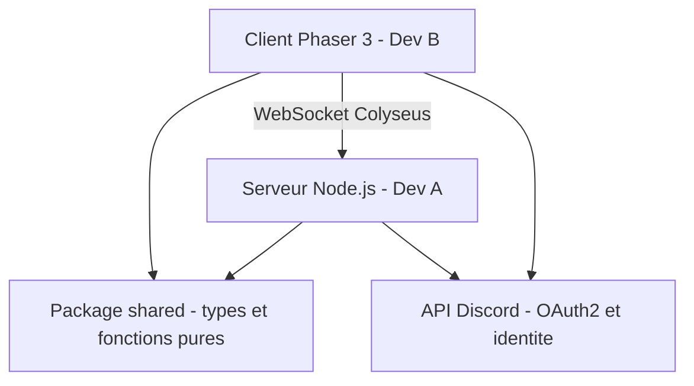
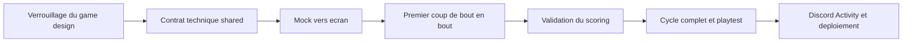

# Plan de développement en binôme — Jeu de plateau en ligne (inspiré de Cascadia, version remaniée)

> **Objet du document** : définir précisément ce que chaque développeur doit accomplir,
> et identifier les phases qui doivent **obligatoirement** être réalisées à deux pour
> garantir la compatibilité du projet de bout en bout.
>
> **Contexte** : jeu web multijoueur temps réel, jouable via une Discord Activity,
> monétisation légère (skins + publicités non invasives), univers visuel et règles
> remaniés pour être juridiquement distincts de Cascadia.

---

## 1. Rappel du concept et des contraintes

- Plateau **unique et partagé** (contrairement au jeu de base) : les joueurs peuvent
  voler les environnements et jetons des autres, saboter les motifs et se faire des
  « crasses ».
- Deux couches de décision par tour : poser une **tuile hexagonale** (arêtes colorées),
  puis poser un **jeton** (5 formes) selon des règles de motifs.
- **Problème technique central** : déterminer les points exige de savoir **qui a posé
  quoi et à quel tour** → l'état complet et l'historique doivent être gérés côté serveur.
- **Binôme asymétrique** :
  - **Dev A** : développeur moyen en **C**, **Python (non POO)**, **HTML**, **CSS**.
  - **Dev B** : débutant complet, **un peu de Python**.

Cette asymétrie change la donne : la stack « bas niveau » (Rust, WebAssembly, Canvas
natif) est à **proscrire**. La priorité est de **réduire la friction d'apprentissage**
tout en **garantissant la compatibilité** par des mécanismes structurels.

---

## 2. La stack technique recommandée (et pourquoi)

### 2.1 Architecture d'ensemble



### 2.2 Choix par couche

| Couche | Technologie | Justification |
|---|---|---|
| **Langage unique** | **TypeScript** de bout en bout | Un seul écosystème pour les deux devs ; le typage statique rappelle le C pour Dev A et sert de filet de sécurité pour Dev B. |
| **Partage de code** | **Monorepo** (`pnpm` ou npm workspaces) | Un package `shared` unique contenant les types et les règles pures, utilisé par le serveur **et** le client. C'est le cœur de la compatibilité. |
| **Serveur / réseau** | **Node.js + Colyseus** | Colyseus fournit les salons, le matchmaking et surtout la **synchronisation d'état par schéma** avec une API TypeScript fortement typée. Il impose un modèle de serveur **autoritaire** (idéal anti-triche). |
| **Client / rendu** | **Vite + Phaser 3** | Phaser fournit déjà boucle de jeu, caméra, détection de clic, sprites et scènes. **Bien plus accessible qu'un Canvas nu ou PixiJS pour un débutant**, tout en restant performant pour une grille hexagonale. |
| **Tests** | **Vitest** | Dev A teste les règles et le scoring sans aucune interface graphique. |
| **UI / menus** | HTML/CSS simple (Dev A) | Les menus, le HUD et les modales restent en HTML/CSS pour capitaliser sur les acquis de Dev A. |

### 2.3 Pourquoi pas les alternatives

- **Backend Python (FastAPI/WebSocket)** : Dev A irait plus vite sur le langage, mais on
  perdrait le **partage de types** entre client et serveur. Deux langages = double
  définition de la structure de données = source majeure de divergence. → **Rejeté**.
- **Rust / Go / WebAssembly** : trop difficile pour Dev B et inutile pour un jeu au
  tour par tour. → **Rejeté**.
- **Canvas natif / PixiJS + Svelte/React** : PixiJS est un moteur de rendu, pas un
  moteur de jeu ; il exige de réécrire input, caméra et boucle de jeu soi-même.
  Phaser 3 fait tout cela nativement. → **Phaser retenu**.

> **Principe directeur** : le typage TypeScript partagé est le **contrat vivant** entre
> Dev A et Dev B. Si l'un modifie une structure sans prévenir, la **compilation casse
> des deux côtés immédiatement**, au lieu d'un bug silencieux en production.

---

## 3. Le contrat partagé — ce qui garantit la compatibilité (CRITIQUE)

C'est la section la plus importante du projet. Toute ambiguïté laissée ici se paiera
en bugs croisés. Le package `shared/` est **la source unique de vérité**.

### 3.1 Système de coordonnées hexagonales

- Adopter les **coordonnées axiales** `(q, r)` — c'est la convention la plus simple et
  la plus documentée (référence : Amit Patel / Red Blob Games).
- Orientation : **« pointy-top »** (pointe en haut), **validé**.
- Toutes les fonctions de géométrie hex vivent dans `shared/hex.ts` :
  - `hexNeighbors(q, r)`
  - `hexDistance(a, b)`
  - `hexDirections` (constante)
  - `pixelToHex(x, y, hexSize)` — conversion écran → coordonnée
  - `hexToPixel(q, r, hexSize)` — conversion coordonnée → écran
- **Règle stricte** : personne ne réimplémente ces maths ailleurs. Dev B se contente
  d'appeler `pixelToHex` / `hexToPixel`. Dev A est propriétaire du fichier.

### 3.2 Types de données partagés (`shared/types.ts`)

Exemple de squelette (à compléter ensemble en Phase 1) :

```ts
// 5 environnements (couleurs) et 5 types de jetons (formes) — Tier A
// Noms/DA définitifs à fixer en Phase 1 ; les index restent stables pour la synchro.
export enum EnvironmentId { E0 = 0, E1 = 1, E2 = 2, E3 = 3, E4 = 4 }
export enum TokenShape { Carre = 0, Triangle = 1, Coeur = 2, Rond = 3, Etoile = 4 }

// Tuile hexagonale : 6 arêtes colorées + capacité d'accueil de jetons
export interface Tile {
  q: number;
  r: number;
  edges: EnvironmentId[];        // 6 arêtes, dans l'ordre horaire
  acceptedShapes: TokenShape[];  // 1 (monochrome), 2 ou 3 (bicolore)
  tokenShape: TokenShape | null; // jeton posé (null = vide)
  tokenOwnerId: string | null;   // propriétaire du jeton
  tileOwnerId: string | null;    // propriétaire de la tuile (contrôle d'environnement)
  turnPlaced: number;            // tour de pose (ancienneté)
}

export type Phase =
  | 'setup' | 'waiting' | 'reroll' | 'chooseTile' | 'placeTile'
  | 'chooseToken' | 'placeToken' | 'confirm' | 'scoring' | 'gameOver';

export interface MarketSlot {
  tileId: string;
  tokenShape: TokenShape;        // jeton associé à l'emplacement
}

export interface PlayerState {
  id: string;
  nickname: string;
  avatarUrl: string;
  teamId: string | null;
  score: number;
  jokers: number;                // illimités, comptés pour le score de fin
}

export interface GameState {
  board: Record<string, Tile>;   // clé = `${q},${r}`
  players: PlayerState[];
  currentPlayerId: string;
  phase: Phase;
  turnNumber: number;
  totalTiles: number;            // tours × joueurs + 4 (fixé à la mise en place)
  market: MarketSlot[];          // 4 emplacements tuile + jeton associé
  tokenPool: TokenShape[];       // pool finie de jetons restants
  environmentMinSize: number;    // ceil((totalTiles - 4) / 10)
  rerollAvailable: boolean;      // bouton de reroll (3 jetons identiques)
  winnerId: string | null;
}

// Union discriminée des coups possibles (squelette à compléter en Phase 1)
export type Move =
  | { type: 'placeTile'; q: number; r: number; rotation: number; slotIndex: number }
  | { type: 'placeToken'; q: number; r: number; tokenShape: TokenShape; slotIndex: number }
  | { type: 'skipToken' }
  | { type: 'reroll' }
  | { type: 'undo' }
  | { type: 'confirmTurn' };

// Réponse serveur -> client
export interface MoveResult {
  ok: boolean;
  reason?: string;               // message d'erreur en cas de coup invalide
  newState?: GameState;
}
```

### 3.3 Moteur de règles partagé (`shared/rules.ts`)

Toutes les règles de validation et de scoring sont des **fonctions pures** :

```ts
export function getConnectedEnvironments(board: GameState['board']): Tile[][];
export function computeEnvironmentScores(state: GameState): Record<string, number>;
export function scoreSquares(board: GameState['board']): Record<string, number>;
export function scoreTriangles(board: GameState['board']): Record<string, number>;
export function scoreHearts(board: GameState['board']): Record<string, number>;
export function scoreRounds(board: GameState['board']): Record<string, number>;
export function scoreStars(board: GameState['board']): Record<string, number>;
export function getValidMoves(state: GameState, playerId: string): Move[];
export function validateMove(state: GameState, move: Move, playerId: string): boolean;
export function applyMove(state: GameState, move: Move): GameState;
export function computeScores(state: GameState): Record<string, number>;
export function resolveReroll(state: GameState): GameState | null;
```

- **Le serveur appelle `applyMove` / `computeScores`** pour faire autorité.
- **Le client appelle `getValidMoves` / `computeScores`** pour afficher les coups
  légaux et le score en direct **avec le même code**.
- **Conséquence sur la compatibilité** : il est *impossible* que le serveur et le
  client calculent un score différent, puisqu'ils exécutent la même fonction.
- **Extensibilité des tiers** : chaque forme de jeton du Tier A possède sa propre
  fonction pure de scoring. Les Tiers B/C/D seront ajoutés via de nouvelles fonctions
  enregistrées dans un registre, sans modifier le noyau (DRY / modulaire).

### 3.4 Protocole d'événements (messages Colyseus)

| Direction | Message | Payload |
|---|---|---|
| Client → Serveur | `move` | `{ move: Move, playerId: string }` |
| Serveur → Client | `state` | `GameState` complet (différentiel géré par Colyseus) |
| Serveur → Client | `moveRejected` | `{ reason: string }` |
| Serveur → Client | `gameOver` | `{ winnerId: string, scores: Record<string, number> }` |
| Serveur → Client | `turnStarted` | `{ playerId: string, turnNumber: number }` |
| Serveur → Client | `marketUpdated` | `{ market, tokenPool, rerollAvailable }` |

Ajouter un champ `v: number` (version du protocole) au premier message d'échange, pour
pouvoir casser la compatibilité proprement lors d'évolutions futures.

### 3.5 Conventions d'assets

- Nommage des sprites : `environment_0.png` (couleurs), `token_0.png` (formes), etc.
  (index aligné sur les enums, pas de noms littéraux).
- `hexSize` (taille de l'hexagone en pixels) : **déterminé lors du développement** pour
  s'adapter à toutes les tailles et résolutions d'écran (responsive).
- Point de pivot des sprites : **centre** (0.5, 0.5) partout.
- Palette de couleurs et police : fournies par Dev A dans un fichier `shared/theme.ts`.

---

## 4. Répartition des tâches

### 4.1 Dev A — Backend, logique, règles et réseau

> Rôle : l'**autorité**. Il est propriétaire du package `shared/` et du serveur.

**Montée en compétences préalable**
- TypeScript de base (types, interfaces, fonctions, `enum`) — très rapide avec un
  bagage C/Python.
- Node.js, npm/pnpm, gestion d'un monorepo.
- Colyseus (définition de `Room`, `Schema`, gestion des messages).
- Vitest (tests unitaires).
- Git : branches, commits, revues de code.

**Tâches concrètes**
1. Initialiser le monorepo (`shared`, `server`, `client`) avec lint + formatage communs.
2. Écrire `shared/hex.ts` (géométrie hexagonale).
3. Écrire `shared/types.ts` (le contrat de données, validé avec Dev B).
4. Écrire `shared/rules.ts` (validation des coups + scoring).
5. Implémenter le **scoring** (cf. [`regles-source-de-verite.md`](regles-source-de-verite.md:1)) :
   - **Environnements** : composantes connexes par couleur d'arête (BFS/DFS), contrôle
     par agrandissement, bonus de fin (+2/+1 par couleur).
   - **Jetons Tier A** : une fonction pure par forme (Carré, Triangle, Cœur, Rond,
     Étoile), via un registre extensible pour les tiers futurs.
   - **Historique de possession** (`turnPlaced` + `ownerId`) pour ancienneté, vols et
     sabotages.
6. Coder le serveur Colyseus :
   - `GameRoom` : état du jeu, passage des tours, minuteur, phases.
   - Validation **anti-triche** de chaque coup (`validateMove`) avant toute mutation.
   - Gestion des **connexions/déconnexions/reconnexions** (un joueur parti ne bloque pas).
7. Écrire les **tests unitaires** (scoring, hex, règles) à partir des exemples du GDD.
8. Écrire le **mock d'état** : un `GameState` statique en JSON pour Dev B.
9. Fournir les **assets de test** (sprites de base) à Dev B.
10. Intégrer le **backend Discord** : échange du code OAuth2, récupération pseudo/avatar.
11. Préparer le **déploiement** (HTTPS, variables d'environnement, hébergement).

### 4.2 Dev B — Frontend, rendu, UI et interactions

> Rôle : l'**expérience joueur**. Il consomme `shared/` sans en être propriétaire.

**Montée en compétences préalable**
- TypeScript de base (variables, fonctions, objets, boucles).
- Vite (démarrer le projet de développement).
- Phaser 3 : scènes, sprites, caméra, gestion des clics.
- Git de base : `commit`, `pull`, `push`, résoudre les conflits simples.

**Tâches concrètes**
1. Mettre en place la scène Phaser 3 (dimensions, fond, résolution responsive).
2. **Afficher la grille hexagonale** à partir d'un état mocké (via `hexToPixel`).
3. Dessiner les **tuiles** (arêtes colorées) et les **jetons** (5 formes) selon leurs
   sprites.
4. Afficher la **propriété** de chaque case (couleur/contour par `ownerId`).
5. Implémenter la **caméra** : zoom à la molette + déplacement (pan) du plateau.
6. Implémenter la **détection de clic** : `pixelToHex` + surbrillance des cases légales
   (`getValidMoves`).
7. Gérer le **drag-and-drop** ou le clic-poser pour tuiles et animaux.
8. Ajouter les **animations** : pose de tuile, pose de jeton, vol, sabotage.
9. Construire le **HUD** : marché commun (4 tuiles + 4 jetons), jokers, score, joueur
   courant, minuteur de tour, bouton reroll.
10. Afficher **identité des joueurs** (avatar + pseudo).
11. Intégrer le **SDK Discord** côté front (`@discord/embedded-app-sdk`).
12. Rendre le tout **responsive** (PC + mobile, formats portrait et paysage).

### 4.3 Frontière entre les deux

| Élément | Propriétaire | Consommateur |
|---|---|---|
| `shared/hex.ts` | Dev A | Dev B |
| `shared/types.ts` | Dev A (avec validation de Dev B) | Les deux |
| `shared/rules.ts` | Dev A | Les deux |
| `shared/theme.ts` (couleurs, assets) | Dev A | Dev B |
| Rendu / sprites / animations | Dev B | — |
| Serveur / validation | Dev A | Dev B (via le réseau) |

---

## 5. Les phases de synchronisation obligatoires

Ces phases **ne peuvent pas être faites en solo**. Elles doivent être réalisées à deux,
idéalement en pair programming ou en session de travail commune.



### Phase 0 — Verrouillage du game design (avant tout code)

- **Objectif** : définir des règles **non ambiguës** du jeu remanié.
- **Livrable** : le document source de vérité
  [`regles-source-de-verite.md`](regles-source-de-verite.md:1), couvrant :
  - mise en place (tuile de départ en triangle, nombre de tours, total de tuiles) ;
  - déroulement du tour (marché 4 tuiles + 4 jetons, reroll, pose tuile, choix/pose
    jeton, bonus joker, retour, confirmation, minuteur) ;
  - scoring (environnements, jetons Tier A, jokers) et propriété/ancienneté ;
  - mode équipes et règles techniques anti-boucle du reroll.
- **Exemples de score à la main** : non produits en Phase 0 (une seule partie Tier D
  jouée, calculs manuels coûteux et sujets aux erreurs). Remplacés par des **tests
  unitaires incrémentaux** construits par Dev A, validés par le code partagé (Phase 4).
- **Pourquoi ensemble** : les **points ouverts** restants (noms/DA, désambiguïsation des
  paires de Carrés) listés en §10 du document source de vérité doivent être tranchés
  ensemble avant le codage.

### Phase 1 — Le contrat technique (écriture de `shared/`)

- **Objectif** : verrouiller la structure de données et le protocole.
- **Contenu à fixer ensemble** :
  - Orientation hex : **pointy-top** (validé) ; `hexSize` déterminé lors du développement.
  - Enum `EnvironmentId` / `TokenShape` et leur mapping visuel (sprite/couleur).
  - Schéma complet de `GameState`, `Move`, `MoveResult`.
  - Noms et payloads des messages réseau (table du §3.4).
  - Conventions d'assets.
  - Le reste des décisions techniques sera consigné dans un **document technique**.
- **Livrable** : `shared/types.ts`, `shared/hex.ts` et le squelette de `shared/rules.ts`
  **compilés et validés par les deux**.
- **Pourquoi ensemble** : c'est le contrat. Dev B doit pouvoir dire « il me manque ce
  champ pour afficher ça » ; Dev A doit pouvoir dire « cette donnée n'existe pas côté
  serveur ».

### Phase 2 — Du mock à l'écran (validation visuelle)

- **Objectif** : s'assurer que l'état de données est correctement interprété à l'écran.
- **Dev A** : fournit un `GameState` mocké (JSON fixe) + les sprites de test.
- **Dev B** : affiche la grille, les terrains, les animaux et la propriété.
- **Ensemble** : vérifier la correspondance état → visuel (couleurs, orientation de
  l'hex, position des labels, contour de propriété).
- **Pourquoi ensemble** : tout malentendu sur la sémantique d'un champ (ex. `ownerId`
  vide, `turnPlaced` à 0) se révèle ici à moindre coût.

### Phase 3 — Premier coup de bout en bout

- **Objectif** : prouver que le client et le serveur parlent le même langage.
- **Déroulé** : Dev B clique une case → le client envoie `move` → le serveur `validateMove`
  → `applyMove` → renvoie l'état → Dev B voit la tuile apparaître.
- **Ensemble** : déboguer la sérialisation, les coordonnées (client vs serveur) et le
  cycle de vie de la connexion.
- **Livrable** : **un coup complet** fonctionnel dans les deux sens.

### Phase 4 — Validation du scoring

- **Objectif** : garantir que le score affiché = le score calculé par le serveur.
- **Dev A** : transforme les exemples du GDD en tests unitaires (`computeScores`).
- **Dev B** : vérifie que le HUD affiche exactement ces valeurs.
- **Ensemble** : tester les cas limites (vols en chaîne, sabotages, égalités, plateaux
  pleins).
- **Pourquoi ensemble** : parce que le scoring utilise le **même code** des deux côtés,
  une divergence ne peut venir que d'une mauvaise lecture de l'état — à détecter à deux.

### Phase 5 — Cycle complet et playtests

- **Objectif** : jouer des parties complètes et fiabiliser l'expérience.
- **Contenu** : tours, minuteur, fin de partie, reconnexion après déconnexion.
- **Ensemble** : jouer réellement (l'un est hôte, l'autre invité), relever les bugs UX
  et les déséquilibres de règles.
- **Livrable** : une partie jouable du début à la fin, sans intervention manuelle.

### Phase 6 — Discord Activity et déploiement

- **Objectif** : rendre le jeu jouable dans un vrai salon vocal Discord.
- **Contenu** : configurer l'app sur le portail développeur, brancher OAuth2,
  charger `@discord/embedded-app-sdk`, rendre l'iframe responsive, déployer en HTTPS.
- **Ensemble** : tester dans un salon vocal réel (les deux devs + des amis).

---

## 6. Méthodologie de travail en parallèle

### 6.1 Découplage du travail

- **Dev B travaille sur données mockées** : il n'a pas besoin du serveur pour faire
  avancer le rendu et les interactions.
- **Dev A travaille sur tests unitaires** : il n'a pas besoin de l'interface pour faire
  avancer les règles et le scoring.
- Le **seul point de contact** entre les deux est le package `shared/` et le protocole
  de la Phase 1.

### 6.2 Git

- Dépôt unique (monorepo), branches courtes par fonctionnalité, `main` toujours verte.
- **Toute modification de `shared/` = revue par les deux** (c'est un changement de
  contrat).
- Convention de commits claire (ex. Conventional Commits) pour l'historique.
- Dev A fait les revues de code de Dev B (pédagogique et qualitatif).

### 6.3 CI et qualité

- `lint` + `typecheck` + `vitest` à chaque pull request.
- Le `typecheck` du monorepo est la **première barrière de compatibilité** : s'il
  échoue, le code ne peut pas être fusionné.

### 6.4 Accompagnement de Dev B

- **Pair programming** sur les points durs (détection de clic hex, caméra, animations).
- Dev A fournit des **fonctions à signature simple** et documentées, pour que Dev B
  n'ait qu'à les appeler.
- Retour visuel immédiat privilégié (Phaser) pour maintenir la motivation.

---

## 7. Ordre chronologique récapitulatif

### Étape A — Phase d'apprentissage (les deux devs, en parallèle)

1. **Dev A** : TypeScript → Node.js → Colyseus → Vitest → Git (détail §4.1).
2. **Dev B** : TypeScript → Vite → Phaser 3 → Git (détail §4.2).
   - Les deux devs n'ayant jamais touché ces outils, cette étape précède tout code du projet.
   - Procédure d'installation (Windows + VSCode), liens officiels, ordre de codage et
     tests : voir [`installation-apprentissage-tests.md`](installation-apprentissage-tests.md:1).

### Étape B — MVP

3. **Phase 0** — Verrouillage des règles (fait, voir [`regles-source-de-verite.md`](regles-source-de-verite.md:1)).
4. **Phase 1** — Contrat technique `shared/` + **document technique** (ensemble).
5. Développement découplé : Dev A (règles + serveur + tests) / Dev B (rendu + input sur mock).
6. **Phases 2 à 5** — Mock → écran, premier coup de bout en bout, validation du scoring, cycle complet + playtests (ensemble).

### Étape C — Produit final

7. **Phase 6** — Discord Activity + déploiement (ensemble).
8. **DA forte** (noms, images, animations) intégrée à la fin via le code adaptatif.

---

## 8. Risques et points de vigilance

- **Dérive de scope** : commencer par un plateau fixe, sans Discord, sans monétisation.
  Ajouter le reste une fois le noyau stable.
- **Surcharge de Dev B** : ne pas lui demander de toucher au serveur ni aux règles ; le
  cantonner à Phaser + TypeScript de base.
- **Divergence de règles** : toute règle modifiée doit passer par `shared/rules.ts` et
  par un test unitaire, jamais par une bidouille locale.
- **Responsive Discord** : prévoir dès le départ le rendu en portrait **et** paysage,
  et les petites tailles d'écran.
- **Reconnexion** : un joueur qui quitte un salon vocal ne doit pas casser la partie
  (état persistant côté serveur, réintégration possible).
- **Anti-triche** : le serveur est la seule source de vérité ; le client ne fait que
  *demander* des coups, jamais les appliquer de son propre chef.

---

## 9. Décisions clés à valider avec l'utilisateur

Les choix structurants retenus dans ce document (à confirmer) :

1. **TypeScript end-to-end** plutôt qu'un backend Python, au prix d'une montée en
   compétence de Dev A — pour garantir le partage de types.
2. **Phaser 3** plutôt que PixiJS/Svelte, pour l'accessibilité pour Dev B.
3. **Colyseus** plutôt que Socket.io brut, pour la synchronisation d'état typée.
4. **Package `shared/`** comme source unique de vérité (types + règles pures).
5. **Six phases de synchronisation** obligatoires, du game design au déploiement.
6. **Règles verrouillées** pour le Tier A : voir [`regles-source-de-verite.md`](regles-source-de-verite.md:1)
   (v1.2), avec les points ouverts restants à trancher (§10).
