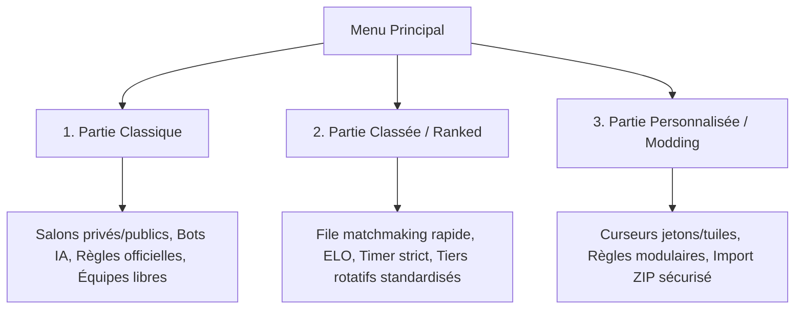
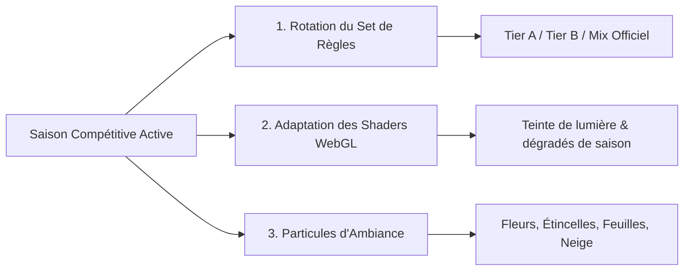
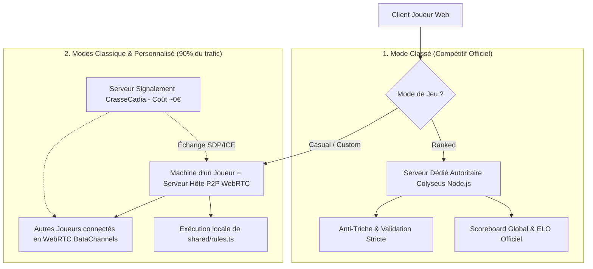
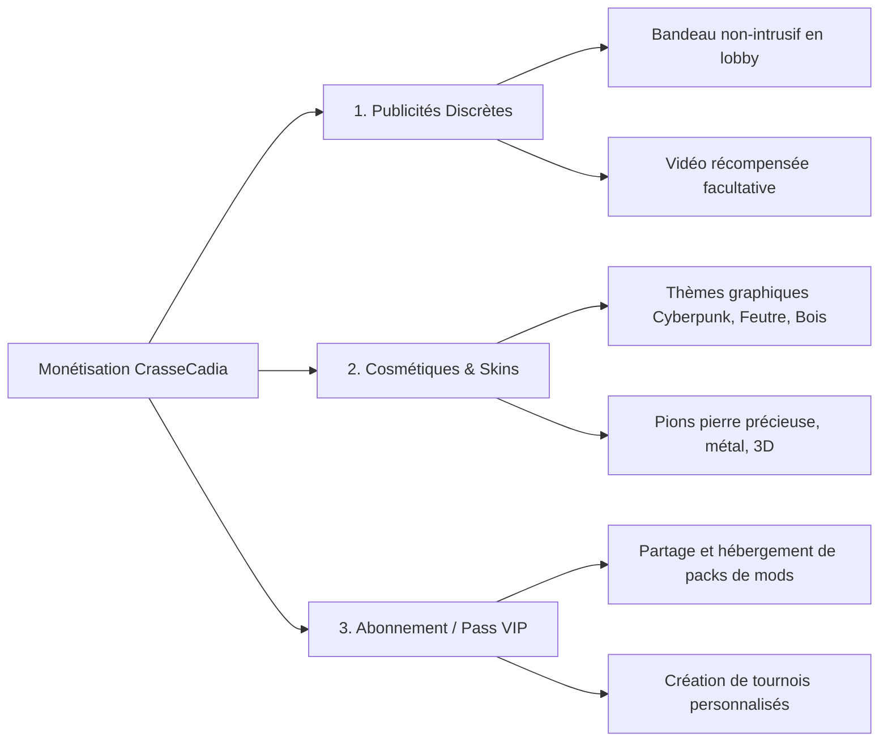

# Spécification Technique & Architecture Globale — CrasseCadia (v1.0)

> **Projet** : CrasseCadia (nom de code évolutif)  
> **Auteur** : Équipe CrasseCadia  
> **Statut** : Document de référence validé  
> **Cible de déploiement** : Serveur multijoueur temps réel (Colyseus / Node.js) + Tests locaux et Discord Activity

---

## Sommaire

1. [Synthèse & Vision du Projet](#1-synthèse--vision-du-projet)
2. [Modes de Jeu & Options Joueurs](#2-modes-de-jeu--options-joueurs)
3. [Gestion des Tiers, Matchmaking & Système de Saisons](#3-gestion-des-tiers-matchmaking--système-de-saisons)
4. [Personnalisation Avancée, Injection ZIP & Paliers de Comptes](#4-personnalisation-avancée-injection-zip--paliers-de-comptes)
5. [Architecture Client-Serveur Dédié (Node.js + Colyseus)](#5-architecture-client-serveur-dédié-nodejs--colyseus)
6. [Moteur Graphique 2.5D, Volumétrie, Éclairage, Animations & Shaders Solaires](#6-moteur-graphique-25d-volumétrie-éclairage-animations--shaders-solaires)
7. [Génération Procédurale des Tuiles & Découpage Visuel](#7-génération-procédurale-des-tuiles--découpage-visuel)
8. [Architecture Modulaire Long-Terme & Organisation Scalable du Code](#8-architecture-modulaire-long-terme--organisation-scalable-du-code)
9. [Stratégie de Monétisation Respectueuse](#9-stratégie-de-monétisation-respectueuse)
10. [Sécurité, Authentification Minimale, Zero-Log & Conformité RGPD](#10-sécurité-authentification-minimale-zero-log--conformité-rgpd)
11. [Plan d'Implémentation & Conventions de Code](#11-plan-dimplémentation--conventions-de-code)
12. [Synthèse des Décisions Validées](#12-synthèse-des-décisions-validées)

---

## 1. Synthèse & Vision du Projet

### 1.1 Le Concept Fondateur
Inspiré par l'élégance de *Cascadia*, **CrasseCadia** prend le contre-pied fondamental du jeu d'origine :
- **Plateau unique et partagé** : Les joueurs ne construisent pas leur écosystème dans leur coin ; ils s'affrontent sur un même archipel hexagonal en expansion.
- **Interactions directes ("Crasses")** : Possibilité de dérober la propriété d'un biome en l'étendant, d'invalider les paires ou structures d'animaux/jetons adverses, et de bloquer l'adversaire.
- **Deux couches interdépendantes** :
  1. *Les tuiles (Environnements)* : 5 couleurs d'arêtes. Contrôle basé sur l'agrandissement et l'ancienneté.
  2. *Les jetons (Formes)* : 5 types (Carré, Triangle, Cœur, Rond, Étoile) possédant chacun leur propre logique géométrique et de sabotage.
- **Ressource tactique : Les Jokers** : Permettent de découpler le marché (choisir un jeton non associé) ou sont conservés pour des points en fin de partie.

---

## 2. Modes de Jeu & Options Joueurs

Le jeu propose trois modes principaux, chacun répondant à une expérience utilisateur spécifique.



### 2.1 Mode Partie Classique (Casual / Amis / IA)
Idéal pour jouer entre amis ou s'entraîner contre des bots.

* **Options configurables par le chef de salon :**
  - **Nombre de joueurs** : 1 à 8 joueurs recommandés (support technique jusqu'à 16). Possibilité d'ajouter des Bots IA configurables (Facile, Moyen, Rusé).
  - **Durée de tour (Timer)** : Curseur de 15 à 180 secondes (défaut : 60 s). Possibilité d'activer un mode "Sans minuteur" pour les parties amicales relaxantes.
  - **Nombre de tours** : Curseur de 10 à 30 tours (défaut : 20 tours).
  - **Ordre de jeu** : Ordre des sièges fixe ou Tirage aléatoire au départ.
  - **Mode Équipes** :
    - *Chacun pour soi* (défaut).
    - *Équipes personnalisées* (tailles libres, ex: 1v1, 2v2, 3v3 ou asymétrique 1v3).
    - *Répartition 50/50 aléatoire* automatique.
    - *Équilibrage de temps de jeu* : les petites équipes jouent plusieurs fois par tour de table pour égaliser le nombre d'actions globales.
  - **Visibilité du score** : Score affiché en direct OU Score masqué (révélé au décompte final à la fin de la partie).

### 2.2 Mode Partie Classée (Ranked / Compétitif)
Dédié aux parties compétitives en ligne avec calcul d'indice ELO/MMR certifié.

* **Paramètres verrouillés (Fair-play & Standardisation) :**
  - Timer strict : 45 secondes par tour.
  - Règles officielles : Tier A officiel standardisé (ou Tier de la Saison active).
  - **Files Compétitives Proposées** :
    1. *File 1v1 Duel* (affrontement tactique pur en tête-à-tête).
    2. *File 2v2 Équipes* (coordination en duo avec ELO d'équipe et scoreboard dédié).
    3. *File 4 Joueurs Free-For-All* (chacun pour soi compétitif).
  - Serveur autoritaire avec validation anti-triche : aucun état n'est calculé unilatéralement par le client.
  - **Système Anti-Rage-Quit & Gestion Déconnexions / AFK (Spécification Précise)** :
    - Si un joueur se déconnecte ou ne joue pas son tour :
      - **Pendant les 3 premiers tours d'inactivité/déconnexion** : Un Bot IA en mode "Facile" prend le relais et joue après **30 secondes** (ce délai accorde une fenêtre de grâce au joueur pour revenir).
      - **Après ces 3 tours consécutifs** : Le Bot IA joue immédiatement après **5 secondes** pour ne plus ralentir les autres joueurs.
      - **Reconnexion sans limite** : Le joueur peut se reconnecter **à tout moment** et réintégrer sa partie.
      - **Règle de reconnexion en plein tour** : Si le joueur se reconnecte *pendant son tour* (alors que le bot est en train d'attendre ou de jouer), il doit attendre que le bot ait achevé l'action du tour en cours, puis il reprend le contrôle complet dès son tour suivant.
    - **Cas particulier du Mode Équipe (2v2)** :
      - Si un joueur d'une équipe se déconnecte, son tour n'est pas confié à un bot : **son tour est automatiquement attribué à son coéquipier actif**.
      - Ce n'est que si **tous les membres de l'équipe se déconnectent** qu'un bot IA prend le relais selon la règle standard (3 tours à 30s, puis 5s).

### 2.3 Mode Partie Personnalisée (Custom / Bac à Sable / Modding Débridé)
Le laboratoire créatif du jeu. Conçu pour laisser les joueurs totalement libres, qu'ils soient raisonnables ou veuillent expérimenter les configurations les plus extrêmes :

* **Curseurs Débridés (Capacités Étendues jusqu'à 30 ou plus) :**
  - **Nombre de types de jetons** : Curseur de 2 à **30+ types de jetons distincts** (défaut : 5).
  - **Nombre d'environnements** : Curseur de 2 à **30+ biomes distincts** (défaut : 5).
  - **Nombre de tours** : Curseur de 5 à **100+ tours** (défaut : 20).
  - **Taille du marché** : De 2 à **12 paires tuile/jeton affichées** (défaut : 4).
  - **Jokers de départ** : De 0 à **30+ jokers** alloués à chaque joueur au démarrage.
* **Ergonomie Universelle des Curseurs (Souris & Clavier) :**
  - **Glissement direct à la souris (Drag & Drop)** pour un réglage rapide et intuitif.
  - **Touches Flèche Gauche ($\leftarrow$) et Flèche Droite ($\rightarrow$)** : Ajustement ultra-précis **unité par unité**.
  - **Combinaison `Maj + Flèches` (`Shift + $\leftarrow$ / $\rightarrow$`)** : Incréments rapides par pas de 5 ou 10.
* **Options Visuelles & Règles Modulaires :**
  - **Visibilité et surbrillance des montages (Règle d'affichage clé)** :
    - *Par défaut* : Chaque joueur ou équipe **ne voit que ses propres montages** surlignés dans sa propre couleur. Tout le reste du plateau est sobre pour une lisibilité parfaite.
    - *Option personnalisée "Montages & Scores Complets"* : Surbrillance des montages de **tous les joueurs** et affichage des scores détaillés en temps réel.
  - **Règles modulaires (Toggles On/Off)** :
    - *Vols d'environnements autorisés / interdits*.
    - *Sabotage de paires / chaînes activé / désactivé*.
    - *Rerolls automatiques et manuels activés / désactivés*.
    - *Bonus tuile monochrome activé (+1 joker) / désactivé*.
  - **Injection de règles & assets par ZIP (Modding)** (détaillé ci-après).

### 2.4 Système des Cartes Objectif (Inspiration "Les Aventuriers du Rail")
Les objectifs secrets constituent une tension stratégique majeure à double tranchant :

```
┌────────────────────────────────────────────────────────────────────────┐
│             CYCLE DE VIE DES CARTES OBJECTIF (TICKET TO RIDE)          │
├────────────────────────────────────────────────────────────────────────┤
│ 1. Mise en place :                                                    │
│    • Tirage de 3 cartes : 1 Forte Valeur (10-15 pts) + 2 Faible Valeur │
│    • Choix du joueur/équipe : Conserver ou Rejeter chaque carte        │
├────────────────────────────────────────────────────────────────────────┤
│ 2. En cours de partie (Ravitaillement sous condition) :                │
│    • CONDITION STRICTE : Tous les objectifs conservés sont complétés   │
│    • Tirage de 3 nouveaux objectifs à FAIBLE VALEUR                    │
│    • Choix : Rejeter au maximum 2 cartes (en conserver au moins 1)     │
├────────────────────────────────────────────────────────────────────────┤
│ 3. Décompte final (Sanction à double tranchant) :                      │
│    • Objectif REMPLI   : +valeur ajoutée au score                      │
│    • Objectif NON REMPLI : -valeur SOUS-TRAITE du score final !        │
└────────────────────────────────────────────────────────────────────────┘
```

- **Génération Procédurale des Cartes** :
  - Le texte descriptif, les icônes de conditions et la valeur en points sont incrustés dynamiquement par le moteur graphique sur **deux templates visuels distincts** :
    1. *Carte Faible Valeur* : Cadre épuré en ardoise / argent avec sceau discret.
    2. *Carte Forte Valeur* : Cadre doré baroque orné de dorures et gemme centrale.
- **Intégration au Modding ZIP** :
  - Possibilité d'injecter des objectifs personnalisés via un fichier `objectives.json` dans les packs de mods (décrit en §4).

### 2.5 Système de Chat & Raccourcis Clavier
Pour favoriser la coordination d'équipe et la convivialité sans interférer avec les actions de jeu :
- **Chat d'Équipe (`Entrée` / `Enter`)** :
  - Ouvre la boîte de dialogue en mode canal d'équipe.
  - Les messages sont chiffrés / filtrés côté serveur et **uniquement transmis aux coéquipiers**.
  - Idéal pour élaborer des stratégies secrètes de placement sans que les adversaires ne le sachent.
- **Chat Général (`Maj + Entrée` / `Shift + Enter`)** :
  - Ouvre la boîte de dialogue en mode diffusion publique.
  - Le message est affiché sur le canal global pour tous les participants du salon.
- **Mode Individuel ("Chacun pour soi")** :
  - La touche `Entrée` active directement le chat général public.

---

## 3. Gestion des Tiers, Matchmaking & Système de Saisons

### 3.1 La Problématique du Matchmaking avec Tiers Multiples
Dans *Cascadia*, chaque animal dispose de plusieurs cartes de règles (Tiers A, B, C, D).  
Si chaque joueur en partie classée pouvait choisir individuellement le tier de chaque jeton, la file de rencontres aléatoires serait morcelée en $4^5 = 1024$ files différentes, rendant le matchmaking **virtuellement impossible** ou interminable.

### 3.2 Solution Retenue pour les Files Aléatoires & Compétitives

Nous implémentons une architecture en 3 volets :

```
┌────────────────────────────────────────────────────────────────────────┐
│                        GESTION DES TIERS                               │
├────────────────────────────┬───────────────────────────────────────────┤
│ Mode Classé (Ranked)       │ • Set Standard Fixe (Tier A officiel)    │
│                            │ • Rotation Saisonnière Officielle         │
├────────────────────────────┼───────────────────────────────────────────┤
│ Mode Classique (Casual)    │ • Vote en Lobby (Phase Pick & Ban de 15s) │
│                            │ • Préréglages recommandés en 1 clic       │
├────────────────────────────┼───────────────────────────────────────────┤
│ Mode Personnalisé (Custom) │ • Sélection manuelle totale ou Mod ZIP    │
└────────────────────────────┴───────────────────────────────────────────┘
```

1. **En Classé — La "Saison Active" / Rotation Régulière** :
   - La file principale utilise le **Tier A (Officiel Équilibré)** ou le **Set de la Saison Active**.
   - Évite toute fragmentation : 1 seule file classée active, matchmaking instantané.
2. **En Classique — Vote Éclair en Lobby (Pick & Ban)** :
   - Lors de la création du salon, si le chef autorise le choix, les joueurs disposent de 15 secondes pour voter pour le Tier de chaque animal ou pour un "Preset" thématique (ex: "Aggressif", "Harmonieux", "Constructeur").
3. **En Personnalisé** :
   - Liberté totale : choix indépendant de chaque règle par jeton parmi tous les tiers disponibles.

### 3.3 Système de Saisons pour le Mode Classé & Adaptation Graphique
Le mode classé est rythmé par des **Saisons compétitives trimestrielles** qui renouvellent la méta et habillent le jeu d'une ambiance visuelle évolutive :



* **Printemps ("Renouveau Végétal")** :
  - *Palette & Shaders* : Lumière douce du matin, teintes d'herbe tendre et de ciel azur.
  - *Particules* : Pétales de fleurs de cerisier flottant doucement au-dessus du plateau.
* **Été ("Zénith Ardent")** :
  - *Palette & Shaders* : Éclairage zénithal éclatant et chaud, effet de mirage thermique subtil sur les bords de table.
  - *Particules* : Élucitations ambrées et pollens dorés scintillants.
* **Automne ("Moisson Sauvage")** :
  - *Palette & Shaders* : Lumière rasante dorée/cuivrée, contrastes chauds profonds.
  - *Particules* : Feuilles d'érable rougeoyantes en tourbillon lors des poses de tuiles.
* **Hiver ("Frimas & Aurores")** :
  - *Palette & Shaders* : Lumière cristalline bleutée, effet de givre subtil sur les tranches biseautées des hexagones.
  - *Particules* : Flocons de neige délicats et reflets d'aurore boréale animés en arrière-plan.

### 3.4 Les 4 Tiers Officiels du Jeu (Tiers A, B, C, D)

> [!NOTE]
> **Clarification des Tiers par rapport à Cascadia** :
> Les règles historiques décrites dans le document source de vérité initial correspondent en réalité au **Tier D (Expert / Master)**. Les tiers de base de Cascadia étant en partie trop passifs et faciles, CrasseCadia propose une progression en 4 Tiers équilibrés, interactifs et propices aux "crasses" :

```
┌────────────────────────────────────────────────────────────────────────┐
│                   LES 4 TIERS DE CRASSECADIA                           │
├───────────┬────────────────────────────────────────────────────────────┤
│ Tier A    │ • Initiation Stratégique & Dynamisme (Accessible & Rapide) │
│ Tier B    │ • Densité Géométrique & Mathématique (Placement Exigeant)  │
│ Tier C    │ • Sabotage Agressif & Conflit Direct ("Crasses" Maximales) │
│ Tier D    │ • Expert / Master (Règles Sources de Vérité Validées)      │
└───────────┴────────────────────────────────────────────────────────────┘
```

#### 1. Tier A — Initiation Stratégique & Dynamisme
Conçu pour des parties rythmées, lisibles et compétitives :
- **Carré (Trios Compacts)** : 3 carrés mutuellement adjacents formant un triangle compact rapportent **9 points**. Tout carré isolé ou excédentaire ne faisant pas partie d'un trio complet vaut 0.
- **Triangle (Chaînes d'Arêtes)** : Triangles placés le long du périmètre extérieur du plateau. Barème : 2 triangles (**4 pts**), 3 (**8 pts**), 4 (**13 pts**), 5 (**18 pts**), 6 et + (**24 pts**).
- **Cœur (Paires Espacées)** : Paires de cœurs qui doivent obligatoirement être séparées par **exactement 1 case d'écart** (distance de 2 hexagones). Rapporte **6 pts** par paire valide. Si deux cœurs se touchent, ils s'invalident.
- **Rond (Clans Libres)** : Groupes de ronds connectés sans contrainte de ligne, mais limités à 5 ronds maximum par clan. Barème : 3 ronds (**6 pts**), 4 (**11 pts**), 5 (**17 pts**). Tout rond ajouté au-delà de 5 détruit le clan (vaut 0).
- **Étoile (Balises Étoilées)** : 1 étoile rapporte **3 points par type de biome différent** présent parmi ses tuiles adjacentes.

#### 2. Tier B — Densité & Alignements Géométriques
Pour les stratèges qui aiment l'optimisation spatiale rigoureuse :
- **Carré (Échelle / Lignes Parallèles)** : Deux paires de carrés parallèles face à face formant un rectangle de 4 pions. Rapporte **14 points** par échelle complète.
- **Triangle (Chevrons / Zig-Zag)** : Chaîne de triangles alternant obligatoirement deux directions (angles de 60°/120°). Barème : 3 (**6 pts**), 4 (**10 pts**), 5 (**15 pts**), 6+ (**21 pts**).
- **Cœur (Arbre Ramifié)** : Un cœur central connecté à au moins 3 cœurs satellites distincts sans aucune boucle. Rapporte **12 points** par ramification valide.
- **Rond (Couronnes Hexagonales)** : Anneau de ronds entourant une tuile centrale. 4 ronds (**8 pts**), 5 ronds (**14 pts**), anneau complet de 6 ronds (**22 pts**).
- **Étoile (Pont Stellaire)** : Étoile placée sur la frontière entre deux biomes d'au moins 3 tuiles chacun. Rapporte **8 points** si elle connecte deux grands biomes différents.

#### 3. Tier C — Sabotage & "Crasses" Agressives (Conflit Direct)
Pour les joueurs qui aiment l'affrontement frontal et les coups bas :
- **Carré (Mur de Rupture)** : Ligne de carrés coupant la progression d'un biome adverse. Rapporte **5 points** par tranche de biome adverse neutralisée.
- **Triangle (Flèche Prédatrice)** : Alignement de 3 triangles pointant directement vers un jeton adverse. Siphonne **4 points** à la structure ciblée pour les attribuer au poseur.
- **Cœur (Parasitage)** : Cœur posé adjacent à une chaîne de cœurs adverse. S'il agrandit la chaîne, il en vole immédiatement la propriété complète quel que soit le joueur précédent.
- **Rond (Balises Piégées)** : Poser un rond adjacent à un jeton adverse d'un autre type bloque ce jeton et empêche son propriétaire de marquer son bonus de fin, tout en rapportant **4 pts** au poseur.
- **Étoile (Trou Noir)** : Une étoile entourée d'au moins 3 jetons identiques de joueurs adverses annule leurs points et rapporte **15 points** au poseur.

#### 4. Tier D — Expert / Master (Règles Sources de Vérité Initiales)
Le set de référence de haute voltige tactique :
- **Carré (Paires Strictes Isolées)** : Paires strictes de 2 carrés adjacents (1 paire = **5**, 2 = **11**, 3 = **18**, 4 = **27**, **+9** par paire suivante). Un 3e carré adjacent invalide la paire (0 pt).
- **Triangle (Ligne Droite Stricte)** : Ligne continue sur l'un des 3 axes de la grille (1 = **2**, 2 = **5**, 3 = **9**, 4 = **13**, 5 = **17**, 6 = **21**, 7+ = **25**).
- **Cœur (Chaînes & Boucles sans Triangle Direct)** : Chaînes libres (1 = **2**, 2 = **4**, 3 = **7**, 4 = **12**, 5 = **16**, 6 = **20**, 7+ = **25**). Un cycle triangulaire direct (3 cœurs mutuellement adjacents) brise la chaîne et détruit le trio.
- **Rond (Solitaires Isolés)** : Ronds strictement isolés (1 = **2**, 2 = **5**, 3 = **8**, 4 = **11**, 5 = **14**, 6 = **18**, 7 = **22**, 8+ = **26**). Si deux ronds se touchent, ils s'invalident mutuellement.
- **Étoile (Diversité Multiforme)** : Points selon le nombre de types de jetons distincts adjacents (1 type = **2**, 2 = **5**, 3 = **9**, 4 = **14**, 5 = **20**).

---

## 4. Personnalisation Avancée, Injection ZIP & Paliers de Comptes

### 4.1 Format et Structure du ZIP de Modding
Les créateurs de contenu peuvent importer leurs propres variantes de règles et graphismes via un fichier ZIP formaté selon une convention rigoureuse :

```
mon-pack-de-regles.zip
├── manifest.json              # Métadonnées, déclaration des jetons et environnements
├── rules.json                 # Définition déclarative des règles de scoring (DSL sécurisé)
├── objectives.json            # Objectifs secrets personnalisés (haute et faible valeur)
└── assets/                    # Textures et icônes
    ├── environments/
    │   ├── env_desert.png
    │   └── border_desert.png
    └── tokens/
        ├── token_dragon.png
        └── token_phoenix.png
```

#### Exemple de `manifest.json` :
```json
{
  "name": "Extension Mythologique",
  "version": "1.0.0",
  "author": "PlayerOne",
  "description": "Ajoute les jetons Dragon et Phénix, et de nouveaux objectifs secrets de grande valeur.",
  "tokens": [
    { "id": "dragon", "name": "Dragon", "asset": "assets/tokens/token_dragon.png" },
    { "id": "phoenix", "name": "Phénix", "asset": "assets/tokens/token_phoenix.png" }
  ],
  "environments": [
    { "id": "volcano", "name": "Volcan", "baseColor": "#ff4500", "asset": "assets/environments/env_volcano.png" }
  ]
}
```

#### Exemple de `objectives.json` (Déclaratif) :
```json
[
  {
    "id": "obj_flame_emperor",
    "tier": "high",
    "value": 12,
    "title": "Empereur des Flammes",
    "description": "Contrôler le plus grand biome Volcan avec au moins 8 tuiles",
    "condition": { "type": "LARGEST_ENVIRONMENT", "env": "volcano", "minTiles": 8 }
  },
  {
    "id": "obj_dragon_duo",
    "tier": "low",
    "value": 5,
    "title": "Nid de Dragons",
    "description": "Avoir au moins 2 paires de Dragons isolées",
    "condition": { "type": "TOKEN_PAIRS", "token": "dragon", "minPairs": 2 }
  }
]
```

### 4.2 Blindage Sécuritaire Absolu (Anti-Zip Bomb & Anti-Malware)

L'importation de fichiers par les utilisateurs présente des vecteurs d'attaque critiques que notre analyseur neutralise :

| Risque | Vecteur d'attaque | Contre-mesure appliquée |
|---|---|---|
| **Zip Bomb** | Fichier 42.zip de 10 Ko se décompressant en 4.5 Po de données | 1. Analyse des headers sans tout extraire en mémoire.<br>2. Seuil max décompressé strict : **25 Mo max au total**.<br>3. Ratio de décompression maximal : **10:1** (si ratio > 10, rejet immédiat).<br>4. Nombre maximal d'entrées : **50 fichiers max**. |
| **Dépassement de mémoire** | Upload de fichiers géants (vidéos, etc.) | Taille du fichier ZIP brut bridée à **8 Mo max**. |
| **Path Traversal (Zip Slip)** | Noms de fichiers piégés (`../../etc/passwd` ou `..\..\AppData`) | Rejet strict de tout nom contenant `..`, `/` initial, `\` ou caractères spéciaux non alphanumériques. Tous les chemins sont normalisés et cantonnés au bac à sable mémoire. |
| **Exécution de code malveillant (RCE / XSS)** | Présence de scripts `.js`, `.exe`, `.bat`, `.html`, `.svg` piégé | **Whitelist stricte d'extensions autorisées** : `.json`, `.png`, `.jpg`, `.webp`. Rejet immédiat si un fichier interdit est détecté. Aucun exécutable ni script n'est toléré. |
| **Injection de logique malveillante** | Code JS arbitraire exécuté via `eval()` ou `new Function()` | **Aucun code JS n'est exécuté**. Les règles personnalisées utilisent un **DSL déclaratif pur (JSON AST)** interprété par un moteur d'évaluation sécurisé sandboxé. |
| **ZIP malformé / Corrompu** | Crash du parser et déni de service (DoS) | Encapsulation dans des blocs `try/catch` avec contrôle CRC32 strict et messages d'erreurs explicites guidant l'utilisateur. |

### 4.3 Paliers d'Utilisateurs, Quotas d'Injection ZIP & Rétention des Données

Le jeu favorise l'accessibilité immédiate tout en protégeant les ressources du serveur :

```
┌────────────────────────────────────────────────────────────────────────┐
│                   PALIERS DE COMPTES & GESTION DES MODS                │
├────────────────────────────┬───────────────────────────────────────────┤
│ 1. Joueur Invité (Sans     │ • Aucun compte requis (Pseudo + #Tag auto)│
│    compte)                 │ • Injection ZIP locale autorisée          │
│                            │ • Stockage volatile 100% RAM / Session    │
│                            │ • DÈS QUE LA PAGE EST QUITTÉE : TOUT PERDU│
├────────────────────────────┼───────────────────────────────────────────┤
│ 2. Joueur avec Compte      │ • Sauvegarde du profil et ELO             │
│    Gratuit                 │ • Quota ZIP : 10 Mo max                   │
│                            │ • Crédits & Pubs récompensées optionnelles│
│                            │   pour débloquer du stockage temporaire   │
├────────────────────────────┼───────────────────────────────────────────┤
│ 3. Joueur avec Compte      │ • Quota ZIP étendu : 50 Mo max            │
│    Payant (VIP / Club)     │ • Hébergement multi-packs sur serveur     │
│                            │ • Partage immédiat avec amis en salon     │
├────────────────────────────┼───────────────────────────────────────────┤
│ 4. Rétention d'Inactivité  │ • Si inactif pendant 2 ANS : SUPPRESSION  │
│    (Tous comptes)          │   DÉFINITIVE et irrémédiable des données  │
└────────────────────────────┴───────────────────────────────────────────┘
```

1. **Joueur sans compte (Accès Invité & Reconnexion Éphémère)** :
   - Pseudo généré automatiquement avec tag (ex: `Voyageur#382`).
   - L'utilisateur peut importer un ZIP pour tester en local ou dans son salon.
   - **Système de Reconnexion Éphémère (Token de Session Invité)** :
     - Si un invité subit une micro-coupure réseau, ferme accidentellement son onglet ou actualise la page (`F5`), **il n'est PAS kické**.
     - Un jeton de reconnexion temporaire (`guestReconnectionToken`, 32 octets aléatoires) est stocké dans son `sessionStorage` à l'entrée dans la partie.
     - Ce token reste valide **pendant 3 heures** (ou jusqu'à la fin définitive de la partie).
     - En rouvrant l'URL du salon, le client présente ce token : le joueur retrouve instantanément son siège, son pseudo temporaire et son tour de jeu.
     - **Éphémérité totale** : Dès que la partie est officiellement terminée ou la salle dissoute, le token expire et toutes les données de session sont détruites.
2. **Joueur avec compte gratuit** :
   - Taille maximale de ZIP acceptée : **10 Mo**.
   - Possibilité de visionner des **publicités récompensées facultatives** pour cumuler des crédits permettant de débloquer du stockage temporaire supplémentaire (ex: passer à 20 Mo pendant 7 jours), acquérir des skins ou conserver des replays.
3. **Joueur avec compte payant (VIP / Abonné)** :
   - Taille maximale de ZIP acceptée : **50 Mo** (permettant des textures 4K ou de nombreux biomes et thèmes sonores).
   - Stockage cloud pérenne de plusieurs variantes de règles réutilisables en multijoueur.
4. **Purge d'inactivité (2 ans)** :
   - Tout compte sans aucune connexion enregistrée pendant **2 années consécutives** est automatiquement et définitivement détruit avec l'ensemble de ses données associées (profil, ELO, skins, zips).

---

## 5. Architecture Réseau Hybride & Optimisation des Coûts Serveur

Afin de **minimiser drastiquement les coûts d'hébergement serveur** tout en déportant un maximum de calculs sur les machines des joueurs, CrasseCadia implémente une **architecture réseau hybride bicéphale** :



### 5.1 Mode Classé (Ranked) : Serveur Dédié Centralisé
- **Seule Autorité Centrale** : Le serveur Colyseus Node.js hébergé sur VPS/Cloud est l'unique autorité.
- **Scoreboard Global Persistant** : Calcul certifié de l'indice ELO/MMR, classement mondial en temps réel et historique compétitif officiel.
- **Sécurité Maximale** : Élimination de tout risque de triche ou de manipulation d'état entre adversaires inconnus.

### 5.2 Modes Classique & Personnalisé : Architecture "Joueur-Hôte" (P2P WebRTC / Listen Server)
Pour toutes les parties amicales, personnalisées, privées ou avec bots (qui représentent l'immense majorité des sessions) :
- **Un Joueur comme Serveur de Jeu (Hôte Local)** :
  - Le créateur du salon (ou le joueur disposant de la meilleure latence et puissance CPU) exécute le moteur autoritaire (`VirtualServer` basé sur `shared/rules.ts`) directement dans son navigateur web.
  - Tous les calculs de grille, scoring d'environnements, algorithmes de chaînes et IA des bots sont effectués par la machine de l'hôte.
- **Connexions Pair-à-Pair Ultra-Rapides (WebRTC DataChannels)** :
  - Les autres participants se connectent directement à l'hôte sans passer par un serveur intermédiaire lourd.
  - **Latence quasi-nulle (0 ping réseau central)** et réactivité instantanée.
- **Serveur de Signalement CrasseCadia Minimaliste (Coût négligeable)** :
  - Le serveur central CrasseCadia n'agit que comme un simple aiguilleur WebRTC (*Signaling Server* via WebSocket léger).
  - Il n'effectue **aucun calcul de jeu** et ne consomme que quelques kilo-octets pour mettre en relation les pairs (offres/réponses SDP et candidats ICE).
  - Un simple serveur VPS à 5 €/mois peut ainsi gérer des dizaines de milliers de parties simultanées sans saturer !
- **Migration d'Hôte Automatique (*Host Migration*)** :
  - Si le joueur-hôte quitte ou se déconnecte, l'état complet du jeu (sérialisé à chaque coup) est immédiatement transféré au joueur suivant le plus stable, qui prend le relais en tant que nouvel hôte sans interrompre la partie.

### 5.3 Approche Visuelle Validée : Composition Procédurale (Approche B)
- Validation de l'**Approche B** : composition dynamique des tuiles hexagonales à l'aide d'une texture de base par biome et de masques de découpage vectoriels avec bordure de frontière esthétique (rivière, falaise, lisière).
- Avantages confirmés : poids d'assets minimal, compatibilité totale et immédiate avec les mods ZIP (ajouter un biome ne requiert qu'une seule image).

### 5.3 Moteur de Rendu : Comparatif & Choix Recommandé

La doc proposait Phaser 3. Examinons les alternatives modernes :

| Solution | Volume / 2.5D / Éclairage | Poids bundle | Facilité Modding & Découpage procédural | Note Globale |
|---|---|---|---|---|
| **Phaser 3** | Moyen (2D classique, shaders WebGL possibles mais rigides) | ~1.2 Mo | Moyen (textures atlas précompilées) | 7/10 |
| **PixiJS v8** | Élevé (moteur WebGL/WebGPU ultra-rapide, filtres d'éclairage et masques vectoriels dynamiques natifs) | ~400 Ko | Excellent (composition de textures en temps réel) | **9.5/10 (Recommandé)** |
| **Three.js (Isométrique)** | Parfait pour la 3D pure (mesh biseautés, ombres portées réelles) | ~600 Ko | Très bon pour les pions 3D, plus complexe pour l'UI | 8.5/10 |
| **Canvas 2D natif + Shaders** | Léger, mais oblige à recoder caméra, zoom, gestion des scènes | ~20 Ko | Bon mais chronophage | 6/10 |

**Recommandation d'optimisation** : Utiliser un rendu **Canvas/WebGL 2.5D accéléré** (avec PixiJS v8 ou Three.js isométrique léger) qui excelle dans :
- La découpe et superposition de masques vectoriels pour les biomes.
- Les filtres d'éclairage dynamique, ombres douces et reflets.
- Une compatibilité mobile et desktop sans aucune saccade (60 FPS constants).

---

## 6. Moteur Graphique 2.5D, Volumétrie, Éclairage & Animations

Le jeu **ne doit pas être plat**. Voici la conception technique du rendu en volume :

### 6.1 Volumétrie des Tuiles Hexagonales
- **Effet Chanfrein (Bevel 2.5D)** : Chaque tuile possède une épaisseur apparente avec des tranches biseautées projetant une ombre propre selon la source lumineuse.
- **Relief de surface** : Normal maps légères ou dégradés d'ombrage calculés qui donnent à chaque biome une texture tangible (granuleux pour le désert, ondulations pour l'eau, relief boisé pour la forêt).
- **Ombre portée dynamique (Drop Shadow)** : Chaque tuile projette une ombre douce sur la table de jeu ou les tuiles inférieures, accentuée lors de la prise en main (lévitation).

```
   Perspective 2.5D d'un hexagone :
          /─────────\      <-- Surface supérieure éclairée (Lumière zénithale)
        /             \
       |               |   <-- Arêtes et transition de biomes
        \             /
          \─────────/
          |||||||||||      <-- Tranche d'épaisseur (Bevel / Ombre d'extrusion)
       ▒▒▒▒▒▒▒▒▒▒▒▒▒▒▒▒▒   <-- Ombre portée douce sur le tapis de jeu
```

### 6.2 Analyse de Pertinence Technique : PBR vs POM

À la question : *« Serait-il utile et pertinent d'ajouter un système de PBR et/ou POM pour augmenter la qualité de jeu ou est-ce de la difficulté inutile ? »*

Voici l'analyse d'ingénierie graphique et la décision retenue :

```
┌────────────────────────────────────────────────────────────────────────┐
│                        COMPARAISON PBR vs POM                          │
├────────────────────────────┬───────────────────────────────────────────┤
│ 1. PBR Lite (Albedo +      │ • TRÈS PERTINENT & RETENU                 │
│    Normal + Roughness)     │ • Rendu magnifique des pions et biomes    │
│                            │ • Brillance laquée, rugosité de pierre    │
│                            │ • Coût GPU quasi-nul (60 FPS constants)   │
├────────────────────────────┼───────────────────────────────────────────┤
│ 2. POM (Parallax Occlusion │ • DIFFICULTÉ INUTILE & ÉCARTÉ             │
│    Mapping complet)        │ • Raymarching lourd par pixel (16-32 it.) │
│                            │ • Fait ramer mobiles et PC sans gros GPU  │
│                            │ • Gain imperceptible en vue de dessus     │
│                            │ • Déformations parasites aux bords        │
└────────────────────────────┴───────────────────────────────────────────┘
```

1. **Le PBR (Physically Based Rendering) — OUI (Version "PBR Lite" Optimisée)** :
   - **Pourquoi c'est indispensable** : Le PBR applique les lois physiques réelles de la lumière (modèle Cook-Torrance / Blinn-Phong étendu) via 3 couches : texture diffuse (Albedo), relief de surface (Normal Map) et rugosité/spéculaire (Roughness/Metallic).
   - **Le résultat "WOW"** : Les pions en bois laqué brillent de reflets spéculaires réalistes, les tuiles ont du grain tangible, et la lumière solaire dynamique (§6.7) ricoche naturellement sur les matières.
   - **Performance** : 1 seul calcul vectoriel direct par fragment. Zéro surcoût, parfaitement fluide sur tous les navigateurs.
2. **Le POM (Parallax Occlusion Mapping) — NON (Difficulté Inutile & Contre-Performant)** :
   - **Pourquoi l'écarter** : Le POM simule des crevasses et de la profondeur 3D à l'intérieur d'un polygone plat en effectuant une boucle de raymarching (16 à 32 lectures de texture par pixel). Sur un plateau de 50 tuiles avec de multiples pions, cela saturerait les GPU intégrés (Intel Iris/UHD) et viderait la batterie des mobiles.
   - **Absence de valeur ajoutée** : En vue de dessus ou à 45° isométrique, un **Normal Mapping bien calibré avec des chanfreins (Bevels géométriques) et de l'Ambient Occlusion de contact** produit un résultat visuel à 98% identique sans aucune pénalité de framerate.

### 6.3 Éclairage & Ambiance
- **Lumière directionnelle globale** : Source lumineuse douce orientée à 45° (haut-gauche), créant des rehauts lumineux spéculaires sur les bords supérieurs des tuiles et des jetons.
- **Occlusion ambiante de contact** : Entre deux tuiles adjacentes, un fin trait d'ombre de contact renforce la sensation d'assemblage physique de pièces de jeu de société de luxe.

### 6.4 Volumétrie des Jetons
- Les jetons sont représentés comme des **pions en bois massif ou en acrylique laqué** :
  - Disque surélevé avec réflexion spéculaire (brillance).
  - Épaisseur visible projetant une ombre sur la tuile réceptrice.
  - Halo de couleur du joueur propriétaire incrusté subtilement sous le pion.

### 6.4 Animations & "Game Feel" Professionnel (Détail Exhaustif)

Le dynamisme visuel repose sur une hiérarchisation claire des animations selon l'enjeu tactique :

1. **Pose de tuile classique (sans impact critique)** :
   - Légère lévitation lors du placement.
   - Drop fluide avec léger rebond doux (*squash & stretch* élastique) et fine poussière à l'impact.
2. **Pose de tuile à FORT IMPACT (Vol de biome ou vol de structure)** :
   - **Rotation aérienne** : La tuile s'élève, effectue une rotation dramatique à 360° en l'air avant de s'abattre violemment sur son emplacement (effet *slam*).
   - **Onde de choc & Impact lourd** : Particules d'éclats lumineux et son percutant.
   - **Saut en forme de vague (*Wave Jump / Ripple Effect*)** : Dès l'impact de la tuile voleuse, toutes les tuiles appartenant à l'environnement ou à la structure volée sautent successivement en une onde de propagation sinusoïdale (effet vague). Le halo de contrôle change de couleur au passage de la vague.
3. **Structure brisée & Sabotage (Paires invalidées, Ronds collés, Cœurs brisés)** :
   - **Animation de fracture** : Les jetons invalidés subissent une animation de fissure avec craquement sonore, puis se séparent visuellement en **deux moitiés brisées**.
   - **Persistance visuelle** : Les jetons brisés **restent affichés sous leur forme brisée à l'écran pour tous les joueurs** jusqu'à la fin de la partie. Cela matérialise en permanence sur le plateau les "crasses" réussies et les points perdus.

### 6.5 Système de Lisibilité et Surbrillance des Structures
Pour garantir une clarté visuelle instantanée et éviter toute confusion entre la maîtrise du territoire (environnements) et les combinaisons d'animaux/jetons, le jeu applique deux méthodes de rendu géométriquement séparées :

```
┌────────────────────────────────────────────────────────────────────────┐
│               DIFFÉRENCIATION VISUELLE DES STRUCTURES                  │
├────────────────────────────┬───────────────────────────────────────────┤
│ 1. Environnements (Biomes) │ • LISERÉ COLORÉ PÉRIMÉTRIQUE             │
│    (Contrôle territorial)  │ • Fait le tour extérieur de tout le biome │
│                            │ • Couleur = Joueur ou Équipe propriétaire │
├────────────────────────────┼───────────────────────────────────────────┤
│ 2. Structures de Jetons    │ • LIGNES VECTORIELLES JOIGNANT LES CASES  │
│    (Paires, Chaînes...)    │ • Relient les hexagones par leur milieu   │
│                            │ • PASSENT SOUS LES JETONS (au sol)        │
│                            │ • Couleur = Joueur propriétaire           │
│                            │ • Ligne rouge brisée si structure cassée  │
└────────────────────────────┴───────────────────────────────────────────┘
```

1. **Environnements (Tuiles)** :
   - Lorsqu'un joueur prend le contrôle d'un biome (taille minimale atteinte), un **liseré coloré lumineux** entoure le contour extérieur complet de l'archipel de tuiles concerné.
   - Les arêtes intérieures partagées conservent leurs couleurs d'arêtes natives ; seul le périmètre extérieur est souligné dans la couleur du joueur contrôlant.
2. **Structures de Jetons (Motifs)** :
   - Des **lignes de liaison vectorielles** d'épaisseur marquée relient les centres des tuiles formant la structure (ex: segment reliant les 2 carrés d'une paire, ligne droite continue reliant une chaîne de triangles, tracé ondulé reliant une chaîne de cœurs).
   - **Passage sous les pions** : Les lignes sont dessinées sur la surface de la tuile et passent **sous le pion en relief 2.5D**. Le pion reste parfaitement visible et dégagé, tandis que la ligne émerge de sous son socle pour se connecter aux pions voisins.
   - **Jetons isolés (Ronds)** : Un anneau ou halo circulaire au sol est projeté sous le pion pour indiquer sa propriété sans nécessiter de trait.
   - **Structures brisées** : Le trait de liaison devient rouge sombre en pointillés et les pions brisés en deux restent posés au-dessus.

### 6.6 Shaders Dynamiques Solaires & Cycle Jour/Nuit (100% Respect de la Vie Privée)

Le rendu visuel s'adapte en temps réel au cycle solaire pour offrir une atmosphère immersive et vivante.

> [!IMPORTANT]
> **ZÉRO GÉOLOCALISATION — VIE PRIVÉE ABSOLUE** :
> Le jeu **ne demande ni n'utilise JAMAIS** les API de géolocalisation du navigateur (`navigator.geolocation`) ni aucune géolocalisation par adresse IP.
> La position du soleil est calculée **exclusivement et localement** sur le terminal du joueur via l'horloge système et le décalage horaire du navigateur :
> ```ts
> const now = new Date();
> const localHour = now.getHours() + now.getMinutes() / 60; // Heure locale décimale (0.0 - 24.0)
> ```

#### Modèle d'Éclairage Solaire dans le Fragment Shader :
Le shader 2.5D calcule la direction de la lumière principale (`u_sunDirection`), sa température de couleur (`u_sunColor`) et la longueur des ombres portées (`u_shadowLength`) :

| Période | Plage horaire | Ambiance & Température | Direction & Ombres |
|---|---|---|---|
| **Aube / Matin** | 06h00 – 09h59 | Lumière rasante douce, teintes rosées et pêche chaude (3500K) | Soleil à l'Est (angle 45°), ombres étirées vers l'Ouest |
| **Midi Solaire** | 10h00 – 14h59 | Lumière blanche zénithale éclatante et neutre (5500K) | Soleil haut (angle 80°), ombres très courtes et nettes sous les hexagones |
| **Après-midi / Crépuscule** | 15h00 – 19h59 | Lumière rasante ambrée, dorée puis orangée (2800K) | Soleil à l'Ouest (angle 135°), ombres très allongées vers l'Est |
| **Soirée / Nuit** | 20h00 – 05h59 | Ambiance nocturne tamisée, lueur lunaire bleue froide (8000K) | Lumière diffuse, bordures d'arêtes et pions légèrement phosphorescents |

- **Transitions fluides** : L'interpolation des vecteurs de lumière et des couleurs d'ambiance se fait par fonction cosinus douce (`smoothstep`), sans aucun saut visuel brutal.

---

## 7. Génération Procédurale des Tuiles & Découpage Visuel

### 7.1 Comparatif des deux approches d'affichage

| Critère | Approche A : Images pré-rendues (1 plein, 2/3, 1/3) | Approche B : Découpage procédural + Masque frontière (Validée) |
|---|---|---|
| **Nombre d'images à produire** | Explosion combinatoire : $5 \text{ pleines} + (5 \times 4) \times 2 \text{ bicolores} = 45$ images ! | Seulement **5 images de biomes + 1 ou 2 masques de frontière** ! |
| **Poids total des assets** | Lourd (~15-30 Mo) | Ultra-léger (~1-2 Mo) |
| **Modding / Ajout d'environnements** | Très contraignant : ajouter 1 biome oblige à créer 16 nouvelles images | Immédiat : 1 seule texture de biome suffit, le moteur fait le reste |
| **Personnalisation des frontières** | Fixe | Dynamique (on peut changer la frontière : rivière, chemin, lisière) |

### 7.2 L'Approche Retenue : Composition Procédurale par Superposition Logicielle

1. **La Tuile Pleine (Monochrome)** :
   - Application directe de la texture du biome avec masque hexagonal et éclairage 2.5D.
2. **La Tuile Bicolore (Style Cascadia : 3 Arêtes par Environnement & Courbe Frontière Esthétique)** :
   - Conformément aux tuiles officielles de Cascadia (voir référence visuelle ci-dessus), chaque environnement d'une tuile bicolore couvre **exactement 3 arêtes consécutives** (les 6 arêtes hexagonales sont réparties 3 et 3).
   - *Couche 1 (Fond Biome A)* : Texture du premier environnement couvrant ses 3 arêtes consécutives.
   - *Couche 2 (Masque & Biome B)* : Texture du second environnement couvrant les 3 arêtes consécutives opposées.
   - *Couche 3 (Courbe Frontière Esthétique Organique)* : La ligne de fracture entre les deux biomes n'est pas un trait droit artificiel mais une **courbe douce et naturelle** (falaise escarpée, berge de cours d'eau, lisière de forêt ou dégradé géologique).
   - *Couche 4 (Arêtes colorées)* : 6 segments de contour nets identifiant précisément les couleurs d'arêtes pour la règle de jeu (3 d'une couleur, 3 de l'autre).
3. **Superposition des Jetons Autorisés (Symboles d'accueil)** :
   - En début de partie, l'algorithme équilibré calcule la capacité d'accueil de la tuile (1, 2 ou 3 types de jetons acceptés).
   - Les icônes correspondantes sont disposées sous forme de disques le long ou de part et d'autre de la frontière naturelle :
     - *1 jeton* : 1 icône discrète au centre de la case.
     - *2 jetons* : 2 icônes réparties harmonieusement de part et d'autre de la courbe frontière (identique à l'illustration Cascadia de référence).
     - *3 jetons* : 3 icônes disposées en constellation équilibrée.
4. **Pose finale du Jeton Joueur** :
   - Lorsque le joueur pose son jeton physique, celui-ci vient masquer les symboles d'accueil avec un pion 2.5D surélevé portant la couleur du joueur.

### 7.3 Formats d'Images, Résolutions & Pipeline de Redimensionnement Automatique

Pour garantir une netteté visuelle maximale tout en permettant aux joueurs d'importer n'importe quel fichier sans contrainte technique :

#### 1. Formats et Résolutions Cibles Recommandés :
- **Format géométrique universel : Carré 1:1** :
  - Idéal pour centrer les géométries hexagonales et les pions circulaires sans déformation.
  - Optimisé pour les architectures GPU (puissances de deux / mipmaps).
- **Résolutions de référence (Standard Haute Définition)** :
  - **Jetons (Tokens)** : Carré 1:1, **256 × 256 px** (PNG transparent ou WebP).
  - **Environnements / Biomes (Tuiles)** : Carré 1:1, **512 × 512 px** (PNG, WebP ou JPG).
  - **Masques de frontière / transition** : Carré 1:1, **512 × 512 px** (PNG transparent avec masque alpha).
  - **Templates de Cartes Objectifs** : Format vertical 2:3, **600 × 900 px** (PNG/WebP).

#### 2. Pipeline d'Ingestion & Redimensionnement Automatique (Smart Asset Ingestion) :
Le moteur client intègre un système d'adaptation automatique tolérant :
- **Acceptation de toute résolution** : Si un joueur importe une image en 128×128, 400×400, 1080×1080 ou 2048×2048, le moteur la redimensionne automatiquement sans erreur.
- **Recadrage intelligent (Smart Crop)** : Si l'image fournie n'est pas carrée (ex: 16:9 ou 4:3), elle subit un recadrage centré automatique (`object-fit: cover` centré) pour remplir le carré 1:1 sans bande noire ni étirement anamorphique.
- **Optimisation mémoire automatique (OffscreenCanvas downscaling)** : Les images de très haute résolution (ex: 4K) sont redimensionnées au chargement en mémoire vers 512×512 px via un filtre bicubique haute qualité, évitant tout risque de saturation de la mémoire VRAM ou de chute de FPS.
- **Formats supportés** : `.png`, `.webp`, `.jpg`, `.svg`.

---

## 8. Architecture Modulaire Long-Terme & Organisation Scalable du Code

Pour garantir une exploitation pérenne, l'ajout trivial de nouveaux skins, de nouvelles variantes de règles, de soundbanks ou de mods, le code est découpé selon les principes de la **Clean Architecture** et du **Domain-Driven Design (DDD)**.

```
CrasseCadia/
├── shared/                       # CŒUR MÉTIER PUR (Isomorphique : Node & Navigateur)
│   ├── src/
│   │   ├── core/                 # Maths géométriques hex, structures immuables
│   │   │   ├── hex.ts            # Coordonnées axiales (q, r), distances, directions
│   │   │   └── state.ts          # Définition des états (GameState, Tile, Player)
│   │   ├── rules/                # MOTEUR DE RÈGLES PLUG-AND-PLAY
│   │   │   ├── registry.ts       # Registre universel des règles (Tiers A/B/C/D & Custom)
│   │   │   ├── environment.ts    # Détection BFS des composantes connexes & ancienneté
│   │   │   ├── scoring/          # Stratégies pures de scoring par jeton
│   │   │   │   ├── squareScore.ts    # Paires isolées & invalidation
│   │   │   │   ├── triangleScore.ts  # Chaînes droites
│   │   │   │   ├── heartScore.ts     # Chaînes & boucles (détection cycle triangle)
│   │   │   │   ├── roundScore.ts     # Ronds isolés
│   │   │   │   └── starScore.ts      # Voisins distincts
│   │   │   └── engine.ts         # Ordonnanceur de validation et décompte global
│   │   ├── modding/              # Spécification et validation du DSL de mods ZIP
│   │   │   ├── schema.ts         # Schéma de validation strict (Zod / JSON Schema)
│   │   │   └── parser.ts         # Interpréteur déclaratif sécurisé sans eval()
│   │   └── index.ts
│   └── package.json
│
├── server/                       # SERVEUR AUTORITAIRE COLYSEUS (Node.js)
│   ├── src/
│   │   ├── rooms/
│   │   │   ├── GameRoom.ts       # Cycle de vie de la partie, réplication d'état
│   │   │   ├── LobbyRoom.ts      # Salons, matchmaking, création de parties
│   │   │   └── schema/           # Colyseus Schema (sérialisation binaire ultra-rapide)
│   │   ├── services/
│   │   │   ├── turnScheduler.ts  # Gestion des tours, minuteurs et mode équipe
│   │   │   ├── afkHandler.ts     # IA relais (3 tours à 30s puis 5s, reconnexion)
│   │   │   ├── botAI.ts          # Intelligence artificielle (Heuristique Facile/Moyen)
│   │   │   └── zipSecurity.ts    # Garde-fou sécurité anti-zip bomb & path traversal
│   │   ├── config.ts
│   │   └── index.ts
│   └── package.json
│
└── client/                       # CLIENT WEB HAUTE PERFORMANCE (Vite + WebGL)
    ├── src/
    │   ├── engine/               # Rendu graphique 2.5D
    │   │   ├── renderer.ts       # Initialisation Canvas/WebGL & boucle de rendu
    │   │   ├── camera.ts         # Contrôleur zoom / pan avec inertie
    │   │   └── hexMesh.ts        # Génération dynamique des tuiles biseautées & ombres
    │   ├── themes/               # SYSTÈME DE SKINS & THÈMES TOTALEMENT DÉCOUPLÉ
    │   │   ├── themeManager.ts   # Gestionnaire de thèmes actifs
    │   │   ├── definitions/      # Packs de skins configurables
    │   │   │   ├── defaultTheme.ts   # Thème d'origine (Harmonie Nature)
    │   │   │   ├── woodTheme.ts      # Thème Plateau Bois d'ébène & Marqueterie
    │   │   │   ├── cyberTheme.ts     # Thème Synthwave / Néon
    │   │   │   └── stoneTheme.ts     # Thème Ardoise & Runes Mystiques
    │   ├── audio/                # AUDIO MODULAIRE
    │   │   ├── soundEngine.ts    # Mixeur audio principal & volume
    │   │   ├── synthSoundBank.ts # Bruitages procéduraux Web Audio API (zéro dépendance)
    │   │   └── sampleSoundBank.ts# Bruitages pré-enregistrés haute fidélité (WAV/WebM)
    │   ├── vfx/                  # EFFETS VISUELS & PARTICULES
    │   │   ├── animationDirector.ts # Orchestrateur des poses, vagues et slams
    │   │   ├── brokenTokens.ts      # Rendu persistant des jetons fracturés en 2
    │   │   └── particleSystems.ts   # Éclats, poussière de pose, ondes de choc
    │   ├── ui/                   # INTERFACE UTILISATEUR & HUD
    │   │   ├── hud.ts            # Marché, minuteur, jokers, cartes de joueurs
    │   │   ├── customLobbyModal.ts # Modale de configuration personnalisée
    │   │   └── modLoaderModal.ts # Drag-and-drop de ZIP sécurisé avec prévisualisation
    │   ├── net/
    │   │   └── colyseusClient.ts # Adaptateur réseau client <-> serveur
    │   └── main.ts
    └── package.json
```

### 8.1 Points Forts de cette Architecture Modulaire :
1. **Ajout de Skins en 1 clic** :
   - Chaque skin définit uniquement des métadonnées (couleurs d'arêtes, textures de biomes, bordures, matières de pions).
   - Aucun impact sur la logique du jeu : un joueur peut voir un skin "Cyberpunk" pendant que son adversaire voit un skin "Bois Précieux".
2. **Isolation Hermétique de l'Audio** :
   - Le moteur de jeu déclenche des événements logiques (`triggerEvent('TILE_SLAM', { intensity: 1.5 })`).
   - Le `SoundEngine` et l'`AnimationDirector` traduisent ces événements sans coupler la logique aux graphismes.
3. **Pérennité du Modding & Tiers Futurs** :
   - Pour ajouter le Tier B ou un jeton personnalisé, il suffit d'ajouter un fichier dans `shared/src/rules/scoring/` et de l'enregistrer dans `registry.ts`. Zéro régression possible sur le Tier A.

---

## 9. Stratégie de Monétisation Respectueuse

Pour assurer la viabilité économique du jeu sans jamais dégrader l'expérience joueur ni introduire de Pay-to-Win :



1. **Publicités Non-Intrusives** :
   - Uniquement sur les écrans d'attente / lobby (jamais en pleine partie active).
   - Publicité récompensée facultative (ex: visionner un spot de 15s pour débloquer temporairement un skin de plateau pour la partie).
2. **Boutique Cosmétique Pure (Skins de plateau et de jetons)** :
   - *Thèmes de plateau* : Feutre de casino, plateau en bois d'ébène et nacre, style Synthwave néon, ardoise et pierre brute.
   - *Skins de pions* : Pions en céramique japonaise, gemmes taillées, origami.
   - *Animations d'impact* : Ondes de foudre, pétales de fleurs de cerisier, anneaux magiques lors de la pose.
3. **Abonnement "CrasseCadia Club" (Modding & Communauté)** :
   - Stockage et partage cloud de ses packs de règles personnalisés (mods ZIP hébergés sur le serveur).
   - Statistiques avancées et historique détaillé des replays.
   - Badges exclusifs et salon de discussion prioritaire sur Discord.

---

## 10. Sécurité, Authentification Minimale, Zero-Log & Conformité RGPD

Pour garantir une sécurité de niveau bancaire et un respect absolu de la vie privée des joueurs, le projet adopte une philosophie de **"Privacy by Design"**, **"Zero-Log"** et **"Exposition Minimale"**.

### 10.1 Authentification Minimale & Système d'Identifiants (Format Riot)
Aucune donnée intrusive n'est demandée (pas de nom, prénom, adresse, numéro de téléphone ou date de naissance) :

1. **Format des Pseudos (Format Riot / Discord)** :
   - Pseudo : 3 à 16 caractères alphanumériques/espaces.
   - Tag discriminant : `#XXX` composé de 3 caractères alphanumériques générés aléatoirement (ou choisis à l'inscription).
   - *Exemple* : `Cachalot#742` ou `HexaMaster#A9B`.
   - *Avantage majeur* : Les joueurs peuvent choisir librement le pseudo qu'ils souhaitent sans jamais être bloqués par un message "Ce pseudo est déjà pris".
2. **Options d'Inscription au Choix** :
   - *Option A (Email Simple)* : Adresse e-mail + Mot de passe fort (avec vérification par lien sécurisé).
   - *Option B (OAuth2 / GAFAM Classique)* : Connexion en 1 clic via Google ou Discord. Seuls l'identifiant OAuth et l'e-mail sont transmis, sans aucune permission supplémentaire.

### 10.2 Politique "Zero-Log" & Éphémérité des Données (Conformité RGPD)

```
┌────────────────────────────────────────────────────────────────────────┐
│                     CYCLE DE VIE DES DONNÉES & PURGE                   │
├────────────────────────────┬───────────────────────────────────────────┤
│ 1. Chats (Équipe & Public) │ • 100% Volatiles en RAM sur le serveur   │
│                            │ • DÉTRUITS IMMÉDIATEMENT dès la fin de    │
│                            │   la partie. Zéro écriture sur disque !   │
├────────────────────────────┼───────────────────────────────────────────┤
│ 2. Historiques de Parties  │ • Conservés au MAXIMUM 3 À 4 SEMAINES     │
│    & Replays               │ • Utilisés uniquement pour l'ELO et les   │
│                            │   signalements anti-triche, puis purgés   │
├────────────────────────────┼───────────────────────────────────────────┤
│ 3. Comptes Inactifs        │ • Tout compte inactif pendant 2 ANS est   │
│                            │   DÉFINITIVEMENT SUPPRIMÉ sans retour     │
├────────────────────────────┼───────────────────────────────────────────┤
│ 4. Droit à l'Oubli         │ • Bouton "Supprimer mon compte" en 1 clic │
│                            │ • Effacement irréversible et immédiat     │
└────────────────────────────┴───────────────────────────────────────────┘
```

- **Principe de Minimisation (Article 5.1.c RGPD)** : Seules les données indispensables au fonctionnement de la session de jeu sont traitées.
- **Zero-Log sur les Échanges Privés** : Aucun historique de messages texte de chat n'est sauvegardé en base de données.
- **Droit d'Accès et de Portabilité (Article 15 et 20 RGPD)** : Possibilité d'exporter l'intégralité de ses données de profil au format JSON en un clic.

### 10.3 Sécurité Cryptographique Solide
- **Hachage des Mots de Passe** : Utilisation d'**Argon2id** (standard de référence OWASP et vainqueur de la Password Hashing Competition) avec sel aléatoire cryptographique de 16 octets par utilisateur, 3 passes et 64 Mo de mémoire. (Alternative standard Node.js : `bcrypt` avec 12 rounds de salage).
- **Gestion des Sessions** : Jetons de session sécurisés (256 bits générés via `crypto.randomBytes(32)`), transmis exclusivement via des cookies `HttpOnly`, `Secure` et `SameSite=Strict` pour neutraliser les attaques XSS et CSRF.
- **Comparaison en Temps Constant** : Toutes les vérifications de hashs ou tokens utilisent `crypto.timingSafeEqual()` pour empêcher toute attaque temporelle (*Timing Attack*).
- **Protection Anti-Brute Force** : Limitation stricte du débit (*Rate Limiting*) sur les endpoints d'authentification (5 tentatives max par minute par adresse IP, suivi d'un verrouillage temporaire exponentiel).

### 10.4 Analyse Exhaustive des Failles Potentielles & Contre-Mesures

Avant la mise en production, l'architecture colmate l'ensemble des vecteurs d'attaque identifiés :

| Vecteur d'Attaque | Risque / Scénario | Contre-Mesure Appliquée |
|---|---|---|
| **Falsification de Score / Coup illégal** | Client modifié injectant des scores ou posant des tuiles interdites | **Serveur Autoritaire Colyseus** : Le client n'envoie que des intentions (`Move`). Le serveur vérifie l'inventaire des jokers, l'adjacence, la compatibilité des arêtes et recalcule lui-même les scores. |
| **Zip Bomb (Déni de Service)** | Décompression d'un fichier ZIP archive monstrueux saturant la RAM | Analyse des en-têtes pré-décompression : quota décompressé strict (max 25 Mo / 50 Mo VIP), ratio max 10:1, max 50 fichiers. |
| **Path Traversal (Zip Slip)** | Noms d'entrées malveillants type `../../server/config.js` | Normalisation stricte, interdiction formelle de `..`, `/` ou `\` en début de chemin. Bac à sable mémoire fermé. |
| **Exécution de Code Arbitraire (RCE)** | Upload de scripts JS/exécutables dans un ZIP de mod | Whitelist stricte d'extensions autorisées (`.json`, `.png`, `.webp`, `.jpg`). Rejet de tout fichier `.js`, `.mjs`, `.sh`, `.exe`, `.html`, `.svg`. |
| **Injection de Logique Malveillante** | Définition de règles de calcul de score personnalisées piégées | **DSL Déclaratif AST pur** : Les règles dans `rules.json` et `objectives.json` sont un arbre de syntaxe JSON statique interprété. **Zéro `eval()` ou `new Function()`**. |
| **Cross-Site Scripting (XSS)** | Injection de code HTML/JS via les pseudos ou le chat | Échappement systématique des chaînes de caractères (`DOMPurify`), interdiction de balises HTML, politique CSP (`Content-Security-Policy`) verrouillant l'exécution de scripts en ligne. |
| **Cross-Site Request Forgery (CSRF)** | Action exécutée à l'insu du joueur par un site tiers | Cookies de session configurés avec `SameSite=Strict`. En-têtes personnalisés obligatoires (`X-Requested-With`) sur l'API. |
| **Prototype Pollution** | Modification de `__proto__` ou `constructor` via un payload JSON | Utilisation d'objets sans prototype (`Object.create(null)`), validation et sanitisation de tous les objets entrants via schémas stricts **Zod**. |
| **Replay Attack / Usurpation** | Réémission de paquets réseau pour rejouer des coups | Numérotation séquentielle des messages et synchronisation basée sur le numéro de tour et l'état interne autoritaire. |

---

## 11. Plan d'Implémentation & Conventions de Code

### 11.1 Conventions de Développement
- **Langage** : TypeScript strict (`noImplicitAny`, typage exhaustif, interfaces partagées).
- **Architecture** : Clean Architecture & DDD (Domaine pur dans `shared/`, Infrastructure/Réseau dans `server/`, Présentation dans `client/`).
- **Tests Automatisés** : Vitest pour couvrir 100% des règles de scoring, détection d'environnements, algorithmes de géométrie hexagonale et parsing sécurisé de ZIP.
- **Workflow Git & Exécution Locale** :
  - Dépôt Git initialisé avec commits sémantiques (`feat:`, `fix:`, `docs:`, `test:`).
  - Serveur Colyseus Node.js autoritaire avec rechargement à chaud.
  - Client web Vite rapide avec tests locaux instantanés.

---

## 12. Synthèse des Décisions Validées

Toutes les spécifications techniques, sécuritaires et de game design sont désormais actées et verrouillées :

1. **Les 4 Tiers Officiels & Objectifs Secrets (Style "Aventuriers du Rail")** :
   - Déploiement des 4 Tiers officiels : **Tier A** (Initiation & Dynamisme), **Tier B** (Densité & Alignements), **Tier C** (Sabotage & Conflit Direct), **Tier D** (Expert / Master — Règles initiales de la source de vérité).
   - Système de cartes objectifs secrets à double tranchant : 3 cartes au départ (1 forte valeur, 2 faible valeur) avec choix conservation/rejet, re-pioche sous condition, décompte strict (`+valeur` si réussi, `-valeur` soustraite si non rempli).
2. **Modes de Jeu & File 2v2 Classée** :
   - Mode Classé intégrant une file dédiée **2v2 par Équipe** (avec ELO d'équipe) en plus du 1v1 et du 4-Joueurs FFA.
   - Mode Personnalisé **débridé jusqu'à 30+ pour tous les paramètres** (jetons, biomes, tours, jokers), avec sliders manipulables à la souris (drag) et au clavier via flèches gauche/droite à l'unité.
3. **Affichage, Lisibilité & Découpage Cascadia des Tuiles** :
   - Tuiles bicolores Cascadia : **3 arêtes consécutives par biome** séparées par une **courbe frontière esthétique organique** (falaise, berge, lisière), avec symboles d'accueil répartis de part et d'autre.
   - Lisibilité des structures : Liseré coloré entourant les biomes, et lignes de liaison reliant les centres des tuiles **en passant sous les pions 2.5D**.
4. **Moteur Graphique 2.5D, PBR Lite & Shaders Solaires** :
   - **PBR Lite retenu** (Albedo + Normal Map + Roughness/Specular) pour sublimer le bois laqué et les textures de biomes à 60 FPS constants.
   - **POM complet formellement écarté** pour éviter toute chute de framerate sur mobile/PC modeste.
   - Poses à fort impact (rotation 360°, onde de choc, vague de saut des tuiles) et jetons fracturés persistants.
   - Shaders solaires dynamiques synchronisés sur l'heure locale **sans géolocalisation**.
   - Shaders et particules saisonniers pour le mode classé.
5. **Communication & Chat intégré** :
   - Chat d'équipe accessible via la touche `Entrée` (`Enter`).
   - Chat général accessible via le raccourci `Maj + Entrée` (`Shift + Enter`).
6. **Paliers de Comptes & Modding Sécurisé** :
   - Invité : sans compte, pseudo + tag `#XXX` auto, mods en RAM/session (perdus dès fermeture).
   - Gratuit : 10 Mo max de zip, crédits publicitaires récompensés facultatifs.
   - VIP : 50 Mo max de zip, hébergement multi-packs.
   - Purge automatique des comptes inactifs depuis 2 ans.
7. **Sécurité, Zero-Log & Conformité RGPD** :
   - Pseudos avec tag Riot-style (`Pseudo#XXX`), inscription Email simple ou GAFAM classique.
   - Mots de passe chiffrés par Argon2id / bcrypt.
   - Zero-Log sur les chats (détruits dès la fin de partie), historiques conservés quelques semaines au plus.
   - Comblement préventif de toutes les failles (Zip Bomb, Zip Slip, RCE, XSS, CSRF, Prototype Pollution).
8. **Infrastructure Réseau Hybride & Économie Maximale** :
   - Mode Classé : Serveur dédié Colyseus autoritaire sur Node.js avec Scoreboard global persistant et anti-triche certifié.
   - Modes Classique & Personnalisé : Architecture Joueur-Hôte (*Listen Server*) où la machine d'un joueur héberge la logique via WebRTC DataChannels P2P, réduisant la charge serveur de 90%.
   - Token de session éphémère invité (valide 3h) permettant à un joueur sans compte de se reconnecter instantanément à sa place en cas de coupure ou rafraîchissement F5 sans être kické.
